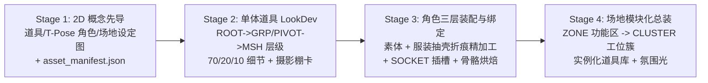

# 工业级 Blender 3D 游戏资产管线技能 (Blender Pipeline Skill Wiki)

> 🎯 **核心宗旨**：将 AI 从「仅会生成 `bpy` 代码片段」升级为「**可重复、可验证、零畸变交付生产级 3D 游戏资产**」。
> 🧱 **核心技术边界（职责解耦）**：**严禁让 LLM 在 Python 脚本里手写成千上万个顶点坐标（`vertices = [...]`）去“硬捏”写实有机人体或复杂曲面**。工业级高模管线遵循 **「AI 3D 扩散大模型（Hunyuan3D / TRELLIS 2 / Rodin）生成有机高模基底 + LLM 编写 `bpy.data` / `bmesh` 脚本自动化处理四边面重构、非破坏性硬表面修改器栈、Geometry Nodes 微观细节、程序化高级材质、自动骨骼装配与高低模烘焙导出」**。
> 📚 **架构模式**：采用 **Skill Wiki 渐进式披露 (Progressive Disclosure) + 自动化验证门禁 (Automated Quality Gate)**。主文件负责意图路由与六步闭环调度，细分领域规范按需注入。

---

## 一、触发判定流 (Trigger Decision Flow)

当接收到的任务满足以下任一条件时，**必须强制触发**本技能流程：

```text
收到任务 / 准备处理 3D 资产
       │
       ▼
是否涉及以下动作？
├── 1. 编写/修改 Blender Python (bpy / bmesh / mathutils) 建模、重拓扑、几何节点、材质或动画脚本
├── 2. 使用 Blender MCP (addons/blender_mcp) 实时操控场景、调用 3D 生成接口或使用 Headless CLI 批处理
├── 3. 生成/精修 3D 角色（有机高模重构 / 潮玩放样）、骨骼蒙皮 (Armature / Rigify / Vertex Groups)、NLA 多轨动画
├── 4. 构建 3D 建筑、室内外环境场景、硬表面装备、灯光摄像机或程序化几何体
├── 5. 执行 High-to-Low 法线/AO 烘焙、导出 .blend / .glb / .gltf 资产并对接到 Godot 4 场景中
       │
       ├── 【是】 ──► 触发本 Skill 流程（任务路由 ➔ 注入领域分册 ➔ 六步闭环执行与验证 ➔ 声明）
       └── 【否】 ──► 纯 2D / 纯 GDScript 业务逻辑修改，交由 framework-aware 处理
```

---

## 二、Skill Wiki 知识索引与按需路由 (Domain Router)

请根据具体任务涉及的技术子域，使用 `view_file` **按需点对点读取**对应的 `references/` 文档，严禁不看规范凭直觉硬写 `bpy` 代码：

```text
.agents/skills/blender-pipeline/
├── SKILL.md                               # [当前主入口] 职责解耦边界、四阶精模流程、六步生产闭环、双通道执行策略
├── references/                            # [领域知识分册 - 编码前按需注入]
│   ├── concept_and_lookdev_workflow.md    # [必读 P0] 2D 概念图先导 ➔ 单体摄影棚 LookDev ➔ 角色精修 ➔ 场地模块化总装
│   ├── api_reliability.md                 # [必读 P0] 强制优先 Data API (bpy.data/bmesh)、Blender 4/5 兼容、坐标轴换算
│   ├── scene_hierarchy_architecture.md    # [必读 P0] 严禁扁平对象汤：三层隔离 Collection 树 + 3~4 层父子场景图 (ROOT/GRP/PIVOT/SOCKET)
│   ├── highpoly_character_pipeline.md     # [高模角色] 3D 扩散基底导入、QuadriFlow 重拓扑、Geometry Nodes 泊松盘细节、高低模烘焙
│   ├── procedural_modeling.md             # [建模分册] BMesh 连续放样、非破坏性分层修改器栈、顶点组空间锚点、70/20/10 细节
│   ├── materials_and_lighting.md          # [材质灯光] Principled BSDF 兼容、Random Walk SSS 毛孔皮肤、Pointiness 边缘磨损、三点布光
│   ├── rigging_and_animation.md           # [绑定动画] 模块化分层子网格蒙皮、SOCKET 骨骼插槽、BBox/Rigify 自动装配、NLA 压轨
│   └── godot_export_contract.md           # [引擎对接] 百万面 High-to-Low 4K 法线/AO 自动烘焙、GLB 导出契约、.gdignore 隔离、Godot 挂载
├── examples/                              # [Few-Shot 正反范例库]
│   └── asset_patterns.md                  # 角色/高模/硬表面/树状层级/导出的 ❌典型反模式 vs ✅工业级黄金范式
└── scripts/                               # [自动化精加工、质检与摄影棚 LookDev 工具]
    ├── high_precision_refiner.py          # 角色服装/护甲分件精加工器 (Crease折痕+抽壳+微倒角+纹理置换+VGroup剥离)
    ├── render_lookdev_card.py             # 单体道具/角色/场地 摄影棚三合一 LookDev 预览卡渲染器 (Front+Side+Iso34)
    ├── verify_blender_asset.py            # Blender 内部结构化断言（含层级反扁平化审计） + 多视角检视照自动渲染脚本
    └── run_pipeline_gate.sh               # 一键执行「构建 ➔ 结构断言 ➔ 多视角渲染 ➔ Godot 导入」全链路门禁
```

### 领域路由速查表

| 任务子域 | 触发关键词 | 必须注入文档 | 核心防坑重点 |
| :--- | :--- | :--- | :--- |
| **概念效果图与精模工作流** | 场景简陋、效果图、先调单个物品、角色设定、场地总装 | [references/concept_and_lookdev_workflow.md](references/concept_and_lookdev_workflow.md) | **严禁无参考图直接手写全场景大杂烩脚本**；必须先生成【单体道具 / 角色三视图 / 场地切面】2D 概念图与 `asset_manifest.json`，再按 70/20/10 法则逐个单体 LookDev 精模后总装。 |
| **工程化层级与场景图设计** | Hierarchy、层级、扁平化、Outliner、Collection、父子节点、枢轴 Pivot、Socket | [references/scene_hierarchy_architecture.md](references/scene_hierarchy_architecture.md) | **严禁扁平对象汤或无脑全合并死网格**；必须构建三层隔离集合（`01_Export` / `02_Work` / `03_Studio`）与 3~4 层父子场景树（`ROOT_* ➔ GRP_*/ZONE_*/PIVOT_*/SOCKET_* ➔ MSH_*`），挂载时必设 `matrix_parent_inverse`。 |
| **API 可靠性与 Data API 铁律** | `bpy`、`bmesh`、上下文报错、坐标朝向、版本兼容 | [references/api_reliability.md](references/api_reliability.md) | **强制优先使用 `bpy.data` / `bmesh`，严禁滥用依赖 UI 上下文的 `bpy.ops`**；Blender 5.x 兼容；Blender `-Y` 对应 Godot `+Z`；严禁残留 `.001` 污染。 |
| **高面数精致角色装配式管线** | 高模角色、MPFB2、分件剥离、边缘折痕 Crease、重拓扑、Geometry Nodes | [references/highpoly_character_pipeline.md](references/highpoly_character_pipeline.md) | **告别“一坨泥”单网格，采用「基础素体(MPFB2) + 多层独立服装抽壳 + 表面铆接配饰」三层装配式架构**；调用 `high_precision_refiner.py` 注入边界折痕 (`crease_edge`)、微倒角与 `Displace` 微观纹理体积。 |
| **程序化网格与硬表面修改器栈** | 角色形体、硬表面护甲、修改器栈、顶点组锚点、建筑家具 | [references/procedural_modeling.md](references/procedural_modeling.md) | 硬表面采用 **`Mirror ➔ Solidify ➔ Boolean ➔ Bevel ➔ Weighted Normal ➔ Subsurf` 非破坏性分层修改器栈**；使用顶点组作为局部空间锚点；流线肢体用 `bmesh` 环截面放样。 |
| **高级程序化材质与灯光** | 材质、SSS 皮肤、毛孔凹凸、金属磨损、Pointiness、透明玻璃 | [references/materials_and_lighting.md](references/materials_and_lighting.md) | 皮肤开启 **Random Walk SSS + Noise/Bump 微米毛孔**；硬表面使用 **`Geometry.Pointiness` + `ColorRamp`** 生成程序化边缘磨损；兼容 Blender 4/5 节点端口名。 |
| **自动骨骼装配与动画** | 骨架、Armature、Rigify、自动对齐、权重、Walk/Run | [references/rigging_and_animation.md](references/rigging_and_animation.md) | 刚性挂件/手持道具走 `SOCKET_*` 骨骼插槽；服饰与身体按逻辑域分为分层子网格共享 `Armature`；外部高模支持 **BBox 切片 + Rigify 自动装配**。 |
| **高低模烘焙与 Godot 对接** | 法线烘焙、Bake、减面、导出 GLB、导入 Godot | [references/godot_export_contract.md](references/godot_export_contract.md) | **百万面高模严禁直接进游戏引擎**，必须执行 `High_Poly ➔ Low_Poly` 减面、Smart UV Project 与 Cycles 4K 法线/AO 自动烘焙；仅导出 `01_Export_Hierarchy` 集合。 |

---

## 三、双通道执行策略：Blender MCP vs. Headless CLI

本项目同时配备了 **Blender MCP (`addons/blender_mcp`)** 与 **Blender Headless CLI**，按场景分工协同：

| 执行通道 | 适用场景 | 调用方式 | 工业级要求 |
| :--- | :--- | :--- | :--- |
| **通道 A：Headless CLI (主力生产管线)** | 参数化构建单体道具/角色/场地、QuadriFlow 重拓扑、高低模 Cycles 烘焙、骨骼蒙皮、多轨动画、LookDev 卡生成、CI 验证 | `/Applications/Blender.app/Contents/MacOS/Blender --background --python <script.py>` | **所有交付资产必须保留可一键重跑的 `.py` 构建脚本**，确保 100% 确定性可复现。 |
| **通道 B：Blender MCP (实时视觉闭环与 3D 生成探针)** | 用户已打开 Blender GUI 时的交互式微调、调用 3D 生成接口导入高模、执行代码并截图观察穿模/比例问题（Visual Closed-Loop） | `call_mcp_tool("blender", "blender_ping" / "blender_render_snapshot" / ...)` | 交互微调或视觉闭环确认的参数，最终必须回写固化到 `.py` 构建脚本中，防止手工状态丢失。 |

---

## 四、四阶模块化精模 × 六步质量闭环 (4-Tier × 6-Step Closed Loop)

凡涉及完整 3D 场景或多资产定制，必须遵循 **自底向上（Bottom-Up）四阶生产流**，且每一阶内部均执行 **六步质量闭环**：



### 单资产内部六步闭环 (`Spec ➔ Generate ➔ Execute ➔ Verify ➔ Repair ➔ Deliver`)
1. **Spec（视觉、层级与规格锚定）**：对照 `concepts/` 下的 2D 概念图与 `asset_manifest.json`，明确资产的物理尺寸、原点位置（底部中心 `Z=0`）、朝向（面向 `-Y`）、**3~4 层父子场景树设计（`ROOT_* ➔ GRP_*/PIVOT_*/SOCKET_* ➔ MSH_*`）** 以及 **Primary (70%) / Secondary (20%) / Tertiary (10%)** 三级细节拆解。
2. **Generate（模块化脚本生成）**：查阅对应 `references/*.md`，严格使用 `bpy.data` / `bmesh` 编写独立模块化脚本（涵盖三层隔离 Collection、树状父子挂载、分件折痕抽壳精加工 `high_precision_refiner.py`、Geometry Nodes 细节、SSS/磨损材质与骨骼绑定）。
3. **Execute（确定性执行）**：通过 Blender Headless CLI 或 MCP 执行构建脚本，生成 `.blend`（若为百万面高模角色，自动执行 High-to-Low 减面与 4K 法线/AO 烘焙）并仅选中 `01_Export_Hierarchy` 导出 `.glb`。
4. **Verify（摄影棚 LookDev 比对 + 自动化结构与层级断言）**：
   - 运行 `scripts/render_lookdev_card.py` 渲染 **`Front + Side + Iso34` 三合一摄影棚 LookDev 预览卡**，并用 `view_file` 与 2D 概念设定图同屏比对精致度、比例与色彩；
   - 运行 `scripts/verify_blender_asset.py` 执行 8 项结构化体检（含**场景层级深度与反扁平化断言**、语义前缀命名检查、网格零面积检测、未应用缩放检测、骨骼空权重检测、NLA 轨道检测、GLB 二进制头核对）。
5. **Repair（靶向修复）**：若 LookDev 预览卡相比 2D 概念图显得简陋、比例失调、穿模或被检出扁平化层级，立即单点迭代该资产脚本并重跑第 3~4 步。
6. **Deliver（总装与 Godot 集成交付）**：在场地脚本中按 `ZONE_* ➔ CLUSTER_*` 层级实例化所有已验收的高精道具与角色，导出最终 `.glb` 并运行 Godot Headless `--import` 验证引擎导入零报错。

---

## 五、回复声明格式契约 (Declaration Contract)

在回复用户时，若触发了本技能，必须在回复最开头包含如下 Skill 加载状态声明（若同时触发了 `framework-aware` 则合并声明）：

```markdown
> 🛠️ **已加载 Skill**：`blender-pipeline`
> 📖 **已注入文档**：`concept_and_lookdev_workflow.md`、`api_reliability.md`、`scene_hierarchy_architecture.md`
> ✅ **已通过门禁**：`render_lookdev_card.py` / `verify_blender_asset.py`
```

---

## 六、一键自动化精加工与质量门禁命令 (Automation & Quality Gate Commands)

```bash
# 0. 对角色服装/护甲分件执行 BMesh 边界折痕硬化、4mm 实体化抽壳、限权微倒角与顶点组分件剥离
/Applications/Blender.app/Contents/MacOS/Blender --background <path/to/asset.blend> \
  --python .agents/skills/blender-pipeline/scripts/high_precision_refiner.py -- \
  --target <MSH_Name> --extract-vgroup Armor_Zone --displace-strength 0.0005 --save

# 1. 为单体道具/角色渲染 1920x640 三合一摄影棚 LookDev 预览卡 (Front + Side + Iso34)
/Applications/Blender.app/Contents/MacOS/Blender --background <path/to/asset.blend> \
  --python .agents/skills/blender-pipeline/scripts/render_lookdev_card.py -- \
  --out-dir <path/to/renders> --name <asset_name>

# 2. 对指定 .blend 资产运行结构化质检（含反扁平化 Hierarchy 审计）与多视角检视照渲染
/Applications/Blender.app/Contents/MacOS/Blender --background <path/to/asset.blend> \
  --python .agents/skills/blender-pipeline/scripts/verify_blender_asset.py -- \
  --render-views --glb <path/to/asset.glb>

# 3. 运行全链路门禁脚本（构建 -> Blender 资产质检 -> GLB 校验 -> Godot Headless 导入验证）
bash .agents/skills/blender-pipeline/scripts/run_pipeline_gate.sh \
  <path/to/build_script.py> <path/to/asset.blend> <path/to/asset.glb> --render-views
```
