# 概念先导与单体 LookDev 精模工作流 (_doc_concept_and_lookdev_workflow)

> **核心铁律**：**严禁在没有任何视觉参考图（Concept Sheet）的情况下直接凭想象手写全场景 `bpy` 基础几何体代码！**
> 工业级 3D 场景之所以精致，是因为严格遵循 **「2D 概念效果图锚定 ➔ 单体道具摄影棚精模调优 ➔ 角色三视图对齐精修 ➔ 场地模块化总装与光影合成」** 的自底向上（Bottom-Up）四阶生产流。

---

## 一、为什么直接写代码建全场景一定会「简陋」？

1. **缺乏视觉基准（No Visual Anchor）**：AI 直接从文字提示词写 `bpy.ops.mesh.primitive_cube_add` 时，脑中没有倒角比例、色彩冷暖对比、次级结构分割线与材质粗糙度对比，极易退化为「火柴盒 + 圆球」的积木拼凑感。
2. **全场景单脚本反模式（Monolithic Script Anti-Pattern）**：把整栋大楼、广场、办公桌、椅子、绿植塞进同一个几百行的脚本里，每个道具只能分到 10~15 行代码（2 个方块拼一张桌子），细节必然匮乏。
3. **缺少高阶修改器与三级造型（Missing 70/20/10 Hierarchy & Modifiers）**：没有使用 `Bevel`（倒角）、`Subdivision Surface`（细分曲面）、`Solidify`（实体化）以及「大轮廓 70% + 中结构 20% + 小点缀 10%」的三级造型法则。

---

## 二、四阶精模生产流水线（4-Tier Concept-to-LookDev Pipeline）

```mermaid
flowchart LR
    subgraph S1["Stage 1: 2D 概念设定先导"]
        C1["1.1 单体道具设定图\n(concept_prop_*.png)"]
        C2["1.2 角色三视图设定\n(concept_character_*.png)"]
        C3["1.3 场地空间效果图\n(concept_venue_*.png)"]
        C4["1.4 资产拆解清单\n(asset_manifest.json)"]
    end
    subgraph S2["Stage 2: 单体道具 LookDev"]
        P1["独立脚本建模\n(props/build_prop_*.py)"]
        P2["摄影棚三视图渲染\n(render_lookdev_card.py)"]
        P3["对照 2D 效果图修模\n(70/20/10 细节达标)"]
    end
    subgraph S3["Stage 3: 角色精模 LookDev"]
        CH1["细分曲面+发丝/衣领精模"]
        CH2["三视图对比 2D 角色设定"]
        CH3["骨骼蒙皮 + NLA 动作质检"]
    end
    subgraph S4["Stage 4: 场地模块化总装"]
        V1["建筑空间壳体与室内分区"]
        V2["实例化已验收单体道具库"]
        V3["冷暖光影氛围与全场景交付"]
    end
    S1 --> S2 --> S3 --> S4
```

---

## 三、各阶段执行标准与硬性门禁

### Stage 1：2D 概念设定图先导（Concept Art & Manifest）

在编写任何 Blender 建模代码前，必须先通过 `image-generator` 产出以下 **3 类 2D 视觉基准图**（存放于 `<scene_dir>/concepts/` 目录，并放置 `.gdignore` 避免冗余导入）：

1. **核心单体道具设定图 (`concept_prop_*.png`)**
   - 包含 3/4 轴测主视图 + 局部正交拆解图（如：人体工学升降工位套装、网格转椅、双联曲面屏、机械键盘、咖啡杯、龟背竹盆栽、自动贩卖机、玻璃隔断、休闲沙发、安检闸机）。
2. **角色三视图设定图 (`concept_character_*.png`)**
   - 必须在同一张画布上对齐展示 **正面（Front）、侧面（Side）、45° 轴测（Iso 3/4）**，明确头身比（如 2.5~3 头身潮玩比例）、发型体积层次、衣领/袖口/领带贴合关系、配饰与鞋履造型。
3. **场地空间切面/透视效果图 (`concept_venue_*.png`)**
   - 采用 3/4 等轴测切面微缩景观（Isometric Cutaway Diorama）或主视觉透视图，明确室内功能分区（前台闸机区、开放工位群、老板玻璃房、茶水间休闲区）与室外高层幕墙/广场的空间衔接及冷暖光影基调。
4. **结构化资产拆解清单 (`asset_manifest.json`)**
   - 将 2D 效果图中的视觉元素转化为可量化验证的数据字典：每个资产的 `id`、目标包围盒尺寸 `(W, D, H)`、**Primary / Secondary / Tertiary 三级组件列表**、主辅色值（Hex）与粗糙度/金属度参数。

---

### Stage 2：单体道具摄影棚精模与 LookDev（Single-Prop Studio LookDev）

**严禁在主场景脚本里用两三个 Cube 敷衍制作家具！** 每个核心道具必须在 `blender/props/` 下拥有独立的构建模块或脚本，并满足以下工艺标准：

#### 1. 「70 / 20 / 10」三级造型铁律
每个单体道具必须具备三个层级的几何结构，且子部件数量 $\ge 5$、PBR 材质槽数量 $\ge 3$：
- **Primary 大轮廓 (70%)**：决定道具辨识度的主体体块與黄金长宽高比例（如：L 型圆角橡木桌面 + 哑光黑钢制升降桌腿）。
- **Secondary 中结构 (20%)**：决定工业设计品质的转折结构（如：人体工学椅的五星脚架、气压杆、座垫包边、网布靠背外框、腰托、T 型扶手；显示器的万向支架臂与超窄边框）。
- **Tertiary 小点缀 (10%)**：赋予「呼吸感与生活气息」的微缩细节（如：机械键盘的分色键帽、桌垫上的无线鼠标、带牛皮纸隔热套的外卖咖啡杯、屏幕上的代码发光色块、盆栽花盆的竖向罗纹与盆土鹅卵石）。

#### 2. 高阶修改器（Modifiers）必选清单
- **硬表面家具/电子设备**：必须挂载 `BEVEL` 修改器（`width=0.005~0.02, segments=3, limit_method='ANGLE'`）并开启 `shade_smooth`，严禁出现 90° 死硬刀锋边缘。
- **软包沙发/靠垫/角色服饰/绿植叶片**：必须使用 `SUBSURF`（`levels=2`）配合缩放变形或 `SIMPLE_DEFORM`（弯曲/锥化），呈现饱满柔和的曲面张力。

#### 3. 单体摄影棚 LookDev 卡片验收（`render_lookdev_card.py`）
每完成一个单体道具脚本，必须调用 `render_lookdev_card.py` 在标准无影棚（三点柔光箱 + 轮廓光 + 地面接触阴影）中渲染 **`Front / Side / Iso34` 三合一 LookDev 预览卡**，并用 `view_file` 与 Stage 1 的 `concept_prop_*.png` 比对。若造型简陋、比例失调或穿模，立即单点迭代该道具脚本，直至精致度达标。

---

### Stage 3：角色三视图对齐精模（Character LookDev & Rigging）

1. **三视图严苛对齐**：
   - **正面（Front）**：检查头肩比、五官间距、镜框粗细、呆毛与刘海团块、翻领开口、领带与工牌吊绳的对称度。
   - **侧面（Side）**：**重点检查前后贴合度**——镜腿必须准确落于耳廓上方，红领带与工牌必须紧贴衬衫前胸法线轮廓，后脑勺发量饱满不扁平，身体重心自然落在脚掌中心。
   - **45° 轴测（Iso34）**：检查脸部腮红、立体鼻头、卷边袖口、皮带金属扣与手中咖啡杯的立体剪影。
2. **先静帧 LookDev 验收，后绑定刷权重**：
   - 在绑定骨骼前，先用 `render_lookdev_card.py` 确认角色静态造型与材质质感完全对齐 `concept_character_*.png`，再执行骨骼绑定与 4 套 NLA 动画（`Idle / Walk / Run / Slack`）压轨。

---

### Stage 4：场地模块化总装与灯光氛围（Venue Modular Assembly）

当所有单体道具（Stage 2）与角色（Stage 3）均通过 LookDev 验收后，场地构建脚本（`build_venue_*.py` / `build_office_building.py`）负责：
1. **室内外一体化微缩剧场（Cutaway Lobby + Skyscraper Tower）**：
   - 一层大堂设计为**高通透无遮挡落地玻璃 / 局部切面开放式办公层**，让摄像机在近景与中景都能清晰看到室内精美的模块化家具群；
   - 地面采用拼接材质（水磨石大厅过道 + 暖色木地板工位区 + 休息区地毯），天花板布置现代条形格栅灯带。
2. **模块化实例化组装（Modular Instancing）**：
   - 直接调用 `props/` 下已验证的高精道具构建函数（或导入独立 `.glb`/`.blend`），按室内平面布局摆放：前台接待区、安检闸机阵列、6~8 组完整人体工学工位群、玻璃隔断会议室/老板房、茶水间咖啡机与自动贩卖机角、休闲沙发区、多处龟背竹绿植与室外林荫广场。
3. **层次化光影氛围（Cinematic Lighting）**：
   - 结合室外暖阳斜射光（Sun Light）、室内暖白格栅顶灯（Area Light）、电脑屏幕与贩卖机的冷青/暖橙自发光（Emission），复刻 `concept_venue_*.png` 的电影级冷暖光影对比。
