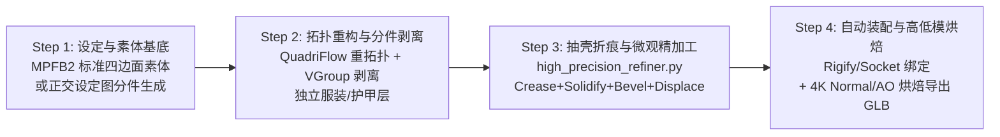

# Skill Wiki · 高面数精致角色 AI Coding 混合管线 (High-Poly Character Pipeline)

> 📖 **Wiki 定位**：定义打造「高面数、细节精致」3D 角色模型的工业级 AI Coding 架构——**“用 AI 3D 扩散大模型生成有机高模基底 + 用 LLM 编写 `bpy` 脚本自动化处理四边面重构、非破坏性硬表面装备、Geometry Nodes 微观细节、程序化高级材质、自动骨骼装配与高低模烘焙导出”**。

---

## 一、 核心架构：告别“一坨泥”单网格，转向「三层装配式管线」

> [!CAUTION]
> **两大核心技术禁区**：
> 1. **严禁让 LLM 在 Python 脚本里手写成千上万个顶点坐标（`vertices = [...]`）硬捏有机人体**；
> 2. **严禁把整张带衣服的角色图直接丢给 3D 生成模型做“一体生成（Single Watertight Mesh）”**——固定体素分辨率（如 $1024^3$）被全身平摊后，脸部、手指、领口与胸章必然糊成“一坨软泥”。

工业级高精商业角色（无论二次元、美式卡通或写实 3A）与 AI 粗糙单网格之间，本质上差在**三个工程维度**：
1. **分件独立度（Sub-mesh Separation）**：绝非一整块死网格，而是由**独立标准素体、独立眼球/牙齿/舌头、多层发束、独立服装层、高精金属扣件**组合而成的层级化装配体（详见 [`scene_hierarchy_architecture.md`](file:///Users/krace/Code/GodotProject/slacker-survivors/.agents/skills/blender-pipeline/references/scene_hierarchy_architecture.md)）；
2. **边缘锐利度（Crease & Bevel Crispness）**：领口、袖口、皮带边缘、护甲倒角必须通过 `crease_edge`（细分折痕）与 `bevel_weight_edge`（微倒角权重）锁死物理边界，彻底消除细分后软塌粘连的“AI 肉感”；
3. **面数分配黄金法则（Density Hierarchy）**：高面数绝非全身平均撒点，而是**「面部/五官/手部极高密度（含眼轮匝肌、口轮匝肌环状 Edge Loops） + 躯干平整四边面布线 + 服装配件多层实体化细分与微观纹理置换」**。

### 三层装配式 AI Coding 角色架构

| 资产层级 | 获取 / 生成方式 | `bpy` 代码精加工逻辑（消除“AI 肉感”的关键） |
| :--- | :--- | :--- |
| **1. 基础素体与高精头部**<br>(Base Body & Head) | **切勿让 AI 从零捏人体！** 通过脚本调用开源标准拓扑人体库（如 **MPFB2 / MakeHuman** 或预置标准 A-Pose 4 万面四边面素体），仅用 AI 生成头雕或通过 MPFB 参数控制五官与体型。 | 锁定眼轮匝肌、口轮匝肌标准环状拓扑（Edge Loops）与根根分明的手指，自带独立眼球/牙齿/舌头子网格，确保眨眼、口型与手部动画零畸变。 |
| **2. 多层独立服装**<br>(Layered Garments) | 将单件衣服独立切图生成网格，或利用 [`create_procedural_submesh_panel`](file:///Users/krace/Code/GodotProject/slacker-survivors/.agents/skills/blender-pipeline/scripts/high_precision_refiner.py#L194-L255) 从素体顶点组自动剥离并外扩生成。 | **自动抽壳 + 边界折痕 + 微倒角 + 纹理体积置换**：调用 [`high_precision_refiner.py`](file:///Users/krace/Code/GodotProject/slacker-survivors/.agents/skills/blender-pipeline/scripts/high_precision_refiner.py) 转化为带真实物理厚度（2mm~5mm）、刀切级锐利边缘与织物经纬/皮革颗粒起伏的高模分件。 |
| **3. 金属扣件/护甲/饰品**<br>(Accessories & Armor) | 单件独立生成（将 100% 体素分辨率集中于一枚胸针或肩甲），或由 AI 编写 `bmesh` / `Geometry Nodes` 泊松盘生成。 | **自动表面吸附（Shrinkwrap / Surface Deform）**：用脚本计算表面法线与偏移（`offset=0.002m`），将纽扣、皮带、肩甲严丝合缝地自动贴合铆接到服装表面，或挂入 `SOCKET_*` 骨骼插槽。 |

---

## 二、 四步走实战管线（从素体/分件到游戏引擎精致高模）



### 第一步：搭建 AI 操控桥梁与标准素体/分件获取

1. **标准素体基因库驱动（MPFB2 / MakeHuman 优先）**：
   - 在 Blender 4.2+ Extensions 中启用 **MPFB2**，通过 Python 脚本直接驱动身高、头身比、肌肉量、五官参数，一键生成自带好莱坞级面部环状布线、独立眼球/牙齿/骨骼的标准素体。
2. **多视角分件设定与高模导入（ComfyUI / MCP 驱动）**：
   - 对复杂发型、独立外套或异形头雕，生成去阴影正交设定图，通过 **Microsoft TRELLIS 2**、**Tencent Hunyuan3D 3.x** 或 **Hyper3D Rodin** 生成分件高模，导入后执行底部对齐（`Z = 0.0`）、朝向校准（面向 `-Y`）与米制尺寸归一化：

```python
import bpy
from mathutils import Vector

def import_and_normalize_base_mesh(glb_path: str, target_height: float = 1.75, obj_name: str = "Character_Base") -> bpy.types.Object:
    """导入 AI 生成的 3D 高模基底，自动居中 XY、贴地 Z=0 并归一化到目标身高（米）。"""
    before_objs = set(bpy.data.objects)
    bpy.ops.import_scene.gltf(filepath=glb_path)
    imported_meshes = [o for o in (set(bpy.data.objects) - before_objs) if o.type == 'MESH']
    if not imported_meshes:
        raise RuntimeError(f"未在 {glb_path} 中找到有效 MESH 对象")

    bpy.ops.object.select_all(action='DESELECT')
    for m in imported_meshes:
        m.select_set(True)
    bpy.context.view_layer.objects.active = imported_meshes[0]
    if len(imported_meshes) > 1:
        bpy.ops.object.join()

    obj = bpy.context.view_layer.objects.active
    obj.name = obj_name
    bpy.ops.object.transform_apply(location=True, rotation=True, scale=True)

    # 计算世界包围盒并归一化身高、贴地居中
    bbox = [obj.matrix_world @ Vector(corner) for corner in obj.bound_box]
    min_v = Vector((min(v.x for v in bbox), min(v.y for v in bbox), min(v.z for v in bbox)))
    max_v = Vector((max(v.x for v in bbox), max(v.y for v in bbox), max(v.z for v in bbox)))
    cur_height = max(max_v.z - min_v.z, 1e-4)
    scale_factor = target_height / cur_height

    obj.scale = (scale_factor, scale_factor, scale_factor)
    bpy.ops.object.transform_apply(location=False, rotation=False, scale=True)

    bbox = [obj.matrix_world @ Vector(corner) for corner in obj.bound_box]
    center_x = 0.5 * (min(v.x for v in bbox) + max(v.x for v in bbox))
    center_y = 0.5 * (min(v.y for v in bbox) + max(v.y for v in bbox))
    min_z = min(v.z for v in bbox)
    obj.location = (-center_x, -center_y, -min_z)
    bpy.ops.object.transform_apply(location=True, rotation=False, scale=False)
    return obj
```

---

### 第三步：用 `bpy` 脚本进行「精致化」改造（四大核心 Coding 环节）

刚由 3D 扩散模型生成的网格往往是拓扑杂乱、无内部结构且表面带噪点的三角面（Tri-mesh）。必须通过以下四类 `bpy` 脚本将其升级为工业级角色资产：

#### 1. 自动化网格清理与四边面重拓扑（Auto-Retopology & Multires Shrinkwrap）

AI 生成的三角面高模无法直接用于骨骼动画形变。标准管线是：先复制保留原高模副本，再对工作网格清理游离顶点、执行 **QuadriFlow 四边面重拓扑**，最后挂载 `MULTIRES`（多级精度）与 `SHRINKWRAP`（缩裹修改器）将原高模的雕刻级细节吸附回四边面网格：

```python
import bpy
import bmesh

def refine_character_mesh(obj_name: str, target_faces: int = 50000, recover_highpoly_details: bool = True) -> bpy.types.Object:
    """
    清理 AI 生成高模的拓扑噪点，执行 QuadriFlow 四边面重拓扑，
    并通过 Multires + Shrinkwrap 将原始雕刻级高频细节无损投射回规整四边面网格。
    """
    obj = bpy.data.objects[obj_name]

    # 0. 若需回投细节，先在 Data 层深拷贝一份原始高模作为吸附目标
    highpoly_ref = None
    if recover_highpoly_details:
        highpoly_ref = obj.copy()
        highpoly_ref.data = obj.data.copy()
        highpoly_ref.name = f"{obj_name}_HighPolyRef"
        bpy.context.collection.objects.link(highpoly_ref)

    # 1. 使用 BMesh (Data API) 清理重叠顶点与游离几何体，避免依赖 UI 上下文
    bm = bmesh.new()
    bm.from_mesh(obj.data)
    bmesh.ops.remove_doubles(bm, verts=bm.verts, dist=0.0001)
    loose_verts = [v for v in bm.verts if not v.link_edges]
    if loose_verts:
        bmesh.ops.delete(bm, geom=loose_verts, context='VERTS')
    bm.to_mesh(obj.data)
    bm.free()
    obj.data.update()

    # 2. 激活対象并执行 QuadriFlow 四边面重拓扑（保持对称、锐边与边界）
    bpy.ops.object.select_all(action='DESELECT')
    bpy.context.view_layer.objects.active = obj
    obj.select_set(True)
    bpy.ops.object.quadriflow_remesh(
        use_mesh_symmetry=True,
        use_preserve_sharp=True,
        use_preserve_boundary=True,
        smooth_normals=True,
        target_faces=target_faces,
    )

    # 3. 挂载多级精度修改器 (Multiresolution) 并用 Shrinkwrap 吸附原高模细节
    if recover_highpoly_details and highpoly_ref is not None:
        multires = obj.modifiers.new(name="HighPoly_Details", type='MULTIRES')
        bpy.ops.object.multires_subdivide(modifier=multires.name, mode='CATMULL_CLARK')
        bpy.ops.object.multires_subdivide(modifier=multires.name, mode='CATMULL_CLARK')

        shrink = obj.modifiers.new(name="Snap_HighPoly", type='SHRINKWRAP')
        shrink.target = highpoly_ref
        shrink.wrap_method = 'PROJECT'
        shrink.use_positive_direction = True
        shrink.use_negative_direction = True

        bpy.ops.object.modifier_apply(modifier=shrink.name)
        bpy.data.objects.remove(highpoly_ref, do_unlink=True)

    return obj
```

#### 2. 分件抽壳、折痕锐化与顶点组剥离精加工（`scripts/high_precision_refiner.py`）

当拿到拆分后的服装、皮具、软甲网格（或准备从素体剥离护甲）时，为彻底消除 AI 网格“边缘软塌、表面橘皮噪点、缺少厚度与受光切面”的问题，直接调用内置工具脚本 [`scripts/high_precision_refiner.py`](file:///Users/krace/Code/GodotProject/slacker-survivors/.agents/skills/blender-pipeline/scripts/high_precision_refiner.py) 执行三步精加工：

1. **BMesh 边界与结构硬边折痕注入 (`inject_precision_creases_and_seams`)**：
   - 自动扫描 `edge.is_boundary`（领口、袖口、裙摆、护甲外沿）注入 `crease_edge = 0.85` 与 `bevel_weight_edge = 1.0`；
   - 自动扫描 `edge.is_manifold` 且面夹角 $\ge 35^\circ$ 的结构转折边注入 `crease_edge = 0.75` 与 `bevel_weight_edge = 0.8`；
   - 对非边界内部顶点（`not v.is_boundary`）执行 `bmesh.ops.smooth_vert(factor=0.35)`，消除表面细碎橘皮噪点的同时**绝对锁死开口边界不缩水**。
2. **工业级高模修改器栈 (`build_high_poly_modifier_stack`)**：
   - `HP_Weld`（合并极近废点） ➔ `HP_Solidify`（`solidify_mode='NON_MANIFOLD'`, `thickness=0.004m`, `bevel_convex=0.5` 赋予 4mm 真实衣料/皮革厚度并传递边缘倒角权重） ➔ `HP_MicroBevel`（`limit_method='WEIGHT'`, `width=0.0012m`, `segments=3`, `profile=0.7`, `miter_outer='MITER_ARC'` 切出锐利受光高光面且防拐角破面） ➔ `HP_Subsurf`（`CATMULL_CLARK`, `use_creases=True`, `boundary_smooth='PRESERVE_CORNERS'`） ➔ `HP_MicroDisplace`（可选微观纹理置换） ➔ `HP_WeightedNormal`（`FACE_AREA_WITH_ANGLE`）。
3. **从素体顶点组自动剥离独立分件 (`create_procedural_submesh_panel`)**：
   - 读取素体上的命名顶点组（如 `'Armor_Zone'`、`'Jacket_Zone'`），自动筛选权重 $> 0.5$ 的拓扑面生成独立子网格 `MSH_*_Plate`，挂载 `SHRINKWRAP`（`NEAREST_SURFACEPOINT`, `offset=0.002m`）紧贴身体表面，并自动挂入工程化父节点与高模修改器栈。

```bash
# Headless CLI 一键对指定服装/护甲分件执行折痕锐化、4mm 抽壳、微倒角与顶点组分件剥离
/Applications/Blender.app/Contents/MacOS/Blender --background <path/to/char.blend> \
  --python .agents/skills/blender-pipeline/scripts/high_precision_refiner.py -- \
  --target MSH_Char_Jacket --extract-vgroup Armor_Zone --thickness 0.004 --bevel-width 0.0012 --save
```

#### 3. 代码构建 Geometry Nodes（几何节点）生成高密微观结构

角色的精致感往往来自**高密度的重复性微观结构**（如护肩鳞片、衣服缝线、科幻管线、铆钉、毛发皮草）。通过 `bpy.data.node_groups.new(type='GeometryNodeTree')` 配合顶点组空间锚点（如 `'Shoulder_Armor'`），可在指定区域表面按泊松盘分布（Poisson Disk）高密度实例化装饰片并沿表面法线自动对齐：

```python
import bpy

def add_poisson_armor_scales_geonodes(
    target_obj: bpy.types.Object,
    scale_piece_obj: bpy.types.Object,
    vertex_group_name: str = "Shoulder_Armor",
    distance_min: float = 0.015,
    density_max: float = 1200.0,
) -> bpy.types.Modifier:
    """
    在 target_obj 上创建 Geometry Nodes 修改器：
    读取指定顶点组权重区 -> 泊松盘撒点 -> 沿表面法线对齐旋转 -> 实例化装饰片 -> 后续叠加 Solidify 与 Bevel。
    """
    ng = bpy.data.node_groups.new(name=f"GN_ArmorScales_{vertex_group_name}", type='GeometryNodeTree')

    # 定义输入输出接口 (Blender 4.0+ interface API)
    in_geom = ng.interface.new_socket(name="Geometry", in_out='INPUT', socket_type='NodeSocketGeometry')
    in_sel = ng.interface.new_socket(name="Selection", in_out='INPUT', socket_type='NodeSocketFloat')
    ng.interface.new_socket(name="Geometry", in_out='OUTPUT', socket_type='NodeSocketGeometry')

    nodes = ng.nodes
    links = ng.links
    n_in = nodes.new('NodeGroupInput')
    n_out = nodes.new('NodeGroupOutput')
    n_join = nodes.new('GeometryNodeJoinGeometry')

    # 泊松盘分布撒点
    n_dist = nodes.new('GeometryNodeDistributePointsOnFaces')
    n_dist.distribute_method = 'POISSON'
    n_dist.inputs["Distance Min"].default_value = distance_min
    n_dist.inputs["Density Max"].default_value = density_max

    # 将表面 Normal 转为实例旋转欧拉角
    n_align = nodes.new('FunctionNodeAlignEulerToVector')
    n_align.axis = 'Z'

    # 引入实例对象并在点上实例化
    n_obj_info = nodes.new('GeometryNodeObjectInfo')
    n_obj_info.inputs["Object"].default_value = scale_piece_obj
    n_obj_info.transform_space = 'RELATIVE'

    n_inst = nodes.new('GeometryNodeInstanceOnPoints')
    n_realize = nodes.new('GeometryNodeRealizeInstances')

    links.new(n_in.outputs["Geometry"], n_join.inputs["Geometry"])
    links.new(n_in.outputs["Geometry"], n_dist.inputs["Mesh"])
    links.new(n_in.outputs["Selection"], n_dist.inputs["Selection"])
    links.new(n_dist.outputs["Normal"], n_align.inputs["Vector"])
    links.new(n_dist.outputs["Points"], n_inst.inputs["Points"])
    links.new(n_obj_info.outputs["Geometry"], n_inst.inputs["Instance"])
    links.new(n_align.outputs["Rotation"], n_inst.inputs["Rotation"])
    links.new(n_inst.outputs["Instances"], n_realize.inputs["Geometry"])
    links.new(n_realize.outputs["Geometry"], n_join.inputs["Geometry"])
    links.new(n_join.outputs["Geometry"], n_out.inputs["Geometry"])

    # 挂载 Geometry Nodes 修改器并绑定顶点组输入
    mod_gn = target_obj.modifiers.new(name="Detail_Scales_GN", type='NODES')
    mod_gn.node_group = ng
    sel_id = in_sel.identifier
    mod_gn[f"{sel_id}_use_attribute"] = 1
    mod_gn[f"{sel_id}_attribute_name"] = vertex_group_name

    # 追加实体化与 4 段倒角修改器
    mod_solid = target_obj.modifiers.new(name="Scales_Solidify", type='SOLIDIFY')
    mod_solid.thickness = 0.003
    mod_bevel = target_obj.modifiers.new(name="Scales_Bevel", type='BEVEL')
    mod_bevel.width = 0.0008
    mod_bevel.segments = 4
    mod_bevel.limit_method = 'ANGLE'
    return mod_gn
```

#### 4. 程序化高级材质树与自动骨骼装配

- **微米级毛孔 SSS 皮肤与 Pointiness 边缘磨损**：详见 [`materials_and_lighting.md`](file:///Users/krace/Code/GodotProject/slacker-survivors/.agents/skills/blender-pipeline/references/materials_and_lighting.md)；
- **基于包围盒切片与 Rigify 的自动骨骼装配**：详见 [`rigging_and_animation.md`](file:///Users/krace/Code/GodotProject/slacker-survivors/.agents/skills/blender-pipeline/references/rigging_and_animation.md)。

---

## 三、 打造“镜头怼脸级”高模角色的两大进阶杀手锏

1. **杀手锏 1：用开源插件 MPFB2 (MakeHuman for Blender) 作为代码驱动的“人体基因库”**
   - AI 直接生成的人体常出现比例失调、手指粘连、锁骨与面部拓扑混乱。
   - 在 Blender 4.2+ `Preferences -> Get Extensions` 中安装官方免费扩展 **MPFB**，其身高、头身比、肌肉量、眼角弧度、鼻梁高度与年龄参数全部暴露于 `bpy`。通过脚本调用 MPFB 生成**达到好莱坞绑定标准、自带独立眼球/牙齿/舌头/骨骼且支持一键多级细分**的标准素体基底，再将精力集中于独立发型、多层服装与护甲配饰的生成与组装。
2. **杀手锏 2：多级细分 (`Subsurf` / `Multires`) + 程序化纹理置换 (`Displace`) 注入微观体积**
   - 50 万~200 万面的高模不能只是“光滑”，必须承载肉眼可见的微观材质体积（如布料经纬编织感、皮革颗粒纹、护甲战损划痕）。
   - 在挂载 `HP_Subsurf` 后追加 `HP_MicroDisplace`（`type='DISPLACE'`，已内置于 [`high_precision_refiner.py`](file:///Users/krace/Code/GodotProject/slacker-survivors/.agents/skills/blender-pipeline/scripts/high_precision_refiner.py)），绑定高频 `VORONOI` / `CLOUDS` 程序化纹理或无缝织物高度图（Height Map），指定给特定顶点组并将 `strength` 设为 `0.0005`（0.5 毫米级真实物理起伏），后续通过 Cycles 法线烘焙完美转移至游戏低模。

---

## 四、 提升 AI 编写 `bpy` 代码质量的 3 个黄金法则

1. **黄金法则 1：强制优先使用 Data API（`bpy.data` / `bmesh`）而非 Operator API（`bpy.ops`）**
   - `bpy.ops.*` 极度依赖当前鼠标所在的 UI 上下文窗口（Context），在后台或 MCP 异步执行时极易抛 `RuntimeError: Operator bpy.ops.xxx.poll() failed, context is incorrect`。
   - **硬性规定**：所有网格创建（`bpy.data.meshes.new` + `bmesh`）、修改器添加（`obj.modifiers.new`）、材质节点连接（`mat.node_tree.links.new`）必须直接操作底层数据块，严禁使用 `bpy.ops`，除非调用无 Data API 替代的算子（如 `quadriflow_remesh`、`bake`、`rigify_generate`）。
2. **黄金法则 2：采用「模块化非破坏性分层修改器栈（Non-destructive Modifier Stack）」**
   - 编写硬表面配件与独立服装分件代码时，**严禁过早坍塌网格**。
   - 标准修改器挂载顺序：`Weld` ➔ `Solidify (NON_MANIFOLD)` ➔ `Bevel (WEIGHT / ANGLE + MITER_ARC)` ➔ `Subdivision Surface (PRESERVE_CORNERS)` ➔ `Displace (Micro-Grain)` ➔ `Weighted Normal`。
3. **黄金法则 3：利用顶点组（Vertex Groups）作为 AI 与模型的「空间锚点」与「分件剥离母版」**
   - 通过法线/高度规则用脚本预生成（或由用户在 Blender 中用权重画笔花 10 秒涂抹）一个命名顶点组（如 `Armor_Zone`、`Shoulder_Armor`），再由 [`create_procedural_submesh_panel`](file:///Users/krace/Code/GodotProject/slacker-survivors/.agents/skills/blender-pipeline/scripts/high_precision_refiner.py#L194-L255) 自动剥离生成 100% 贴合身体的独立高精护甲/衣物分件。

---

## 五、 游戏引擎（Godot 4 / Unity）收尾：自动化高低模烘焙与减面导出

> [!IMPORTANT]
> **百万面高模严禁直接导入 Godot 4 实时运行！** 面向游戏引擎交付时，必须在管线末端执行 **「高模细节烘焙到低模（High-to-Low Poly Normal & AO Baking）」**。

完整自动化烘焙与导出脚本参见 [`godot_export_contract.md`](file:///Users/krace/Code/GodotProject/slacker-survivors/.agents/skills/blender-pipeline/references/godot_export_contract.md) 第 4 节，核心四步如下：
1. **高低模分离**：保留百万面精细模型作为 `High_Poly`，复制一份通过 `QuadriFlow` 或 `Decimate` 压至 **1.5 万 ~ 3 万面** 作为游戏运行态 `Low_Poly`；
2. **自动展平 UV**：对 `Low_Poly` 自动执行 `bpy.ops.uv.smart_project(angle_limit=1.1519, island_margin=0.003)`；
3. **Cycles 4K 自动烘焙**：用 `bpy.data.images.new` 创建 4K 法线贴图（`Non-Color`）与 AO 贴图，临时切换 `CYCLES` 引擎执行 `bpy.ops.object.bake(type='NORMAL', use_selected_to_active=True, cage_extrusion=0.02)`；
4. **材质回填与 GLB 导出**：将烘焙好的法线贴图通过 `ShaderNodeNormalMap` 挂载到 `Low_Poly` 的 `Principled BSDF`，删除临时 `High_Poly` 后一键导出带骨骼与 4K 贴图的 `.glb`。
