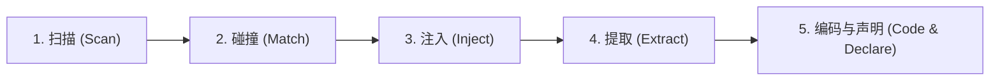

# 框架感知编码技能 (Framework-Aware Skill Wiki)

> **核心宗旨**：**杜绝凭经验臆造代码**。涉及框架层、基础层或通用组件的编码时，必须先查阅对应文档，严格使用正统基类、正规服务接口与分层约定。
> **架构模式**：采用 **Skill Wiki 渐进式披露 (Progressive Disclosure)** 设计。本文件为主入口与导航路由，各领域详细规范见 `references/` 与 `examples/`。

---

## 一、触发判定流 (Trigger Decision Flow)

当接收到的任务或修改意图满足以下任一条件时，**必须强制触发**本技能流程：

```
收到任务 / 准备编码
       │
       ▼
是否涉及以下动作？
├── 1. 新建/修改继承自框架基类的代码 (BaseScene, BaseView, BaseDialog, BaseParams 等)
├── 2. 新建/修改场景生命周期、UI 层级编排、通用控件、弹窗对话框
├── 3. 调用 App.xxx 全局门面服务 (App.net, App.storage, App.audio, App.video, App.logger, App.scene 等)
├── 4. 调用事件总线 (Bus) 或启动管线 (BootPipeline / BootStage / FrameworkRuntime)
├── 5. 使用框架工具类与基建原语 (NodeUtils, FileUtils, TimeUtils, CoordUtils, TaskScope, BaseParams 等)
       │
       ├── 【是】 ──► 触发本 Skill 流程（扫描关键词 ➔ 查阅注入文档 ➔ 声明 ➔ 编码）
       └── 【否】 ──► 纯文档/配置调整/纯资产操作，无需阻塞，直接执行
```

---

## 二、Skill Wiki 知识索引导航 (Wiki Sitemap)

本 Skill 下辖的模块化 Wiki 资源按规范组织如下，Agent 可按需点对点查阅，避免海量上下文污染：

```text
.agents/skills/framework-aware/
├── SKILL.md                          # [当前主入口] 规范总则、触发流与声明契约
├── references/                       # [Wiki 核心规范库]
│   ├── keyword_matrix.md             # 关键词 ➔ 文档路径 ➔ 核心约束 映射矩阵
│   ├── architecture_rules.md         # 架构铁律：分层依赖、三级通信与单复数法则
│   └── verification_checklist.md     # 编码前/中/后三阶段合规自查清单
├── examples/                         # [Few-Shot 范例库]
│   └── code_patterns.md              # 场景、UI、弹窗、按钮、网络服务的正反范式对比
└── scripts/                          # [自动化工具]
    ├── check_compliance.ps1          # 一键扫描全项目架构合规性与 GDScript 语法编译 (PowerShell)
    ├── check_compliance.sh           # 一键扫描全项目架构合规性与 GDScript 语法编译 (Bash)
    └── check_syntax.gd               # Godot Headless 全量 GDScript 语法与静态类型编译扫描器
```

### 快速直达
- **关键词与文档路由**：请直接阅读 [references/keyword_matrix.md](references/keyword_matrix.md)
- **架构铁律与命名法则**：请直接阅读 [references/architecture_rules.md](references/architecture_rules.md)
- **编码合规自查表**：请直接阅读 [references/verification_checklist.md](references/verification_checklist.md)
- **标准正反代码范例**：请直接阅读 [examples/code_patterns.md](examples/code_patterns.md)

---

## 三、标准化执行五步法 (The 5-Step Workflow)



1. **扫描 (Scan)**：解析用户任务，识别涉及的模块技术关键词（如场景、UI、弹窗、网络、音效等）。
2. **碰撞 (Match)**：对照 [references/keyword_matrix.md](references/keyword_matrix.md) 索引，锁定对应的 `_doc_*.md` 文档。
3. **注入 (Inject)**：使用 `view_file` 工具真实读取目标文档内容。
4. **提取 (Extract)**：从文档中明确基类要求、服务入口名称、生命周期钩子与禁止行为。
5. **编码与声明 (Code & Declare)**：带着提取的约束进入编码阶段，并在回复开头显式声明。

---

## 四、回复声明格式契约 (Declaration Contract)

在回复用户时，若触发了本技能，必须在回复最开头包含如下 Skill 加载状态声明：

```markdown
> **已加载 Skill**：`framework-aware`
> **已注入文档**：`_doc_scene.md`、`_doc_ui.md`
```

*(未命中任何框架模块操作时不作此声明)*

---

## 五、自动化合规验证 (Automated Quality Gate)

编码完成后，必须通过自动化扫描与 Godot 静态检查：

```pwsh
# 一键执行架构合规性扫描 + 全项目 GDScript 语法与静态类型编译检查 (PowerShell 或 Bash 二选一)
pwsh .agents/skills/framework-aware/scripts/check_compliance.ps1
# 或: bash .agents/skills/framework-aware/scripts/check_compliance.sh
```

---

## 六、Wiki 维护与扩展准则

- 当 `src/framework/` 或 `src/game/shared/` 新增通用模块时，必须同时编写对应 `_doc_*.md`，并同步更新 [references/keyword_matrix.md](references/keyword_matrix.md)。
- 严禁向矩阵中加入不存在对应 `_doc_*.md` 的“幽灵条目”。
- 发现新的团队坏味道代码时，及时在 [examples/code_patterns.md](examples/code_patterns.md) 补充反模式案例。
