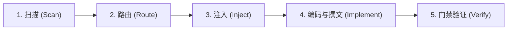

# 框架感知与架构治理技能 (Framework-Aware & Architecture Skill Wiki)

> **核心宗旨**：**杜绝凭经验臆造代码与架构**。涉及框架层、业务垂直模块（MSVP/MES）、数据模型、沙盒持久化、资产引用或编写技术文档时，必须先查阅对应 `_doc_*.md` 与 Wiki 蓝图，严格遵循正统基类、单向依赖 DAG、100% 静态类型与目录拓扑约定。
> **架构模式**：采用 **Skill Wiki 渐进式披露 (Progressive Disclosure)** 设计。本文件为主入口与导航路由，各领域深度规范按需查阅 `references/` 与 `examples/`。

---

## 一、触发判定流 (Trigger Decision Flow)

当接收到的任务或修改意图满足以下任一条件时，**必须强制触发**本技能流程：

```text
收到任务 / 准备设计或编码
       │
       ▼
是否涉及以下动作？
├── 1. 新建/重构框架模块 (src/framework/modules/) 或业务模块 (src/game/features/ MSVP/MES, src/game/shared/)
├── 2. 新建/修改继承自核心基类的脚本 (BaseScene, BaseView, BaseDialog, BaseParams, Base* 门面)
├── 3. 调用或装配全局服务与运行时 (App.xxx, Bus, FrameworkRuntime, RuntimeManifest, RuntimeServiceHost)
├── 4. 设计或修改数据模型 (*Config, *Req/*Resp, *Model, *State, *Data, *Params, *Context)
├── 5. 读写本地沙盒持久化或缓存 (user://, StorageItem.for_config / for_save, FileUtils.USER_*_DIR)
├── 6. 使用框架基建与工具集 (TaskScope, BudgetCache, CooldownScheduler, SpinePool, ShaderWarmer, FSM/BT, *Utils)
├── 7. 新增/重命名/移动/引用 src/assets/ 美术媒体资产或 src/resources/ 静态配置资源
├── 8. 编写或更新架构设计文档 (_doc_*.md)、开发规范文档或 GDScript ## 文档注释
       │
       ├── 【是】 ──► 触发本 Skill 流程（扫描关键词 ➔ 查阅注入文档 ➔ 声明 ➔ 编码/撰文 ➔ R01~R16 门禁校验）
       └── 【否】 ──► 纯外部与代码库无关问答，直接执行
```

---

## 二、Skill Wiki 知识索引导航 (Wiki Sitemap)

本 Skill 下辖的模块化 Wiki 资源与自动化工具组织如下，Agent 可按需点对点查阅，避免全量上下文污染：

```text
.agents/skills/framework-aware/
├── SKILL.md                              # [当前主入口] 规范总则、触发流、声明契约与 R01~R16 门禁速查
├── references/                           # [Wiki 核心规范库]
│   ├── keyword_matrix.md                 # 关键词 ➔ 文档路径 ➔ 核心约束 路由检索矩阵
│   ├── architecture_rules.md             # 架构与编码铁律：单向 DAG、三级通信、单复数、资产/沙盒拓扑、强类型与性能红线
│   ├── module_and_doc_design.md          # 模块设计与文档编写蓝图：Framework 四层模块、MSVP/MES 切片、7大 Model 后缀、_doc_*.md 12维模板
│   └── verification_checklist.md         # 编码前/中/后三阶段合规质量自查清单
├── examples/                             # [Few-Shot 黄金范例库]
│   └── code_patterns.md                  # 场景/TaskScope、MSVP/弹窗、按钮、沙盒持久化、构造 DI、Variant 强类型正反范式对比
└── scripts/                              # [自动化合规引擎]
    ├── check_compliance.py               # 极简 CLI 入口：支持全量/单规则(--rule)/JSON(--json)执行
    ├── check_syntax.gd                   # Godot Headless 全量 GDScript 语法与静态类型编译扫描器
    └── compliance/                       # 模块化合规规则引擎包 (models / context / reporter / rules/*)
```

### 快速导航直达
- **关键词与 `_doc_*.md` 路由检索**：阅读 [references/keyword_matrix.md](references/keyword_matrix.md)
- **架构铁律、沙盒/资产拓扑与编码规范**：阅读 [references/architecture_rules.md](references/architecture_rules.md)
- **模块架构设计（Framework / MSVP / MES）与文档编写模板**：阅读 [references/module_and_doc_design.md](references/module_and_doc_design.md)
- **编码前/中/后三阶段合规自查表**：阅读 [references/verification_checklist.md](references/verification_checklist.md)
- **黄金代码范式与反模式对照**：阅读 [examples/code_patterns.md](examples/code_patterns.md)

---

## 三、标准化执行五步法 (The 5-Step Workflow)



1. **扫描 (Scan)**：解析用户需求，识别涉及的系统域、模块架构模式（Framework 四层 / MSVP / MES）、持久化或资产操作。
2. **路由 (Route)**：对照 [references/keyword_matrix.md](references/keyword_matrix.md) 与 [references/module_and_doc_design.md](references/module_and_doc_design.md) 锁定目标 `_doc_*.md` 文档。
3. **注入 (Inject)**：使用 `read_file` 工具真实读取目标 `_doc_*.md` 文档，提取基类、签名、目录结构与红线约束。
4. **编码与撰文 (Implement)**：严格按提取的架构契约与 100% 静态类型规范编写代码，同步维护 `_doc_*.md` 与 `##` BBCode 注释。
5. **门禁验证 (Verify)**：运行 `check_compliance.py` 确保 **R01 ~ R16** 全量通过（0 errors, 0 warnings），并在回复顶部输出声明。

---

## 四、回复声明格式契约 (Declaration Contract)

在回复用户时，若触发了本技能，必须在回复最开头输出加载状态声明框（列出实际查阅的文档）：

```text
┌─────────────────────────────────────────────────────────────┐
│  📚 [SKILL] framework-aware 已激活                          │
│  ─────────────────────────────────────────────────────────  │
│  • 已查阅文档:                                              │
│    - src/framework/modules/scene/_doc_scene.md              │
│    - src/game/_doc_game.md                                  │
│  • 遵循约束: MSVP 垂直切片分层、100% 静态类型与 R01~R16 门禁 │
└─────────────────────────────────────────────────────────────┘
```

---

## 五、R01 ~ R16 自动化合规门禁速查 (Automated Quality Gate)

每次完成代码编写或重构后，**必须**运行自动化合规引擎验证：

```bash
# 1. 全量执行 R01~R16 架构合规扫描 + Godot Headless 全项目静态编译检查
python .agents/skills/framework-aware/scripts/check_compliance.py

# 2. 按需单独验证指定规则（如仅查 R14 资产与 R16 沙盒持久化）
python .agents/skills/framework-aware/scripts/check_compliance.py --rule R14 --rule R16

# 3. 列出所有已注册规则或输出 JSON 诊断报告
python .agents/skills/framework-aware/scripts/check_compliance.py --list-rules
python .agents/skills/framework-aware/scripts/check_compliance.py --json
```

| 规则 ID | 门禁校验维度 | 核心约束摘要 |
| :--- | :--- | :--- |
| **`R01`** | 网络门面命名 | 统一使用 `App.net`，严禁已废弃的 `App.network` |
| **`R02`** | 参数基建路径 | 统一使用单数 `src/framework/infra/param/` |
| **`R03`** | 视频资产容器 | 统一使用复数 `src/assets/videos/` |
| **`R04`** | 日志模块路径 | 统一使用完整名词 `src/framework/modules/logger/` |
| **`R05`** | 显示与视频层 UI 解耦 | `src/framework/` 内零业务弹窗与硬编码 UI 遮罩 |
| **`R06`** | `shared/` 三支柱与 DAG | `src/game/shared/` 严格锁定 `model/service/component` 单数三支柱且零向上依赖 |
| **`R07`** | 框架单向纯净边界 | `src/framework/` 零 `src/game/`、`src/test/` 引用与项目名泄漏 |
| **`R08`** | 框架内部显式 DI | `src/framework/modules|infra|util` 内部零 `App.xxx` 隐式调用 |
| **`R09`** | 核心模块依赖清单 | 15 大模块主实现类必须声明 `MODULE_ID` / `REQUIRED_MODULES` / `OPTIONAL_MODULES` |
| **`R10`** | 门面边界隔离 | `src/game/` 严禁跨界引用或实例化任何模块 `impl/` 私有实现类 |
| **`R11`** | 基建与工具收敛 | 统一使用 `FileCodecUtils`、`ResourceCodecUtils`、`TaskScope`、`SpinePool` |
| **`R12`** | GDScript 静态类型编译 | Godot Headless 全量 `.gd` 脚本编译 0 Error、0 Warning |
| **`R13`** | 日志规范 | `src/` 下严禁残留原生 `print()`，统一走 `App.logger` |
| **`R14`** | 资产三轴拓扑与归属 | `src/assets/<容器>/<架构域>/`，文件名 `<prefix>_<domain>_<subject>`，零跨 Feature 私引 |
| **`R15`** | 全局类名直呼 | 已声明 `class_name` 的脚本严禁使用 `preload`/`load` 冗余别名 |
| **`R16`** | 沙盒双层拓扑与归属 | `src/game/` 零裸 `"user://"`；仅 `*_model.gd` 可调用 `StorageItem.for_config/for_save` 且 `STORAGE_DOMAIN` 对齐目录域 |

---

## 六、Wiki 维护与演进准则

1. **文档先行与同步**：当 `src/framework/`、`src/game/shared/` 或 `src/game/features/` 新增模块时，必须按 [references/module_and_doc_design.md](references/module_and_doc_design.md) 编写对应 `_doc_*.md`，并同步更新 [references/keyword_matrix.md](references/keyword_matrix.md)。
2. **杜绝幽灵条目**：严禁向 `keyword_matrix.md` 中添加不存在真实文件的路径。
3. **规则与文档闭环**：每当提炼出新的架构约束时，优先在 `.agents/skills/framework-aware/scripts/compliance/rules/` 中沉淀为可自动执行的静态规则，并同步更新本 Wiki。
