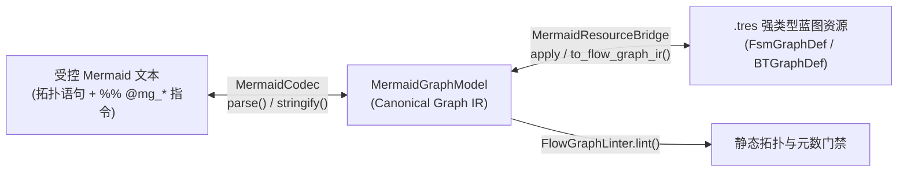
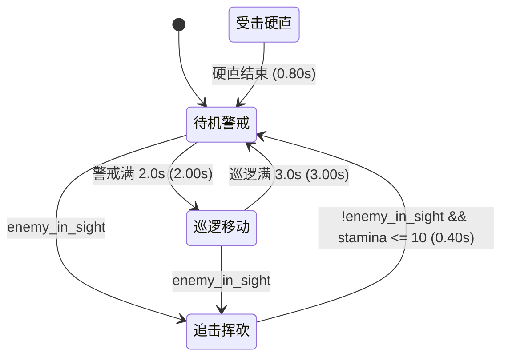
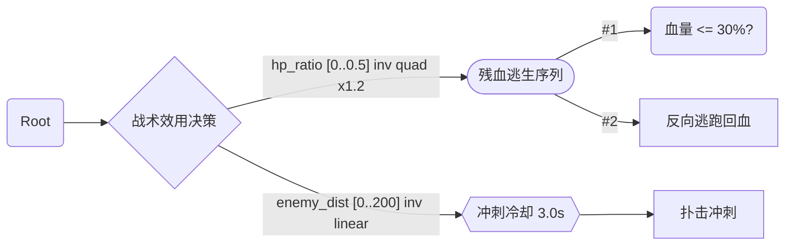

# FlowGraph Mermaid 可逆编译语法与 `.tres` 转换约束规范 (`addons/flow_graph/editor/codec/`)

> **核心定位**：定义 `FlowGraph` 工作台「源码（Source）」编辑模式与 AI/脚本生成蓝图时必须遵守的 **受控可逆 Mermaid 子集（Canonical Reversible Mermaid Subset）**。
> **为什么必须约束语法**：标准 Markdown 渲染级 Mermaid 允许大量自由语法糖（链式连写、`subgraph` 容器、无类型节点、模糊边文案），此类自由文本只能单向画图，**无法唯一、无损地逆向编译为强类型 Godot AST 资源（[`FsmGraphDef`](../../runtime/fsm/ast/fsm_graph_def.gd) / [`BTGraphDef`](../../runtime/bt/ast/bt_graph_def.gd) `.tres`）**。凡需导入编辑器或落盘为 `.tres` 的 Mermaid 文本，必须严格遵循本规范。

---

## 一、 双向转换链路



---

## 二、 全局词法与行级语法铁律（FSM & BT 通用）

| 规则编号 | 约束项 | 合法规范（Must Do） | 严禁写法（Strict Anti-Patterns，会导致解析失败或脏节点） |
| :--- | :--- | :--- | :--- |
| **G01** | **首行图头锁定 Schema** | 首个非空、非 `%%` 注释行必须为：<br>• `stateDiagram-v2` → 映射 `FsmGraphDef` (`schema=fsm`)<br>• `flowchart LR` 或 `flowchart TD` → 映射 `BTGraphDef` (`schema=bt`) | 严禁省略图头，严禁使用 `sequenceDiagram`、`mindmap`、`erDiagram` 等非控制流图头。 |
| **G02** | **严格一行一语句** | 每行仅声明 **1 个节点**、**1 条单跳有向边** 或 **1 条 `%%` 指令**。 | 严禁单行分号拼写 `a --> b; b --> c`；严禁多跳链式边 `a --> b --> c`；严禁并连简写 `a & b --> c`。 |
| **G03** | **唯一有向边算子 `-->`** | 所有状态转换与父子连接仅允许使用实线箭头 **`-->`**。 | 严禁使用虚线 `-.->`、粗线 `==>`、无向线 `---` 或中置文案 `-- text -->`（会被误判为畸形节点 ID）。 |
| **G04** | **节点 ID 标识符约束** | 必须为纯 ASCII 标识符 `[A-Za-z_][A-Za-z0-9_]*`：<br>• **FSM**：推荐语义化 `snake_case`（如 `idle`、`chase_target`）；<br>• **BT**：推荐使用 `n<正整数>`（如 `n1`、`n2`），逆向 `.tres` 时可 1:1 保持稳定的整型 `BTNodeDef.node_id`。 | 严禁为 `*` 或 `[*]`；严禁含空格、中文、连字符 `-`、`->`、`:`、引号或括号。 |
| **G05** | **标题与标签字符转义** | 显示标题与边标签内部如需引号，统一使用单引号 `'`；禁止跨行折行。 | 严禁在标题或边标签内部嵌套双引号 `"` 或未闭合的括号 `[](){}`。 |
| **G06** | **禁用自由装饰与块语法** | 子状态机与公共行为树复用**必须**通过节点参数 `sub_graph_path` 引用独立 `.tres` 文件。 | 严禁使用 `subgraph ... end`、`state X { ... }` 内联大括号嵌套、`note`、`classDef`、`style`、`click`。 |

---

## 三、 FSM 模式专属规范（`stateDiagram-v2` → `FsmGraphDef`）

1. **唯一初始入口必填**：
   - 必须声明 `[*] --> <initial_state_id>`，且目标状态必须存在（否则触发 Linter 错误 `FSM_NO_INITIAL` 与编译错误 `FSM.UnknownInitialState`）。
   - **禁止写结束伪节点边 `<state_id> --> [*]`**：解析器会忽略指向 `[*]` 的边；终结状态直接表现为无出边的普通状态节点。
2. **状态节点声明格式**：
   - 带显示标题：`state "巡逻移动" as patrol`
   - 标题同 ID：`state patrol`
3. **有向转换边与全局打断边格式**：
   - 普通状态转换：`<from_id> --> <to_id>` 或 `<from_id> --> <to_id> : <可读摘要>`
   - **全局任意态打断边（`from_state = &"*"`）**：因标准 Mermaid 不支持 `* --> stun`，统一使用指令注释声明：
     ```text
     %% @any --> stun : [@hit_stun]
     ```
4. **同源同目标单边唯一性铁律**：
   - 同一对 `(from_id, to_id)` 之间**最多只能声明 1 条有向边**（[`MermaidGraphModel.add_edge`](../model/mermaid_graph_model.gd) 会将同起止点的多条边合并覆盖）。
   - 若两个状态间存在多种触发可能，必须在同一条边的 `condition_key` 或 `bb_expr` 中使用 `||` 合并（如 `hp_ratio <= 0.2 || is_panicked`）。
5. **边标签简写推导与 `@mg_edge` 强制边界**：
   - 未写 `%% @mg_edge` 时，`FsmGraphDef.apply_mermaid_ir()` 仅支持三种**单字段**简写推导：
     - `[@event_name]` → `trigger_event = &"event_name"`
     - `<float>s`（如 `2.0s`） → `min_state_time = 2.0`
     - `ident` 或 `!ident` → `condition_key = &"ident"` / `&"!ident"`
   - **强制使用 `%% @mg_edge` 的场景**：凡包含 `bb_expr` 比较式（如 `stamina >= 30`）、非零优先级 `prio`、或同时组合「事件 + 条件 + 最小驻留时间」的转换边，必须配套声明 `%% @mg_edge`，否则边标签仅会退化为纯注释 `description`。

---

## 四、 BT 模式专属规范（`flowchart LR/TD` → `BTGraphDef`）

### 1. 严格有根树（Strict Rooted Tree）拓扑铁律
- **严禁多父共享子节点（禁止 DAG 菱形汇合）**：行为树 AST 中每个 [`BTNodeDef`](../../runtime/bt/ast/bt_node_def.gd) 仅归属唯一父节点的 `children` 数组。若写出 `n1 --> n4` 且 `n2 --> n4`，逆向构建树时第二条边会被访问集去重丢弃。跨分支逻辑复用必须拆分为独立 `.tres` 并通过 `SubTree` 节点挂载。
- **严禁有向环路**：树内不允许任何祖先指向后代的回边，子树嵌套禁止自引用（`SUBGRAPH_SELF_CYCLE`）且最大嵌套深度不超过 `8` 层。

### 2. 六种合法括号形状与 17 种标准节点 `kind` 映射表

解析器**仅识别以下 6 种括号定界符**（严禁使用 `((圆形))`、`[(圆柱)]`、`>旗帜]`、`[/平行四边形/]`）。由于 17 种 BT 节点共享 6 种形状，**凡非默认推导类型必须通过 `%% @mg <id> kind=<Kind>` 显式锁定**：

| Mermaid 括号写法 | 形状名 (`shape`) | 无 `@mg` 时的默认推导 `kind` | 同形状下必须显式声明 `kind=` 的节点类型 | 出入度硬门禁（Arity） |
| :--- | :--- | :--- | :--- | :--- |
| `n1("根节点")` | `round` | `Condition` | **`Root`**（全树唯一顶层入口） | `Root`: 入度 `= 0`，出度 **`= 1`**<br>`Condition`: 出度 **`= 0`** |
| `n2{"战术决策"}` | `diamond` | `Selector` | `UtilitySelector`、`WeightedSelector` | 出度 **`>= 1`**（严禁空组合节点） |
| `n3(["连招序列"])` | `stadium` | `Sequence` | — | 出度 **`>= 1`** |
| `n4[["并行/子树"]]` | `subroutine` | `Parallel` | `SubTree`（需含 `sub_graph_path`） | `Parallel`: 出度 **`>= 1`**<br>`SubTree`: 出度 **`= 0`** |
| `n5{{"修饰器"}}` | `hexagon` | `Inverter` *(或按参数推断)* | `Cooldown`、`Repeater`、`TimeLimit`、`ForceSuccess`、`ForceFailure`、`Service` | 出度 **`= 1`**（必须且只能连 1 个子节点） |
| `n6["执行动作"]` | `rect` | `Action` | `Wait` | 出度 **`= 0`**（叶节点严禁连出边） |

### 3. 连线语法与子分支执行顺序
- 连线格式：`n1 --> n2` 或带序号/摘要管道标签 `n2 -->|"#1"| n3`（管道符 `|...|` 必须紧贴 `-->` 右侧）。
- **子节点评估优先级**：逆向生成 `BTGraphDef` 时，同一组合节点下子分支的执行顺序由边的声明次序与 `prio` 决定；在可视化画布中开启布局对齐时，`flowchart LR` 按子节点 **`pos.y` 从上到下**、`flowchart TD` 按子节点 **`pos.x` 从左到右** 对应 `#1, #2, #3...`。

---

## 五、 无损逆向 `.tres` 的结构化 Pragma 指令集（`%% @mg_*`）

为将黑板契约、17 种精确节点语义、执行器参数、边权重/效用曲线及画布坐标 **100% 无损写入 `.tres`**，所有扩展元数据统一编码在文件底部的 `%%` 注释指令区。

> **JSON 尾置单行铁律**：[`MermaidCodec`](mermaid_codec.gd) 通过行尾切片解析 `params=` 与 `@mg_bb`。因此所有 JSON 载荷**必须为不换行的单行合法 JSON（键名与字符串值使用标准双引号 `"`），且 `params={...}` 必须置于该指令行的最末尾**。

### 1. 图级元数据与黑板契约
```text
%% @mg_meta schema=bt title="slime_tactical_bt"
%% @mg_bb [{"key":"hp_ratio","type":"float","default":1.0},{"key":"in_alert","type":"bool","default":false}]
```
- `schema`：必填 `fsm` 或 `bt`。
- `title`：逆向写入 `FsmGraphDef.graph_id` 或 `BTGraphDef.tree_id`。
- `@mg_bb`：JSON 数组，元素结构固定为 `{"key": String, "type": "bool"|"int"|"float"|"String", "default": Variant}`。

### 2. 节点语义、坐标与参数指令 (`%% @mg`)
```text
%% @mg <node_id> kind=<KindName> pos=<int_x>,<int_y> params=<单行JSON对象>
```
各节点 `kind` 标准 `params` 键名契约如下（严禁自造未定义字段名）：

| 适用域 | `kind` 值 | 标准 `params` 字段契约与类型 |
| :--- | :--- | :--- |
| **FSM** | `State` | `action_key: String`（缺省回退 `state_id`），`sub_graph_path: String`（HFSM 子图 `res://.../*.tres`），其余自定义业务键值原样存入 `FsmStateDef.params` |
| **BT 根** | `Root` | 无业务参数 |
| **BT 组合** | `Selector` | `memory: bool`（默认 `false`，`true` 时子动作 `RUNNING` 期间禁止高优分支抢占） |
| **BT 组合** | `Sequence` | `reactive: bool`（默认 `false`） |
| **BT 组合** | `Parallel` | `require_all_success: bool`（默认 `true`） |
| **BT 组合** | `WeightedSelector` | 权重定义在各子出边的 `@mg_edge` `params={"weight": float}` 中 |
| **BT 组合** | `UtilitySelector` | `momentum: float`（防抽搐滞回加分，默认 `0.10`），`min_score: float`（淘汰阈值，默认 `0.01`），`top_k: int`（候选池大小，默认 `1`），`memory: bool`（默认 `false`） |
| **BT 修饰** | `Inverter` / `ForceSuccess` / `ForceFailure` | 无额外必填参数 |
| **BT 修饰** | `Cooldown` | `cooldown_sec: float`（默认 `1.0`），`jitter_sec: float`（随机浮动秒数，默认 `0.0`） |
| **BT 修饰** | `Repeater` | `repeat_count: int`（默认 `3`），`abort_on_failure: bool`（默认 `true`） |
| **BT 修饰** | `TimeLimit` | `timeout_sec: float`（默认 `3.0`） |
| **BT 修饰** | `Service` | `service_key: String`（必填，对应 `BTCompiler.register_service`），`interval_sec: float`（默认 `0.25`），`jitter_sec: float`（默认 `0.05`） |
| **BT 叶子** | `Action` | `action_key: String`（必填，对应 `BTCompiler.register_action`） |
| **BT 叶子** | `Condition` | 三选一互斥模式：<br>1) 算子模式：`condition_key: String`（支持 `!` 前缀，对应 `register_condition`）<br>2) 黑板比较：`bb_key: String`, `op: "=="|"!="|"<"|"<="|">"|">="`, `value: Variant`<br>3) 复合公式：`expr: String`（支持 `&&`、`||`、`!`、括号与比较符，由 [`FlowBlackboardExpr`](../../runtime/shared/flow_blackboard_expr.gd) 求值） |
| **BT 叶子** | `Wait` | `duration_sec: float`（默认 `0.5`），`jitter_sec: float`（默认 `0.0`） |
| **BT 叶子** | `SubTree` | `sub_graph_path: String`（必填，指向有效外部 `BTGraphDef` `.tres` 路径） |

### 3. 有向边优先级、转换条件与分支效用指令 (`%% @mg_edge`)
```text
%% @mg_edge <from_id>-><to_id> prio=<int> params=<单行JSON对象>
```
- **注意箭头写法**：`@mg_edge` 中连接起止 ID 使用紧凑双字符 **`->`**（无空格，如 `idle->attack` 或 `*->stun`），区别于正文拓扑行的 `-->`。
- 按模式支持的 `params` 字段契约：
  - **FSM 转换边**：`{"condition_key": String, "trigger_event": String, "bb_expr": String, "min_state_time": float, "description": String}`。
  - **BT `WeightedSelector` 出边**：`{"weight": float}`（非负抽样权重，默认 `1.0`）。
  - **BT `UtilitySelector` 出边**：`{"utility": {...}}`，内部规格字段对齐 [`FlowUtilityScorer`](../../runtime/shared/flow_utility_scorer.gd)：
    - 黑板曲线模式：`bb_key: String`, `min_val: float`, `max_val: float`, `invert: bool`, `curve: "linear"|"quad"|"cubic"|"sqrt"|"smoothstep"|"logistic"`, `weight: float`
    - 算子评分模式：`utility_key: String`（对应 `register_utility`）, `invert: bool`, `curve: String`, `weight: float`
    - 多轴乘积模式：`considerations: Array[Dictionary]`（每个元素为上述单轴规格）, `compensate: bool`（默认 `true`）, `weight: float`

> **交互期增量编辑说明（[`SessionSourceApplier`](../debugger/session_source_applier.gd)）**：
> 在编辑器内打开已有 `.tres` 并切到「源码」页小幅增删连线时，若保留原节点 ID 未删且未手写 `@mg`，解析器会自动从上一帧内存模型继承该同名节点的坐标与 `params`；但在**从零新建草稿、跨文件复制粘贴或由 AI 生成完整蓝图源码**时，必须完整输出 `@mg_meta`、`@mg_bb`、`@mg` 与 `@mg_edge` 方可保证 100% 无损落盘。

---

## 六、 标准无损可逆黄金模板

### 模板 A：FSM 状态机（`FsmGraphDef` 可逆模板）



### 模板 B：BT 行为树（`BTGraphDef` 可逆模板，含 `Root` 与效用分支）



---

## 七、 导出 `.tres` 前自检清单（Checklist）

1. **图头与单行检查**：首行是否为 `stateDiagram-v2` 或 `flowchart LR/TD`？是否消除了所有 `subgraph`、`;`、链式 `A --> B --> C` 与非 `-->` 箭头？
2. **入口与元数检查**：
   - `FSM` 是否包含 `[*] --> <初态>` 且无重复 `(from, to)` 边？
   - `BT` 顶层是否为唯一 `Root`（1 个子节点）、所有 `Composite` 子数 `>= 1`、所有 `Decorator` 子数 `== 1`、所有 `Leaf` 子数 `== 0`、且整张图无多父共享节点？
3. **Pragma 完整性检查**：所有多态形状节点是否已声明 `%% @mg <id> kind=...`？所有含参数节点/边是否已附带单行合法 JSON 的 `params={...}` 且置于行尾？
