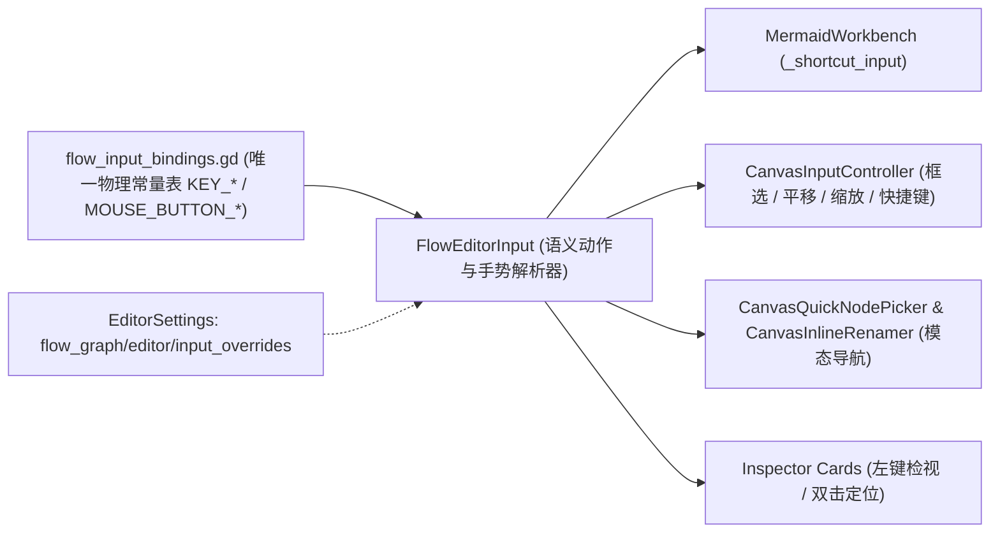

# 编辑器鼠键与手势映射层 (`addons/flow_graph/editor/input/`)

> 本目录是 `flow_graph` 编辑器内所有鼠标按键、滚轮、触控板手势、修饰键与键盘快捷键的**唯一语义映射中心**。

## 职责边界

- **管什么**：声明默认物理键鼠绑定表、按作用域（工作台全局 / 2D 画布 / 模态浮层 / 列表行）解析语义动作、跨平台归一化 `Ctrl`/`Cmd` 修饰键、读取 `EditorSettings` 自定义重映射（`flow_graph/editor/input_overrides`）及格式化可读快捷键提示。
- **不管什么**：不直接持有画布几何状态、不修改图模型（`MermaidGraphModel`）、不直接操作 UI 控件树。

## 架构分层

## 默认核心交互映射速查

| 作用域 | 语义动作 / 角色 | 默认绑定 | 交互语义 |
| :--- | :--- | :--- | :--- |
| 画布指针 | `PTR_PRIMARY` | 鼠标左键 | 空白拖拽框选、单击/加选节点、群组拖拽、拉线连线 |
| 画布指针 | `PTR_PAN_DEDICATED` | 鼠标中键 | 按住直接平移画布视口 |
| 画布指针 | `PTR_CONTEXT_OR_PAN` | 鼠标右键 | 原地点击弹出上下文菜单；拖拽超出死区平移视口 |
| 画布辅助 | `CANVAS_SPACE_HAND_OR_PICKER` | `Space` | 按住配合左键拖拽平移视口；轻点松开唤起快速建点面板 |
| 修饰键 | `MOD_TOGGLE_SELECT` | `Ctrl` / `Cmd` | 单击切换节点选中态、框选时反选切换 |
| 修饰键 | `MOD_ADDITIVE_SELECT` | `Shift` | 单击或框选时将命中节点追加并入当前选集 |
| 修饰键 | `MOD_BYPASS_SNAP` | `Alt` | 拖拽节点时临时绕过 16px 网格吸附 |
| 画布键盘 | `CANVAS_SELECT_ALL` / `CANVAS_CANCEL_OR_CLEAR` | `Ctrl+A` / `Esc` | 全选节点 / 取消拉线或框选并清空选集 |
| 画布键盘 | `CANVAS_FIT_OR_FRAME` / `CANVAS_TOGGLE_BREAKPOINT` | `F` (`Home`) / `F9` | 聚焦框选节点（无选中时适配全图）/ 批量切换节点断点 |
| 画布键盘 | `CANVAS_DUPLICATE` / `CANVAS_DELETE` | `Ctrl+D` / `Del` (`Backspace`) | 批量复制选中节点及内部连线 / 批量删除选中节点或连线 |

## 合规铁律

1. 除 `flow_input_bindings.gd` 外，`addons/flow_graph/editor/` 下任何 UI 脚本严禁硬编码 `KEY_*` 或 `MOUSE_BUTTON_*` 常量。
2. 新增快捷键或手势必须在 `flow_input_bindings.gd` 声明默认项并在 `FlowEditorInput` 暴露 `StringName` 语义常量。
