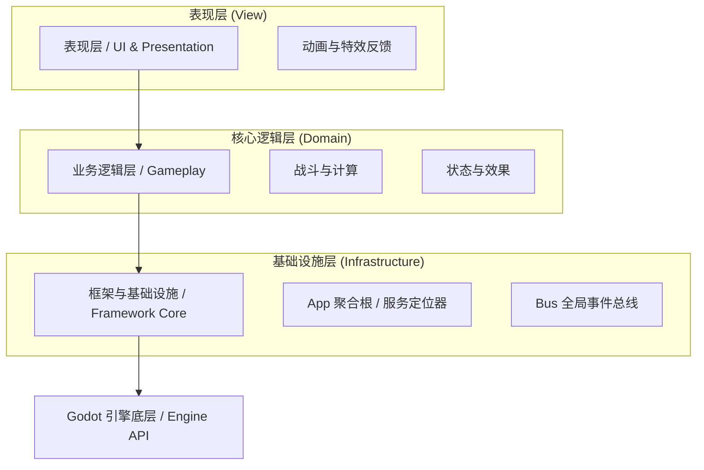
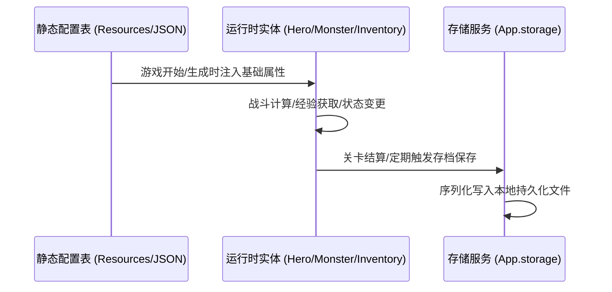

# 🏛️ 项目技术架构设计 (Architecture Design)

> 🎨 **FileSystem 色彩标识**：🟣 `Purple (紫色)` —— 核心技术抽象与架构底座

本模块记录 **Slacker Survivors** 的宏观技术架构设计、代码分层原则与模块解耦规范。

---

## 1. 系统总体分层

项目采用经典的分层架构，严格限制单向依赖关系：

- **表现层 (UI / View)**：负责界面渲染、音效震动与用户交互反馈（继承 `BaseUIView`、`BaseDialog`，使用 `DialogManager`、`BaseTextureButton` 等组件）。
- **业务逻辑层 (Gameplay)**：包含战斗数值结算、技能触发、怪物波次推进与英雄状态，不直接强耦合具体的 UI 节点。
- **框架与基础设施层 (`src/framework/`)**：提供跨业务通用的服务集合，包括事件总线（`Bus`）、服务入口（`App`）、网络（`App.net`）、存储（`App.storage`）、音频（`App.audio`）等。

---

## 2. 通信与解耦规范

为了避免系统演进中形成“意大利面条式”的互相调用，通信遵循以下 3 级约束：

| 通信级别 | 使用机制 | 适用场景 | 示例 |
| :--- | :--- | :--- | :--- |
| **父子节点级** | **Signal / 方法调用** | 强内聚的单场景内树形结构 | 按钮点击通知父面板 `button.pressed` |
| **同层模块间** | **全局事件总线 (`Bus`)** | 跨界面、跨系统广播通知，监听者不关心触发源 | 玩家升级事件 `Bus.emit("player_leveled_up", data)` |
| **全局服务调用** | **服务定位器 (`App.xxx`)** | 获取全局单例功能与系统级接口 | 播放音效 `App.audio.play_sfx(...)`、读写存档 `App.storage` |

> ⚠️ **严禁规则**：
> 1. 业务逻辑层（如怪物计算）严禁直接查找和修改特定 UI 节点（如 `get_node("/root/.../HealthBar")`）。
> 2. 跨系统通知一律通过 `Bus` 事件或数据绑定完成解耦。

---

## 3. 数据流与持久化

- **静态数据**：通过 Godot 自带的 `Resource` 或标准配置表管理，仅供只读。
- **运行时数据**：使用契约参数实体（继承 `BaseParams`），具备自描述与字典序列化能力。
- **存档数据**：统一走 `App.storage` 管道，支持加密与容错校验。

---

## 4. 目录工程与命名设计规范（单复数黄金法则）

为确保全工程目录结构语义清晰、风格高度统一，避免“随意单数”与“随手复数”造成的认知混乱，项目严格推行并执行**单复数黄金法则**：

> 💡 **核心黄金准则**：
> - **领域 / 系统 / 功能域 ➔ 统一单数 (Singular)**：表达一个子系统、能力范畴、逻辑分层或业务领域。
> - **容器 / 资源 / 实例集合 ➔ 统一复数 (Plural)**：表达物理或逻辑上存放多个具体同质对象、文件、资源或插件的集合。

### 4.1 规范矩阵与速查对照

| 分类 | 语义特征 | 命名准则 | 典型目录范式 | 错误示范 (严禁) |
| :--- | :--- | :--- | :--- | :--- |
| **架构顶层与系统域** | 核心架构、业务域、抽象分层 | **单数** | `src/framework/`, `src/game/`, `src/core/` | `frameworks/`, `games/` |
| **基础设施能力域** | 具体技术支撑功能、系统服务 | **单数** | `infra/param/`, `infra/cache/`, `infra/scheduler/` | `infra/params/`, `caches/` |
| **框架业务子模块** | 独立子系统服务域 | **单数** | `modules/scene/`, `modules/storage/`, `modules/video/`, `modules/logger/` | `scenes/` (在 modules 内部时) |
| **通用工具体系域** | 工具能力分类域（二级独立封装） | **单数** | `util/file/`, `util/async/`, `util/node/`, `util/time/` | `utils/files/`, `util/nodes/` |
| **业务场景功能域** | 具体业务玩法或功能模块 | **单数** | `scenes/battle/`, `scenes/lobby/`, `scenes/settlement/` | `scenes/battles/`, `lobbies/` |
| **多媒体与资产容器** | 存放多个具体多媒体文件的物理容器 | **复数** | `assets/videos/`, `assets/textures/`, `assets/fonts/` | `assets/video/`, `assets/texture/` |
| **同质实体/脚本容器** | 存放多个同类抽象组件、适配器或场景 | **复数** | `shared/components/`, `types/`, `adapters/`, `modules/`, `scenes/` | `shared/component/`, `type/`, `adapter/` |
| **外部生态与文档集合** | 多个第三方扩展或说明文档的集合 | **复数** | `addons/`, `docs/` | `addon/`, `doc/` |

### 4.2 结构落地三大硬性守则

1. **工具集二级封装原则 (`util/`)**：
   - `src/framework/util/` 严禁在根目录平铺海量工具文件。
   - 必须按照技术领域细分二级单数目录（如 `file/file_utils.gd`、`async/async_utils.gd`、`node/node_utils.gd` 等），类命名统一使用全局类 `class_name XxxUtils`。
2. **业务组件下沉原则 (`components/`)**：
   - 通用业务视觉控件（如弹窗基类 `BaseDialog`、弹窗管理 `DialogManager`、通用按钮 `BaseTextureButton`）收敛于 `src/game/shared/components/ui/`。
   - `framework/modules/ui/` 仅负责 Godot 引擎层视图树挂载、根视口调度与场景过渡抽象，绝不耦合业务弹窗与业务组件。
3. **参数契约单数领域化 (`param/`)**：
   - 传输参数序列化协议归属于基础设施域 `src/framework/infra/param/`，统一派生自 `BaseParams`，严禁使用非规范的 `params/` 路径。

---

## 5. 详细技术文档索引

- [框架详细约定与微观接口文档 (src/framework/)](file:///d:/code/GodotProject/slacker-survivors/src/framework/_doc_framework.md)
- [场景生命周期规范 (BaseScene)](file:///d:/code/GodotProject/slacker-survivors/src/framework/modules/scene/_doc_scene.md)
- [UI 系统编排与控件规范 (BaseUI)](file:///d:/code/GodotProject/slacker-survivors/src/framework/modules/ui/_doc_ui.md)
- [返回总览](file:///d:/code/GodotProject/slacker-survivors/docs/docs_overview.md)

