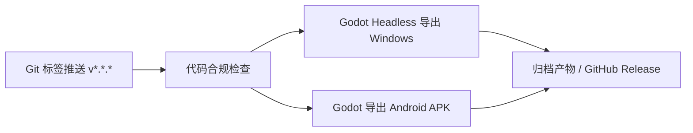

# ⚙️ 构建部署指南 (Deployment Guide)

> 🎨 **FileSystem 色彩标识**：🩵 `Teal (青色)` —— 工程交付、环境依赖与稳定发布

本模块记录 **Slacker Survivors** 的运行环境要求、多端导出配置、签名管理与发布流水线。


---

## 1. 基础开发环境要求

| 组件 | 要求版本 / 说明 | 备注 |
| :--- | :--- | :--- |
| **游戏引擎** | Godot Engine 4.x (当前工程配置: 4.7 Forward Plus) | 统一使用官方稳定版本 |
| **脚本语言** | GDScript 2.0 | 启用严格类型提示 (`@export`, 强类型标注) |
| **Android SDK** | SDK Build-Tools 34+, NDK (若需要定制模块) | 用于导出 Android APK/AAB |
| **JDK** | OpenJDK 17+ | Android 打包签名工具链依赖 |

---

## 2. 多端导出规范 (Target Platforms)

### 2.1 PC 平台 (Windows / macOS / Linux)
- **导出预设**：Release 模式，勾选二进制嵌入 (Embed PCK)。
- **渲染后端**：`Forward Plus`（桌面端保画质）。
- **交付格式**：
  - Windows: 绿色解压包 (`.zip`) 或单文件可执行文件 (`.exe`)。
  - macOS: `.dmg` / `.app` (需要 Apple 开发者签名与公证)。

### 2.2 移动平台 (Android / iOS)
- **导出预设**：移动端渲染需注意着色器兼容性与温控表现（可考虑降级至 `Mobile` 或 `Compatibility` 后端验证）。
- **Android**：
  - 导出格式：国内渠道使用 `.apk`，Google Play 必须提供 `.aab`。
  - 密钥管理：发布签名文件 (`keystore`) 严禁提交至公共 Git 仓库，由环境变量或本地配置注入。
- **iOS**：
  - 导出 Xcode 工程，通过 Xcode 配置证书并在真机 Archive 打包。

### 2.3 Web 平台 (HTML5)
- **SharedArrayBuffer 依赖**：多线程导出需配置 Web 服务器响应头：
  - `Cross-Origin-Opener-Policy: same-origin`
  - `Cross-Origin-Embedder-Policy: require-corp`

---

## 3. 打包与发布流水线 (CI/CD)



### 自动化构建推荐命令 (Godot Headless CLI)
```bash
# Windows Release 导出示例
godot --headless --export-release "Windows Desktop" ./build/windows/SlackerSurvivors.exe

# Android Release 导出示例
godot --headless --export-release "Android" ./build/android/SlackerSurvivors.apk
```

---

## 4. 资源打包与版本热更准则

- **资源包分离 (PCK 划分)**：核心逻辑打包在基础包中，大型音视频或 DLC 资源支持外挂 PCK 加载。
- **配置敏感项**：API 密钥、支付商户号一律通过外部环境变量或加密配置文件注入，严禁硬编码。

---

- [返回总览](file:///d:/code/GodotProject/slacker-survivors/docs/docs_overview.md)
