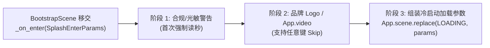

# 01 · 启动页闪屏 (Splash)

> **模块定位**：承接纯空启动器 [`BootstrapScene`](../../src/game/bootstrap/bootstrap_scene.gd) 的首屏视觉模块，专职**品牌/发行商 Logo 呈现、合规声明（健康忠告/光敏警告）与开场闪屏视频播放**。
> **边界红线**：闪屏页**不承担**重度资产加载与网络登录阻塞（均后置到 `02_loading` 与 `03_login`），确保进程拉起后零卡顿呈现品牌画面。

---

## 一、 核心功能清单

1. **首帧无损承接**：由 `BootstrapScene` 先完成 `App.bootstrap()` 与 `GameSettingsService.load_and_apply()`（窗口尺寸、全屏、多语言、音量已就绪），进入闪屏时零窗口跳变、零爆音。
2. **多段式闪屏序列播放**：
   - 支持配置化顺序播放：`[健康游戏/光敏癫痫警告文本卡片]` ➔ `[工作室/发行商静态或补间 Logo]` ➔ `[可选开场动画 MP4/OGV（经 App.video 播放）]`。
   - 视频闪屏默认启用 `VideoPlayOptions.with_first_frame_gate(true)` 消除起播黑闪，并自动触发 `App.audio` 正交避让。
3. **防误触锁定与二周目快速跳过（Skip）**：
   - **最低安全展示锁**（默认 `1.0s`）：防止瞬闪穿帮与合规声明一闪而过。
   - **跳过规则**：首次启动强制播完合规警告页；非首次启动（或品牌段）响应任意键/鼠标左键/手柄 `A`/`Start` 立即快进淡出至下一阶段。
4. **后台轻量预热**：闪屏播放期间，后台非阻塞调用 `App.asset.preload_batch()` 预读 `loading` 与 `login` 主场景 `.tscn`，实现切场零等待。

---

## 二、 状态流转时序

---

## 三、 Steam 单机与联机策略

- **单机/联机完全一致**：闪屏阶段为纯本地渲染，零网络请求依赖，Steam 离线模式与 Steam Deck 掌机均可毫秒级起播。
- **命令行快进支持**：开发调试期（`App.env.is_debug_build()`）或携带 `--skip-splash` / `override_target_scene` 参数时，直接短路闪屏序列进入目标路由。

---

## 四、 工程架构与契约映射 (`MSVP`)

- **目录落点**：`src/game/features/splash/`
  - `model/`：
	- `SplashEnterParams` (`BaseParams`)：可选携带 `override_target_scene` 直达覆盖路由。
	- `SplashSequenceConfig` (`Resource`)：声明闪屏节点序列（类型、资产路径、持续时长、可否跳过）。
	- `SplashState` (`RefCounted`)：当前播放阶段索引与可跳过状态。
  - `service/`：`SplashService`（管理序列步进计时、读取是否首次启动标记、`App.video` 启停编排）。
  - `presenter/`：`SplashPresenter`（绑定跳过输入 `App.input`、驱动视图淡入淡出、结束时跳转 `GameScenes.Scene.LOADING`）。
  - `view/`：`scene/splash/`（`SplashScene` + `SplashView`）与 `component/`（Logo 卡片 / 视频画布单元）。
- **下游交接**：构造 `LoadingTransitionParams`（模式设为 `COLD_BOOT`，目标场景设为 `GameScenes.Scene.LOGIN`），调用 `App.scene.replace()` 移交至 **02 加载资源页**。
