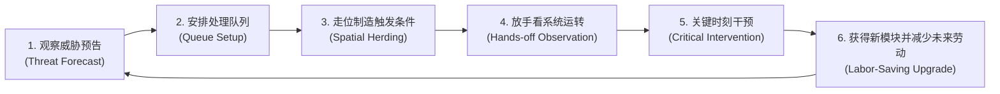
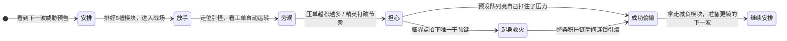

# 卷一：核心愿景、设计支柱与四维心流循环 (Vision, Design Pillars & Core Loop)

> **所属域**：`docs/design/`（参见总纲 [`_doc_design.md`](_doc_design.md)）
> **文档职责**：确立 `Slacker Survivors` 的核心乐趣定义、单轮情绪过山车节拍、四个时间尺度的心流闭环，以及第一阶段必须严格执行的“减法边界”。

---

## 一、 核心愿景与「懒惰爽感」重定义 (Core Fantasy)

### 1. 项目核心定义
> **玩家搭建一套只需要偶尔值班的生存机器，然后在战场上尽量不亲自处理问题，直到系统即将失控时，才做一次关键干预。**

### 2. 「伪懒惰」与「真懒惰」的本质区别
在传统类幸存者（Survivors-like）游戏中，所谓的“自动战斗”往往流于“角色高频自动发射全屏弹幕，玩家只管无脑走位躲怪”，这本质上是**剥夺了操作感后的数值挂机**。

`Slacker Survivors` 追求的**真懒惰感（Earned Laziness）**是：
> **“我提前做了一次聪明安排，所以接下来几十秒都不用重复劳动。”**

| 维度 | 传统 Survivors（无脑挂机 / 弹幕堆叠） | Slacker Survivors（聪明偷懒 / 异常值班） |
| :--- | :--- | :--- |
| **自动化来源** | 系统自带的自动索敌开火（与玩家智力无关） | 玩家亲手编排的**处理队列（Pipeline）**与走位喂料 |
| **玩家日常状态** | 机械地绕圈走位、捡满地经验豆、看满屏光污染 | 像车间主任一样旁观流水线运转，用走位把怪引向工单陷阱 |
| **危机与高潮** | 怪太硬太快 ➔ 数值不够被围死 | 特殊敌人卡住了流水线 ➔ 玩家看准时机**起身救火一次**，整条链瞬间盘活清场 |
| **成长的核心爽点** | DPS 数字变大、满屏特效更吵闹 | **需要亲自操心的破事越来越少**，机器能自动应对的异常越来越多 |

---

## 二、 核心玩法循环与七步情绪节拍 (Core Loop & Emotional Cadence)

### 1. 核心闭环流程图



### 2. 单轮七步情绪节拍 (The 7-Beat Emotional Curve)

每一轮战斗的心流必须严格踩准以下七个情绪节点：

> **安排 (Setup) ➔ 放手 (Release) ➔ 旁观 (Watch) ➔ 担心 (Sweat) ➔ 起身救火 (Intervene) ➔ 成功偷懒 (Payoff) ➔ 继续安排 (Refine)**



* **设计重心——为什么「担心 ➔ 起身救火」是灵魂？**
  - 玩家**不能全程真挂机**（否则变成屏保），也**不应该每秒都亲自瞄准**（否则变成双摇杆射击）。
  - 最舒服的心流状态是：平时 80% 的脏活累活由队列自己处理，玩家只需散步把怪引到舒服的位置；当某个突发威胁打破节奏、眼看积压的延迟收益要烂尾时，玩家做出一次高价值判断——**“现在拍下干预，能把整条链救回来并炸个大的！”**——随后系统重新恢复自动运转。

---

## 三、 四个时间尺度的乐趣分层 (Four Time-Scale Loops)

为保证玩家在每一秒、每一波、每一局都拥有清晰的目标感，玩法乐趣按四个时间尺度严格分层设计：

### 1. 微观尺度（5～10 秒）：看一次处理链是否成立
这是游戏最小的爽点单位。一枚基础攻击包（`WorkPacket`）进入队列，玩家亲眼看着它按槽位顺序演变：

```text
基础工单 ➔ [1. 标记] ➔ [2. 借力/聚拢] ➔ [3. 追踪/穿透] ➔ [4. 延迟] ➔ [5. 爆裂/回收]
```

* **画面可读性硬性指标**（必须在 5~10 秒内向玩家交代清楚）：
  1. 当前工单正经过哪一个模块槽位；
  2. 攻击载体的空间形态发生了什么变化（点 ➔ 线 ➔ 聚怪圈 ➔ 蓄力球 ➔ 分裂弹）；
  3. 哪一个模块替玩家省掉了本来需要手操的动作；
  4. 哪一步因为贪婪延迟而产生了额外风险；
  5. 为什么最后能形成这一下清屏大爆发。
* **即时心理反馈**：*“我只是排了个顺序，它居然真的自己把这群怪收拾干净了。”*

---

### 2. 中观尺度（30 秒）：观察一次自动系统是否需要救火
每 **30 秒左右**，战场必然出现一次**提前预告、可预测的压力事件（Pressure Event）**：
* 高速冲锋敌群突入；
* 巨量小怪潮合围；
* 正面护盾精英卡单；
* 反射/吞噬工单的特殊怪；
* 暂时冻结某个模块槽位的打断者；
* 场地安全区收缩或地面掉落物被抢夺。

* **事件前的决策博弈**：
  玩家提前知道即将发生什么，必须决定：
  - 现在是否重排队列顺序？
  - 是否必须憋住手里的「干预额度」留给这波精英？
  - 是否为了应对下一波威胁而牺牲当前的清怪效率？
* **事件中的双重正反馈**：
  - **情况 A（全自动化解）**：系统依靠玩家预设的顺序自己完美扛住了压力 ➔ 玩家获得**“我早就预判到了”**的智商满足感。
  - **情况 B（临界点救火）**：系统即将崩盘失控，玩家在最后 0.5 秒拍下一次干预，把跑偏的流水线强行拉回轨道 ➔ 玩家获得**“力挽狂澜”**的操作爽感。

---

### 3. 宏观波次尺度（2 分钟）：围绕下一种威胁重构一次机器
每波（或每阶段）结束后，玩家获得有限的改造选择（新模块、新队列槽、模块升级、条件规则、自动收集改造）。

* **升级设计铁律——拒绝纯数值膨胀，专注「消灭重复劳动」**：
  - ❌ **劣质升级**：`攻击力 +10%`、`攻速 +8%`、`生命上限 +20`。
  - ✅ **优质减负升级**：
    - `命中后自动转火至最近未标记目标`；
    - `[延迟] 气泡在倒计时期间自动向怪群密度最高处漂移`；
    - `[回收] 结算时自动将全图掉落物吸回角色身边`；
    - `生命值低于 20% 的敌人触碰工单时直接跳过中间模块进入结算`；
    - `被击退的敌人落地后自动重新挂上 [标记]`；
    - `当护盾精英在场时，队列自动旁路跳过无效的模块槽位`。
* **核心成长目标**：
  > **升级不是让玩家做更多事，而是让未来越来越多的重复劳动不再需要玩家亲自处理。**

---

### 4. 单局全局尺度（10～15 分钟）：从简单流水线进化为具备反制能力的自治系统
一局完整游戏（10～15 分钟）的体验演进分为清晰的三个阶段：

| 阶段 | 时间区间 | 玩家队列形态 | 敌人施压重点 | 玩家角色定位转变 |
| :--- | :--- | :--- | :--- | :--- |
| **第一阶段：建立基础习惯** | `00:00 ~ 03:30` | 3~4 槽极简队列（如 `锁定 ➔ 攻击 ➔ 回收`） | 基础近战群与单向冲锋怪，帮玩家看懂模块顺序与走位引怪的关系 | **流水线学徒**：摸索怎么把怪引到工单舒服的位置 |
| **第二阶段：专门破坏习惯** | `03:30 ~ 10:00` | 5 槽完整队列 + 条件分支改造 | **针对性反制敌群**：<br>• 依赖`[聚拢]` ➔ 刷出霸体远程怪<br>• 依赖`[延迟]` ➔ 刷出提前清印记的催债怪<br>• 依赖`[穿透]` ➔ 刷出受击分裂怪<br>• 依赖`[回收]` ➔ 刷出偷掉落物的清洁工 | **车间调试员**：无需推倒重来，通过对现有机器做局部换槽与小幅重构来见招拆招 |
| **第三阶段：少量关键干预定胜负** | `10:00 ~ 15:00` | 高度自治的复合流水线 | 多核心首领（Multi-Core Boss）与复合机制高压潮 | **异常值班总监**：普通敌群 100% 自动蒸发，只针对 Boss 机制或极端爆仓做一两次一锤定音的干预 |

---

## 四、 第一阶段范围裁剪红线 (Scope Cutting & Red Lines)

为了让核心循环在第一阶段（MVP 原型）纯粹、扎实地立住，必须**果断砍掉**以下四类干扰项：

### 1. 暂时冻结 AI Galgame 系统（移交 Phase 2）
* **原因**：AI 角色、好感度、对话与傲娇罢工极具差异化潜力，但**叙事包装绝不能替代底层玩法循环本身的自洽性**。
* **验证前提**：必须先证明**“即便画面里只有几何图形和工单槽，玩家也愿意反复排队列、看流水线运转、贪压单复利、在临界点救火”**。待此循环跑通后，再按 [`05_progression_and_ai_hooks.md`](05_progression_and_ai_hooks.md) 将 AI 角色作为“有脾气的模块”接入。

### 2. 砍掉「多把独立武器同时开火」
* **原因**：如果玩家身上同时挂着飞刀、圣水、大蒜、闪电链等十几把独立武器，单条处理队列的因果关系会被彻底淹没，游戏瞬间退回普通 Survivors 的特效堆叠。
* **第一版严格限制**：
  - **1 种**基础攻击载体（工单包 `WorkPacket`）；
  - **5 个**队列槽位（从 6 种原型模块中选配）；
  - **1 个**手动干预动作；
  - **3 种**机制截然不同的敌人压力。

### 3. 砍掉「持续手动瞄准与高频射击」
* **原因**：玩家可以走位、引诱、卡视角和拍下干预，但绝不能要求玩家每秒移动准星瞄准敌人。一旦引入持续瞄准，大脑注意力会被即时射击占满，“旁观机器工作”的偷懒爽感将荡然无存。

### 4. 砍掉「零代价随时换槽」与「换位无差异模块」
* **原因**：如果战斗中可以随时免费拖拽交换模块，玩家会陷入每秒微操换槽的疲劳（变成即时战略微操）。
* **硬性约束**：
  - 常规队列重排**只允许在波次间隙（准备阶段）**进行；
  - 战斗中若想改变队列行为，必须消耗宝贵的**「干预额度」**或承受流水线重置代价。
