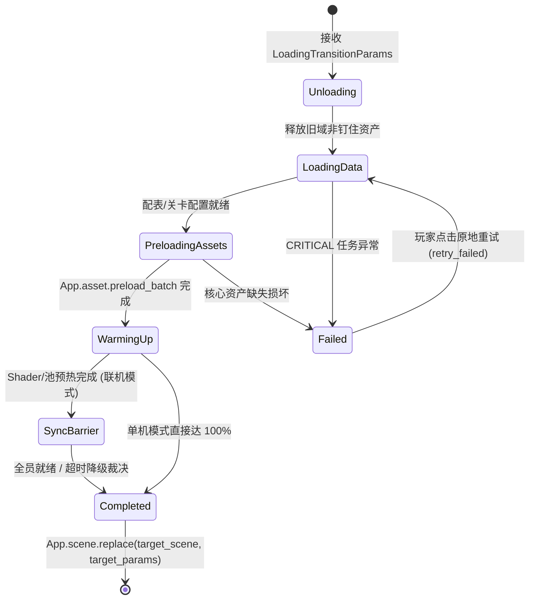

# 02 · 加载资源页 (Loading)

> **模块定位**：全游戏通用的**异步资源装卸载、配置预热与跨大场景过渡中枢**。
> **复用场景**：统一承接 **① 冷启动全局基础预载（`Splash ➔ Login`）**、**② 进局关卡资源加载（`Stage ➔ Gameplay`）**、**③ 退局战场清理回厅（`Gameplay ➔ Lobby`）** 三大重负载过渡流。

---

## 一、 核心功能清单

1. **参数驱动的通用管线 (`LoadingTransitionParams`)**：
   - 调用方仅需传入：`target_scene`（目标场景路径）、`target_params`（透传给目标场景的 `BaseParams`）、`release_domains`（需卸载的旧资源域）、`preload_paths`（需预载资产清单）及自定义加权 `LoadingTask` 列表。
2. **标准五步装卸载流水线**：
   - **Step 1 · 旧域卸载**：安全释放上一大场景未 `pin` 的非共享缓存资产（`App.asset.release`），回收显存与内存水位。
   - **Step 2 · 静态数据装载**：冷启动期装载全局二维导表 `src/resources/tables/`；进局期装载目标关卡编排 `src/resources/stages/` 与实体定义 `defs/`。
   - **Step 3 · 多核并发预载**：调用 `App.asset.preload_batch()` 一次性打满引擎后台多线程 I/O，并将高频公共图集/音效 `pin` 钉住。
   - **Step 4 · Shader 与对象池预热**：驱动 `ShaderWarmer` 预编译材质 PSO、按需预填充 `SpinePool` / 弹幕实体池，根除局内首帧编译卡顿。
   - **Step 5 · 联机同步屏障（仅联机进局激活）**：本地进度达 `95%` 后上报 `LoadReady`，等待房间全员就绪广播后齐步推满 `100%` 切场。
3. **防闪锁与体验反馈**：
   - **平滑阻尼进度条**：底层按任务权重累加真实进度，UI 层 `_process` 阻尼插值追赶，配合最短驻留时长（默认 `0.5s`）杜绝闪屏感。
   - **随机 Tips 轮播**：从多语言词条表按当前过渡上下文（通用 / 关卡机制提示）轮播实用小贴士。
4. **三级容灾与断点续跑**：
   - 继承 `CRITICAL`（致命阻断，展示重试按钮原地从失败任务续跑）、`DEGRADABLE`（记录告警降级继续）、`OPTIONAL`（预热失败静默跳过）三级容灾机制。

---

## 二、 状态流转图

---

## 三、 Steam 单机 vs 联机差异策略

| 场景 | 单机模式 | 联机模式 |
| :--- | :--- | :--- |
| **冷启动 (`Splash ➔ Login`)** | 装载 `tables/` 全局配置 + 预热公共 UI 与 `ShaderWarmupConfig`，100% 离线执行 | 同单机（网络鉴权与网关连接收敛在 `03_login`，不在冷启动加载页阻塞） |
| **进局加载 (`Stage ➔ Gameplay`)** | 本地资源预热达 100% 且满足最短展示时间后立即切场 | UI 显示各队友加载百分比；挂载 `Ready Barrier`（默认 `30s` 超时保护，防掉线队友卡死全队） |

---

## 四、 工程架构与契约映射 (`MSVP`)

- **目录落点**：`src/game/features/loading/`
  - `model/`：
    - `LoadingTransitionParams` (`BaseParams`)：跨场景过渡标准入参契约。
    - `LoadingState` (`RefCounted`)：持有 `phase`、`progress_ratio`、`status_text`、`current_tip`、队友加载进度映射并发射 `state_changed`。
    - `LoadingContext` (`RefCounted`)：管线共享工作台与各阶段耗时诊断指标（`task_metrics_ms`）。
  - `service/`：`LoadingPipelineService` + 可插拔 `LoadingTask` 子类集合（绑定场景 `task_scope` 支持安全取消）。
  - `presenter/`：`LoadingPresenter`（驱动进度面板与 Tips 定时器、响应断点重试、触发最终 `App.scene.replace`）。
  - `view/`：`scene/loading/`（`LoadingScene` + `LoadingView`）与 `component/progress/`（阻尼进度条面板）、`component/tips/`（提示轮播条）。
