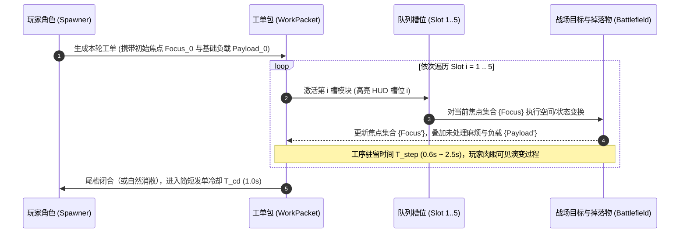

# 卷二：工单流水线架构与模块工序契约 (Pipeline Architecture & Module Contracts)

> **所属域**：`docs/design/`（参见总纲 [`_doc_design.md`](_doc_design.md)）
> **文档职责**：形式化定义“处理队列（Pipeline）”的底层运行状态机、“工单包（`WorkPacket`）”的空间焦点传递模型、六大核心模块的严格输入/输出契约，以及任意两个模块换位后的几何与结算差异矩阵。

---

## 一、 流水线底层运行模型：实体工单与焦点传递 (Pipeline Execution Model)

### 1. 为什么采用「单工单步进」而非「高频子弹附加词条」？
为了实现卷一要求的 **“5～10 秒看懂一次处理链是否成立”**，角色不进行高频散射，而是以 **单轮流水线周期（Cycle，默认 5.0～8.0 秒）** 为单位，向战场派出一枚高辨识度的 **实体工单包（`WorkPacket`）**。

### 2. 核心数据结构：`WorkPacketContext`（工单上下文）
每一个正在场上运行的工单包，本质上是一个携带以下三个核心状态的 `RefCounted` 上下文实例：

1. **当前焦点集合（`focus_nodes: Array[FocusNode]`）**：
   - 决定“下一个模块在哪里生效、对谁生效”。
   - 初始生成时，`focus_nodes` 仅包含 **1 个主焦点**（位于角色前方或最近威胁方向）。
   - 经过`[标记]`后，焦点会转移到被标记的若干敌人身上；经过`[分裂]`后，焦点会裂变为多个空间子坐标；经过`[聚拢]`后，分散的焦点会坍缩合并。
2. **挂载负载（`payload: PacketPayload`）**：
   - 包含 `base_damage`（基础伤害）、`accumulated_multiplier`（累计倍率，初值 `1.0`）、`pierce_power`（破盾等级）与 `linked_enemies`（已挂载待结算敌群列表）。
3. **当前槽位游标（`current_slot_index: int`）与阶段计时器（`step_timer: float`）**：
   - 驱动工单从 `Slot 0` 步进至 `Slot 4`。

---

## 二、 严格顺序敏感铁律的形式化证明 (Formal Order-Sensitivity Contract)

> **设计铁律 #1**：**任何模块如果换位置后结果完全不变，就不应该占据一个队列槽。**

为在数学和空间几何上保证 `Module_A ➔ Module_B ≠ Module_B ➔ Module_A`，所有进入槽位的模块必须属于以下 **三类非交换算子（Non-Commutative Operators）** 之一：

| 算子类别 | 数学本质 | 代表模块 | 为什么不可交换？ |
| :--- | :--- | :--- | :--- |
| **空间拓扑算子** *(Spatial Topology)* | 改变焦点数量 $N$、空间坐标分布 $\vec{P}$ 或矢量方向 $\vec{V}$ | `[标记]`、`[聚拢]`、`[穿透]`、`[分裂]` | **先扩增焦点再位移** vs **先位移再扩增焦点**，产生的空间覆盖几何截然不同。 |
| **时间积分算子** *(Temporal Integration)* | 将瞬时状态挂起，按驻留时间 $\Delta t$ 内卷入的目标数进行倍率积分 | `[延迟]` | 积分算子放在前面会放大后续所有分裂/穿透分支的基数，但承受前期被打断的风险；放在后面则只对末端残余焦点做局部积分。 |
| **状态坍缩/兑现算子** *(State Collapse)* | 清空当前已挂接的待办印记与地面掉落物，将其转化为瞬时伤害与资源回收 | `[回收]` | 放在队尾是“憋大招一次性清盘”；放在队中是“中途落袋为安 + 刷新后续空载流水线”。 |

---

## 三、 六大核心原型模块工序规范 (The 6 Core Prototype Modules)

以下六个模块构成第一版最小原型的完整词库，每个模块均具备严格的 **输入焦点 ➔ 工序执行 ➔ 输出焦点** 契约：

### 1. `[标记]` (Mark — 索敌扩焦算子)
* **工序耗时**：`0.5 秒`（瞬态扫描脉冲）
* **输入（Input）**：当前所有激活焦点 `focus_nodes`（数量 $M$）。
* **执行动作（Process）**：
  - 以每个输入焦点为圆心，在半径 $R_{\text{mark}} = 220\text{ px}$ 内检索最多 $K = 3$ 名未挂印记的敌人（优先锁定无正面护盾阻挡的目标）。
  - 为命中的敌人挂上 **【待办印记（Pending Tag）】**，并将其计入【未处理麻烦】积压池。
* **输出（Output）**：
  - **焦点转移**：将所有成功挂上印记的敌人实体直接作为**新的输出焦点集合**（最多 $M \times 3$ 个焦点）传递给下一槽位；若范围内无敌人，则保留原焦点坐标。
* **省掉的玩家操作**：替玩家省去手动点选目标与分散索敌的精力。

---

### 2. `[聚拢]` (Pull — 空间坍缩算子)
* **工序耗时**：`0.8 秒`（牵引收缩过程）
* **输入（Input）**：当前所有激活焦点 `focus_nodes`。
* **执行动作（Process）**：
  - 每个焦点向半径 $R_{\text{pull}} = 180\text{ px}$ 内的敌人发射可视牵引线（已被`[标记]`的敌人牵引半径翻倍至 $320\text{ px}$，且牵引力道 $+50\%$）。
  - 将受影响的敌人强制拉向各自所属焦点的中心，并造成短暂减速。
  - **护盾交互**：若路径被【护盾精英】的正面盾牌阻挡，正面牵引线会被盾牌弹开失效。
* **输出（Output）**：
  - 收缩完成后的焦点中心坐标集合（此时每个焦点周围已形成高密度怪堆）。
* **省掉的玩家操作**：替玩家省去手动绕大圈聚怪的时间，制造高密度 AoE 靶场。

---

### 3. `[穿透]` (Pierce — 矢量破障算子)
* **工序耗时**：`0.6 秒`（高速直线冲程）
* **输入（Input）**：当前所有激活焦点 `focus_nodes`。
* **执行动作（Process）**：
  - 每个焦点朝**当前玩家移动方向切线**（若玩家静止则朝最近精英/怪群中心）发射一道长 $L = 360\text{ px}$、宽 $W = 48\text{ px}$ 的高能贯穿冲程。
  - **核心特性**：**无视并击碎正面方向护盾**（使护盾精英失衡暴露出背部 2.5 秒），将当前工单负载沿直线传染给路径上洞穿的所有敌人。
* **输出（Output）**：
  - 贯穿冲程的**终点坐标**（穿过怪群/精英盾牌后的背后位置）成为传给下一槽位的新焦点！
* **省掉的玩家操作**：替玩家省去绕背破盾的繁琐微操，直接把后续工序送进敌阵腹地。

---

### 4. `[延迟]` (Delay — 时间压单算子)
* **工序耗时**：`2.5 秒`（挂起蓄力读条）
* **输入（Input）**：当前所有激活焦点 `focus_nodes`。
* **执行动作（Process）**：
  - 将所有当前焦点冻结在原地，展开半径 $R_{\text{delay}} = 150\text{ px}$ 的 **【压单气泡（Debt Bubble）】**。
  - **暂时不结算任何伤害**：在 2.5 秒挂起期内，气泡内每存在 1 名敌人或每有 1 枚地面掉落物进入，工单的 `accumulated_multiplier`（累计倍率）每秒递增 $+0.35\times$（上限 $4.0\times$），同时推高全局【未处理麻烦】数值。
  - **高风险脆弱性（打断机制）**：压单气泡具有可视倒计时环。若在读条完成前被【高速冲锋敌】或反工作流敌人撞击，气泡会**提前炸膛漏气**（倍率清零，仅造成微弱散逸伤害，且工单直接断链终止）。
* **输出（Output）**：
  - 若成功撑过 2.5 秒，输出携带**巨额倍率加成**与**高额压单层数**的原焦点集合。
* **省掉的玩家操作**：把高频刮痧转化为一次性高复利定期存款，让玩家的“走位引怪进圈”获得指数级回报。

---

### 5. `[分裂]` (Split — 拓扑裂变算子)
* **工序耗时**：`0.4 秒`（分叉弹射）
* **输入（Input）**：当前所有激活焦点 `focus_nodes`（数量 $M$）。
* **执行动作（Process）**：
  - 每个输入焦点向两侧（夹角 $60^\circ$ 或朝向周围不同敌群簇）裂变为 **$2$ 个独立子焦点**（焦点总数变为 $2M$，单工单最多裂变上限为 $8$ 个焦点）。
  - 每个子焦点**完整继承**分裂前已积累的 `accumulated_multiplier` 的 $75\%$（即总潜在收益膨胀为 $2 \times 75\% = 150\%$）。
* **输出（Output）**：
  - 空间上散开的 $2M$ 个子焦点集合，后续槽位的每一个模块都将在这些子焦点上**并行同步执行**！
* **省掉的玩家操作**：实现一传十、十传百的连锁覆盖，无需玩家逐一清理漏网之鱼。

---

### 6. `[回收]` (Collect / Cash-Out — 状态坍缩与结单算子)
* **工序耗时**：`0.5 秒`（爆裂清盘 + 磁吸归拢）
* **输入（Input）**：当前所有激活焦点 `focus_nodes` 及全局已挂载的【待办印记】。
* **执行动作（Process）**：
  1. **伤害总结算**：引爆所有当前焦点及全场带有【待办印记】的敌人，造成 $\text{BaseDamage} \times \text{AccumulatedMultiplier} \times (1 + 0.2 \times \text{印记层数})$ 的范围爆发伤害。
  2. **麻烦清空与掉落物磁吸**：将焦点周围半径 $R_{\text{collect}} = 260\text{ px}$ 内的所有地面掉落物（经验/模块碎片）沿工单连线自动打包吸回玩家身上，同时清空本次结算对应的【未处理麻烦】积压值。
  3. **偷懒红利返还**：若单次`[回收]`一次性清除了超过阈值（如 $\ge 8$ 个单位）的积压麻烦，立即返还 **25% 干预额度充能** 并缩短下一轮工单发单冷却。
* **输出（Output）**：
  - 清空后的纯净焦点（若`[回收]`不在第 5 槽，后续槽位将以无积压的初始倍率继续执行尾随动作）。
* **省掉的玩家操作**：彻底免去玩家满地图跑腿捡垃圾和逐个补刀残血怪的苦力活。

---

## 四、 核心模块换位结果对照矩阵 (Permutation Outcome Matrix)

为直观验证 **Law #1（严格顺序敏感铁律）**，以下列出原型中最典型的 5 组相邻/跨槽换位对比：

| 组合对比 | 顺序 A (`X ➔ Y`) 的战场物理表现 | 顺序 B (`Y ➔ X`) 的战场物理表现 | 战术适用场景差异 |
| :--- | :--- | :--- | :--- |
| **`[标记]` vs `[聚拢]`** | **`标记 ➔ 聚拢`**： 先点名远处 3 只分散的怪 ➔ 这 3 只怪各自成为中心，把周围小怪吸成 **3 团独立小怪堆**（多点分流控场）。 | **`聚拢 ➔ 标记`**： 先在单点把怪吸成 **1 团高密度肉球** ➔ 再对肉球中心集中挂满印记（单点极限叠层）。 | 怪群极度分散时用 `标记➔聚拢`；针对精英单点爆破时用 `聚拢➔标记`。 |
| **`[延迟]` vs `[分裂]`** | **`延迟 ➔ 分裂`**： 1 个大泡先憋 2.5 秒攒到 $3.5\times$ 倍率 ➔ 裂变成 **2 个各带 $2.6\times$ 倍率的重型核弹**（一旦蓄力期被打断则全军覆没）。 | **`分裂 ➔ 延迟`**： 起手先裂成 2 个小焦点 ➔ 各自展开 2 个独立小气泡分别蓄力（被冲锋怪撞碎 1 个，另 1 个还能正常结单）。 | 安全期贪极限爆发用 `延迟➔分裂`；高压期求稳防打断用 `分裂➔延迟`。 |
| **`[穿透]` vs `[聚拢]`** | **`穿透 ➔ 聚拢`**： 先一枪穿透护盾精英钻到其**背后** ➔ 在精英背后生成聚拢漩涡，把精英和杂兵一起往后拽（**破盾背刺流**）。 | **`聚拢 ➔ 穿透`**： 先把散怪拽到一条直线上 ➔ 再发射一道贯穿冲程把整坨怪一次性串糖葫芦（正面遇到护盾精英时聚拢会被盾挡住）。 | 第 3 波有【护盾精英】时必用 `穿透➔聚拢`；纯杂兵潮用 `聚拢➔穿透`。 |
| **`[标记]` vs `[分裂]`** | **`标记 ➔ 分裂`**： 先锁定 3 只怪 ➔ 每只怪身上裂出 2 个子焦点（共 **6 个精准追踪源**，紧咬敌群）。 | **`分裂 ➔ 标记`**： 先在空地上分叉出 2 个广角焦点 ➔ 每个焦点再去扫描远端不同方向的怪（**超宽扇面索敌**）。 | 敌群抱团时用 `标记➔分裂`；被四面八方合围时用 `分裂➔标记`。 |
| **`[回收]` 放队中 vs 放队尾** | **`... ➔ 回收(槽3) ➔ 分裂(槽4) ➔ 标记(槽5)`**： 第 3 步就早早结单收菜（防催债怪打断），随后第 4、5 步顺手给下一波怪挂好先手印记（**快进快出稳健流**）。 | **`标记 ➔ 聚拢 ➔ 延迟 ➔ 分裂 ➔ 回收(槽5)`**： 前 4 步层层滚雪球不结算，第 5 步一次性连本带利清屏吸干全场（**高风险高回报贪婪流**）。 | 面对高频干扰怪时把`[回收]`前移保底；平时放队尾追求最大复利。 |

---

## 五、 队列编辑与换槽约束规则 (Queue Editing Constraints)

为了防止玩家在战斗中通过高频换槽把游戏玩成“手速微操游戏”，队列修改遵循以下硬性边界：

1. **波次准备期（Wave Prep Phase）**：
   - 每波开始前有 **威胁预告面板**，此时玩家可 **零代价、无限次** 拖拽调整 5 个槽位中的模块顺序。
2. **战斗运行期（Combat Active Phase）**：
   - 队列槽位默认**锁定（Locked）**，按既定顺序自动循环派发工单。
   - 玩家在战斗中若想临时改变工序，**唯一途径**是使用宝贵的 **【手动干预（Manual Intervention）】**（见卷三 [`03_control_resources_and_intervention.md`](03_control_resources_and_intervention.md)）。
