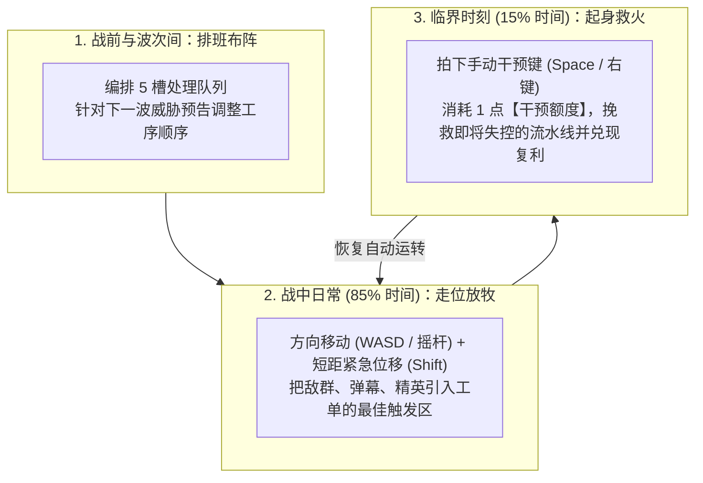
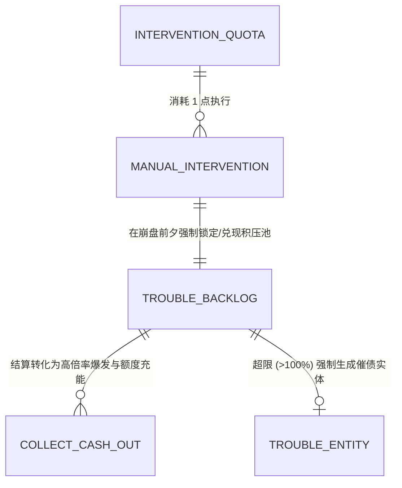
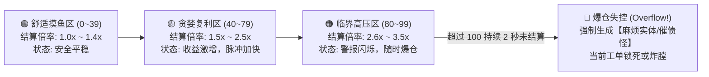

# 卷三：玩家操控、双核资源与关键干预机制 (Player Control, Core Resources & Intervention)

> **所属域**：`docs/design/`（参见总纲 [`_doc_design.md`](file:///Users/krace/Code/GodotProject/slacker-survivors/docs/design/_doc_design.md)）
> **文档职责**：明确界定玩家在战局中的操作边界（“不做什么”与“只做什么”）、通过走位制造触发条件的空间博弈，以及由 **「干预额度（`InterventionQuota`）」** 与 **「未处理麻烦（`TroubleBacklog`）」** 驱动的贪婪与救火经济系统。

---

## 一、 玩家操作边界：从「苦力射手」到「异常值班员」 (Player Control Model)

### 1. 操作减法与操作聚焦
在 `Slacker Survivors` 中，玩家**彻底免除**以下传统重复劳动：
* ❌ 不需要按住左键持续射击；
* ❌ 不需要每秒移动鼠标瞄准单个敌人；
* ❌ 不需要满地图跑腿去踩每一颗经验豆。

玩家的全部精力聚焦于以下 **三项高价值操作**：

---

### 2. 走位的本质：制造触发条件（Spatial Herding & Conditioning）
玩家的移动不是为了单纯逃命，而是为了**给自动化流水线“喂料”**：

| 战场情境 | 玩家的「放牧式走位」动作 | 触发的队列化学反应 |
| :--- | :--- | :--- |
| **队列擅长处理密集怪群** *(如 `聚拢 ➔ 延迟 ➔ 回收`)* | 故意在怪群外围慢速绕弧线（溜怪），不急着让怪分散 | 把原本零散的十几个近战怪揉成一团，刚好踩进工单展开的`[延迟]`压单气泡中心 |
| **精英怪混入杂兵堆** | 卡住距离，把高血量精英拖进正在读条的`[延迟]`爆发区 | 利用周围杂兵叠加的高额【未处理麻烦】倍率，顺带把精英一键灌死 |
| **护盾精英正面卡单** | 利用一次 **短距紧急位移（Dash）** 切过精英侧翼，吸引其转身 | 让工单在精英背后完成`[标记]`与`[聚拢]`，绕开正面护盾死角 |
| **高速冲锋敌试图撞碎`[延迟]`气泡** | 走位诱导冲锋敌的预警红线偏离气泡中心，或故意让其在气泡结算前 0.2 秒冲入圈内 | 不仅保住了气泡不断链，还把冲锋敌自己变成了压单池的最后一块肥肉 |
| **地面堆积大量掉落物** | 将下一轮工单的起始焦点引向掉落物密集区 | 当队列走到`[回收]`时，一网打尽全片区域的资源与积压印记 |

---

## 二、 双核心资源体系 (The Dual-Resource Economy)

为避免系统臃肿，当前版本砍掉蓝条、怒气、金币、弹药等杂项，**全剧仅保留两个深度咬合的核心资源**：

---

### 1. 资源一：干预额度 (`InterventionQuota`) —— “我还能起身几次？”

代表玩家在当前波次还能亲自插手干预流水线的机会次数。

* **基础数值设定**：
  - **初始/每波保底额度**：`1 点`（随局内减负升级可扩充上限至 `2 ~ 3 点`）。
  - **UI 表现**：角色头顶或屏幕底部的 **「咖啡杯 / 起身闹钟」** 图标，带有清晰的充能环（`0% ~ 100%`）。
* **消耗规则**：
  - 每次发动【手动干预】固定消耗 `1 点` 完整额度。
* **五大恢复途径（奖励“聪明偷懒”与“高风险博弈”）**：
  1. **连续自动闭环奖励（核心途径）**：当工单在**没有任何人工干预**的情况下，连续完整跑完 $N$ 轮（默认 $3$ 轮）有效闭环，自动恢复 `+35%` 充能（越不管它，它越给你攒起身机会）。
  2. **高额压单一次性清盘**：单次`[回收]`结算的【未处理麻烦】层数达到高档阈值时，额外返还 `+25% ~ +50%` 充能。
  3. **涉险采集**：主动走位踏入场上刷出的高危异常圈（或贴近精英怪擦身而过），直接吸取充能碎片。
  4. **波次间减负升级**：选择特定模块改造词条。
  5. **放弃即时收益**：在波次结算三选一时选择“跳过模块领取，换取下一波满额干预”。

---

### 2. 资源二：未处理麻烦 (`TroubleBacklog`) —— “拖延症的复利与爆仓”

这是将“懒惰”转化为“核心博弈”的灵魂机制。玩家故意拖延不处理的战场问题不会凭空消失，而是计入全局 **【未处理麻烦（压单池）】**。

#### (1) 麻烦积压的五大来源
| 积压来源 | 单次贡献麻烦值 (`Trouble Value`) | 消除方式 |
| :--- | :--- | :--- |
| **1. 已挂上`[标记]`但尚未结算的敌人** | 每名普通怪 `+3`，每名精英 `+10` | 经过`[回收]`结算或敌人死亡 |
| **2. 处于`[延迟]`气泡内挂起蓄力的伤害** | 每秒每名圈内敌人 `+5` | `[延迟]`正常走完并进入结算 |
| **3. 地面未拾取的掉落物（经验/碎片）** | 每枚掉落物每秒递增 `+1`（越久不捡越值钱） | 被`[回收]`磁吸归拢 |
| **4. 存活超过 12 秒未被击杀的精英/特殊怪** | 每秒递增 `+4`（滞纳金） | 击杀该精英 |
| **5. 队列主动旁路/跳过的异常事件** | 每次跳过 `+15` | 完成一次完整满槽`[回收]` |

#### (2) 压单复利曲线与「爆仓催债」机制
`TroubleBacklog` 拥有明确的量表区间（`0 ~ 100` 点）：

* **为什么玩家会主动选择“先不管”？（拖延红利公式）**：
  $$\text{最终结算收益} = \text{基础收益} \times \left(1 + \alpha \cdot \left(\frac{\text{TroubleBacklog}}{50}\right)^{1.4}\right)$$
  - 在安全区立刻结算，只能拿到 `1.0x` 的平庸收益；
  - 若玩家忍住不按干预，靠走位撑到压单值飙升至 `75 ~ 95` 的**临界高压区**再完成一次`[回收]`，不仅伤害倍率暴涨至 `3.0x+`，连吸回来的地面掉落物经验值也会获得成倍复利加成！
* **爆仓惩罚：麻烦实体（`TroubleEntity` / 催债者）**：
  - 一旦玩家贪过头，导致 `TroubleBacklog >= 100` 且在 `2.0 秒` 宽限期内未能完成结算，系统立即触发 **【爆仓违约】**：
    1. 场上积压的未捡掉落物与未结算印记瞬间坍缩，凝聚成一只高威胁的 **【麻烦实体（催债怪）】**；
    2. 催债怪无视普通牵引，直扑玩家或锁死当前队列的尾槽，逼迫玩家必须消耗干预或亲自走位“还清旧债”才能恢复流水线运转。

---

## 三、 关键干预系统设计 (Manual Intervention System)

### 1. 干预的设计哲学
> **“现在继续躺着，系统可能撑得住；但如果我现在动一下，可以把整条链救回来。”**

* **黄金频率检验标准**：
  - 若玩家每 5~10 秒都在按干预 ➔ **失败**（自动化系统没立住，退化成了主动技能 CD 游戏）。
  - 若玩家整局 60 秒一次都不需要按干预 ➔ **失败**（敌人和压单没有制造出真正的失控压力）。
  - **理想频率**：每 **25～35 秒**（即每次压力事件高潮期）拍下 **1 次** 决定性的干预。

### 2. 干预动作词库与第一版原型选型
随着游戏进程推进，玩家可装备不同流派的干预动作；但在 **第一版 60 秒最小原型** 中，我们锁定最直观、最具“救火与兑现”快感的 **核心干预动作**：

| 干预动作名称 | 适用阶段 | 核心机制描述 | 典型救火场景 |
| :--- | :--- | :--- | :--- |
| **★【紧急插队结算】** *(Instant Overclock Cash-Out)* **[60秒原型默认搭载]** | **Phase 1 原型必选** | 立即中断当前槽位的漫长等待，将当前焦点及其周围的【未处理麻烦】**当场强制跳跃至`[回收]`槽位进行超载引爆**（额外附带一圈震退冲击波，保护气泡与玩家）。 | `[延迟]`气泡已经攒到了 $3.2\times$ 倍率，但【高速冲锋敌】还有 0.3 秒就要撞碎气泡——此时拍下干预，赶在气泡破碎前瞬间完成满额收割并震飞冲锋敌！ |
| **【热切相邻槽位】** *(Hot-Swap Adjacent Slots)* | 进阶可选 | 战斗中立即交换当前正在执行的槽位与下一槽位的位置，并瞬间重置当前槽脉冲。 | 护盾精英突然挡在`[聚拢]`面前，临时将后一槽的`[穿透]`热切提上来，一枪破盾。 |
| **【临时旁路】** *(Bypass Module)* | 进阶可选 | 本轮工单直接跳过当前卡壳或被敌人克制的槽位，并将跳过的耗时转化为下一槽位的范围加成。 | 场上出现【反延迟怪】，一键旁路掉`[延迟]`槽，防止整条链卡死。 |
| **【强行甩锅转向】** *(Force Redirect)* | 进阶可选 | 将场上正在运行的工单核心（连同所有已挂载的延迟炸弹与印记）强行牵引弹射至玩家当前移动方向上的头号威胁目标身上。 | 把在杂兵堆里养肥的满载工单，一把扣到刚刷出来的精英头顶。 |
