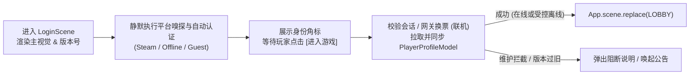

# 03 · 登录页 (Login / Title Screen)

> **模块定位**：游戏主视觉标题页（Title Screen）、跨平台身份认证（[`App.auth`](../../src/framework/modules/auth/_doc_auth.md)）、停服维护拦截、玩家全局档案恢复（[`PlayerProfileService`](../../src/game/shared/service/profile/player_profile_service.gd)）与进入大厅前的唯一守卫门户。

---

## 一、 核心功能清单

1. **主视觉与快捷工具栏**：
   - 展示游戏动态主视觉背景、标题 Logo、客户端版本号（`vX.Y.Z` + 环境标识）与底部版权信息。
   - 右上角常驻快捷工具按钮：**公告 (`05_notice`)**、**设置 (`08_settings`)**、**退出游戏**（玩家无需进大厅即可调整分辨率/音量或查阅维护公告）。
2. **两阶段正交身份认证 (`App.auth`)**：
   - 自动探测宿主平台凭据并签发 `AuthSession`，右上角/左下角实时显示当前身份角标（如 `Steam: <昵称>` / `离线模式` / `Guest`）。
3. **全局玩家档案与云存档挂载 (`PlayerProfileService`)**：
   - 认证通过后调用 `PlayerProfileService.load_or_create_async()`，完成 `L1 内存 ➔ L2 本地 .tmp/.bak ➔ L3 Steam Cloud / HTTP 云端` 档案恢复、会话绑定与登录计数落盘。
   - **高版本存档防坏档拦截**：若捕获 `StorageError.VERSION_TOO_NEW`（如玩家在另一台设备用新版客户端存过档），立即弹窗提示更新客户端并阻断进入，严禁覆盖原存档。
4. **进厅触发交互**：
   - 单机/直连态下呈现经典的 **「点击任意处 / 按任意键进入游戏」**（或「开始游戏」主按钮），校验通过后切入 `04_lobby`。

---

## 二、 Steam 单机 vs 联机双模策略

| 环节 | Steam 单机买断 / 离线优先模式 | Steam 联机 / 自建后端网关模式 |
| :--- | :--- | :--- |
| **自动取证与签发** | 进场静默调用 `App.auth.login_auto_async()`： • Steam 在线：采集 `SteamID64` + `LocalPassthroughVerifier` 0ms 签发 • Steam 离线 / Deck 断网：保底签发真实 `SteamID64` (`is_offline=true`) • 无 Steam 环境：自动降级本机指纹 `Guest` | 启用 `RemoteGatewayVerifier`： • 采集 Steam WebAPI Ticket 请求 `POST /v1/auth/exchange` 换取 JWT • 自动注入 `App.net` Bearer Token 并调用 `App.clock.sync()` 校准权威时间 |
| **服务器维护与断网** | 无远端依赖，100% 直通 | • 若后端返回停服维护码：弹窗展示预计开服时间并拉起 `05_notice` • 若网络超时且 `allow_offline_fallback=true`：`Toast` 提示“当前处于离线模式”，允许单机进厅；纯网游强联机模式则停留本页重试 |
| **账号切换与转正** | 跟随当前登录的 Steam 客户端账号，界面零多余账号框 | 支持切换登录渠道（Steam / 自建 OAuth）及调用 `App.auth.link_provider_async()` 将前期游客进度无损过户绑定至正式平台账号 |

---

## 三、 状态流转时序

---

## 四、 工程架构与契约映射 (`MSVP`)

- **目录落点**：`src/game/features/login/`
  - `model/`：
    - `LoginState` (`RefCounted`)：维护认证状态（`IDLE / AUTHENTICATING / READY / SYNCING_PROFILE / BLOCKED`）、当前展示昵称与离线标记。
    - `LoginReq` / `LoginResp` (`BaseParams`)：可选自建业务服扩展登录信息契约（基础换票已由 `App.auth` 内置消化）。
  - `service/`：`LoginService`（编排 `App.auth` 登录选项、`PlayerProfileService` 档案装载、版本与维护门禁检查，广播 `EVENT_LOGIN_SUCCEEDED`）。
  - `presenter/`：`LoginPresenter`（响应「进入游戏」、切换账号、打开 `NoticeDialog` / `SettingsDialog` 请求，驱动路由跳转 `GameScenes.Scene.LOBBY`）。
  - `view/`：`scene/login/`（`LoginScene` + `LoginView`）与 `component/account/`（身份状态角标 / 渠道选择弹窗）。
