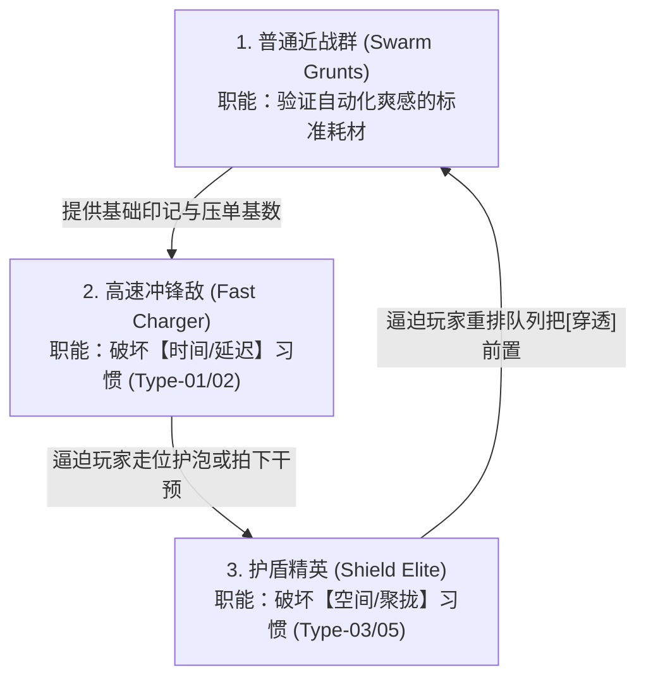
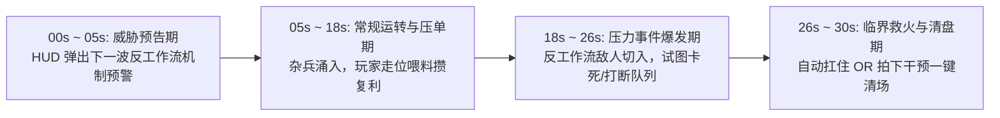

# 卷四：反工作流敌人生态与波次压力系统 (Anti-Workflow Enemies & Pressure Events)

> **所属域**：`docs/design/`（参见总纲 [`_doc_design.md`](file:///Users/krace/Code/GodotProject/slacker-survivors/docs/design/_doc_design.md)）
> **文档职责**：确立“敌人专门破坏自动化工作流而非单纯堆砌数值”的生态准则，定义八大反工作流敌人原型、第一版最小原型的三种核心敌群状态机，以及每 30 秒一次的可预测压力事件（`PressureEvent`）调度机制。

---

## 一、 核心设计哲学：破坏「工作流」，拒绝「数值膨胀」 (Anti-Workflow Philosophy)

在传统 Survivors 游戏中，后期难度往往沦为“怪的血量乘 10 倍、移速乘 2 倍”，玩家死亡时只觉得“我攻击力不够高”。

在 `Slacker Survivors` 中，每一种敌人的核心职责都是 **专门卡住、干扰或利用玩家流水线中的某一个特定环节**：

> **理想挫败感（驱动下一局实验欲）**：
> *“我死不是因为数值不够，而是我这套贪延迟的流水线没考虑【催债者】的提前引爆——下一把我要把`[穿透]`和`[回收]`往前挪一格！”*

---

## 二、 八大反工作流敌人原型谱系 (The 8 Workflow-Disruptor Archetypes)

全项目敌人按其针对的流水线弱点，严格划分为以下八大职能原型：

| 原型代号 | 敌人类型 | 针对的玩家习惯 | 核心破坏机制（How It Breaks the Machine） | 玩家的破局解法（队列重构 / 走位 / 干预） |
| :--- | :--- | :--- | :--- | :--- |
| **Type-01** | **打断者** *(Interrupter)* | 依赖长读条或固定槽位循环 | 发射脉冲或冲撞工单焦点，使当前正在运行的模块槽位**暂时冻结/短路 3 秒**，或直接撞碎`[延迟]`气泡。 | 用走位挡住冲撞路线；或将高风险长读条模块后置；或在撞击前拍下干预结单。 |
| **Type-02** | **催债者** *(Debt Enforcer)* | 依赖高额`[延迟]`与压单复利 | 受战场上【未处理麻烦】吸引，一旦靠近`[延迟]`气泡或高印记怪群，会强制令延迟效果**提前失控反噬**（炸伤玩家而非怪物）。 | 见好就收，把`[回收]`槽位前移降低单次积压时长；或用`[穿透]`优先远程点杀催债者。 |
| **Type-03** | **抢活者** *(Target Hijacker)* | 依赖`[标记]`与单点连锁 | 自身带有高优先级“嘲讽磁场”，强行把周围本应挂给脆皮怪群的`[标记]`和`[聚拢]`全部吸到自己厚重的装甲上，导致工单空转。 | 将`[分裂]`放在`[标记]`之前扩大覆盖基数；或用走位把抢活者引离主怪群。 |
| **Type-04** | **清洁者** *(Floor Sweeper)* | 依赖地面囤积掉落物刷复利 | 不主动攻击玩家，专门在战场上游走**吞噬玩家故意留在地面还没`[回收]`的掉落物与能量球**，每吃一个自身护甲翻倍。 | 调整走位让工单优先经过掉落物密集区；或通过干预提前触发磁吸清场。 |
| **Type-05** | **反规则敌** *(Rule Breaker)* | 依赖无脑`[聚拢]`或条件模块 | 拥有“逆向力场”：受到`[聚拢]`牵引时不仅不被吸过去，反而会**逆向加速扑向玩家**；或令特定条件触发规则暂时失效。 | 波次前换下`[聚拢]`改用`[穿透]`+`[分裂]`，或在战斗中用干预临时旁路掉`[聚拢]`槽。 |
| **Type-06** | **追身敌** *(Couch-Buster)* | 依赖站桩或固定小圈溜怪 | 锁定玩家脚底生成延迟塌陷区或持续贴身紧逼，**强迫玩家离开舒适的放牧走位轨道**，导致怪群阵型散乱。 | 利用短距紧急位移（Dash）在最后关头拉开身位，反手把追身敌引回工单焦点中心。 |
| **Type-07** | **模仿者** *(Pipeline Mimic)* | 依赖单一极致模块（如全堆分裂） | 读取玩家当前队列中**耗时最长或权重最高的一个模块**并复制其效果（如玩家用`[聚拢]`，模仿者也会把周围小怪聚拢成护卫墙并向玩家发射）。 | 保持队列模块功能均衡，避免单一模块过载；在其模仿读条期用干预打断。 |
| **Type-08** | **无聊敌** *(Boring Unit)* | 依赖超复杂花哨连锁 | “绝缘体质”：免疫`[标记]`传染、`[聚拢]`拉扯与`[延迟]`倍率加成，只受最基础的首次碰撞伤害，**逼迫玩家偶尔亲自处理或用最朴素的直接冲程解决**。 | 利用走位让工单的初始生成点或`[穿透]`本体直接撞击它，或留一次干预直接拍死。 |

---

## 三、 第一版 60 秒原型的三种核心敌群规范 (MVP 3 Enemy Specs)

在第一阶段（[`06_mvp_60s_prototype_spec.md`](file:///Users/krace/Code/GodotProject/slacker-survivors/docs/design/06_mvp_60s_prototype_spec.md)）中，我们精选以下 **3 种机制互补的敌人**，构成完整的“建立习惯 ➔ 打破时间习惯 ➔ 打破空间习惯”验证闭环：

### 1. 普通近战群 (`SwarmGrunt` —— 工单耗材与复利燃料)
* **移动特征**：恒定中低移速（$90\text{ px/s}$），朝玩家当前坐标平滑追逐，极易被玩家的环形走位聚拢成团。
* **与六大模块的交互**：
  - 全额受`[标记]`、`[聚拢]`、`[穿透]`、`[延迟]`、`[分裂]`、`[回收]`影响；
  - 死亡后在原地留下【工作成果掉落物】，若玩家暂不回收，掉落物会在地面持续提供【未处理麻烦】复利加成。
* **设计目的**：让玩家在没有干扰时，体验到“我排好队列散散步，几十只怪像割麦子一样被自动打包结算”的基准爽感。

### 2. 高速冲锋敌 (`FastCharger` —— 延迟气泡粉碎机)
* **移动与索敌特征**：
  - 平时以中速（$130\text{ px/s}$）游弋；
  - **核心反工作流 AI**：一旦战场上出现正在读条的 **`[延迟]`压单气泡**（若无气泡则锁定玩家），它会原地蓄力 `0.9 秒`（地面拉出醒目的**红色贯穿预警线**），随后以极高速度（$480\text{ px/s}$）沿直线发起猛烈冲撞！
* **破坏后果**：
  - 若冲锋撞中正在读条的`[延迟]`气泡，气泡当场**炸膛碎裂**——本轮工单积攒的所有倍率归零、后续槽位直接断链跳过！
* **玩家的三种应对博弈**：
  1. **走位诱导**：在它蓄力锁定的瞬间，利用玩家走位或吸引角度，让它在气泡刚好完成 2.5 秒读条后的第 2.6 秒冲进引爆区（从“破坏者”变成“送上门的祭品”）；
  2. **起身救火（关键干预）**：眼看冲锋敌还有 0.2 秒就要撞碎攒满 $3.0\times$ 倍率的气泡，立刻拍下 **【紧急插队结算】**，赶在撞击前把气泡引爆并震晕冲锋敌；
  3. **队列重构**：如果下一波全是冲锋敌，波次前干脆把`[延迟]`换下，或把`[回收]`提到前排打快攻。

### 3. 护盾精英 (`ShieldElite` —— 流水线卡单王)
* **移动与防御特征**：
  - 体型较大、移速较慢（$65\text{ px/s}$），正面撑开一面宽达 $120^\circ$ 的 **【单向防暴能量盾】**，缓慢推进并为身后的普通近战群提供掩护。
* **核心反工作流机制（卡单）**：
  - **正面免疫与阻挡**：来自正面的`[标记]`扫描与`[聚拢]`牵引线撞上护盾会被**完全吸收/弹开**（且会遮挡盾牌后方扇形区域内的所有小怪！）；
  - 如果玩家的队列是无脑的 `标记 ➔ 聚拢 ➔ 延迟`，工单撞在盾牌上会像卡纸的打印机一样原地空转，完全无法处理盾后的怪群。
* **玩家的三种应对博弈**：
  1. **队列重构（最优解）**：在看到第 3 波“护盾精英”威胁预告时，把 **`[穿透]`** 模块调整到 `[标记]` 和 `[聚拢]` 之前（如 `穿透 ➔ 标记 ➔ 聚拢 ➔ 延迟 ➔ 回收`）——工单第一拍直接一枪击穿正面护盾并把焦点送到精英背后，第二、三拍从精英背后完成标记和倒吸聚怪！
  2. **走位卖破绽**：利用短距紧急位移（Dash）绕到精英身后勾引其缓慢转身，趁其背部朝向工单焦点时完成背刺连锁；
  3. **借力炸盾**：利用周围近战群攒出高额`[延迟]`压单后，通过走位或干预在精英侧面引爆范围结算。

---

## 四、 30 秒可预测压力事件与「针对性反制刷怪」 (30s Pressure Events & Adaptive Director)

### 1. 30 秒压力事件循环 (`PressureEvent` Timeline)
每局战斗以 **30 秒** 为一个标准压力节拍（60 秒原型则压缩为每 **20 秒** 一波）：

### 2. 中期「专门破坏习惯」的动态导演规则 (Adaptive Habit-Breaking Rules)
在完整 10~15 分钟对局的中期（3~10 分钟），刷怪导演系统（`WaveDirectorEngine`）会统计玩家过去 60 秒的队列依赖度，并按以下规则自动抽取下一波的 **针对性压力事件**：

| 系统检测到的玩家当前依赖习惯 | 下一波自动插入的针对性压力事件 | 逼迫玩家做出的微调决策 |
| :--- | :--- | :--- |
| **`[聚拢]` 收益占比 $> 50\%$** | 刷出 **【霸体远程敌群 + 反规则敌】**（聚拢无效或逆向扑脸） | 将`[分裂]`或`[穿透]`前置，改用广域覆盖替代单点吸怪 |
| **`[延迟]` 平均挂起时长 $> 2.0\text{s}$** | 刷出 **【高速冲锋敌 + 催债者】**（专门狙击气泡并提前引爆印记） | 将`[回收]`槽位前移缩短账期，或预留干预额度专门护泡 |
| **`[穿透]` 直线伤害占比过高** | 刷出 **【受击分裂怪】**（被穿透后一分为二从两侧包抄） | 在`[穿透]`后紧跟`[聚拢]`或`[延迟]`，把分裂出来的子怪当场按住 |
| **地面掉落物平均滞留 $> 10\text{s}$** | 刷出 **【清洁者小队】**（进场直奔地面掉落物偷吃） | 调整走位路线优先经过掉落区，或装入双`[回收]`加速周转 |
| **依赖单点超高爆发秒杀** | 刷出 **【多核心同步首领（Multi-Core Boss）】**（需同时击破 3 个分立核心，否则 3 秒后互相复活） | 启用 `标记 ➔ 分裂 ➔ 延迟` 的多焦点同步引爆结构 |
