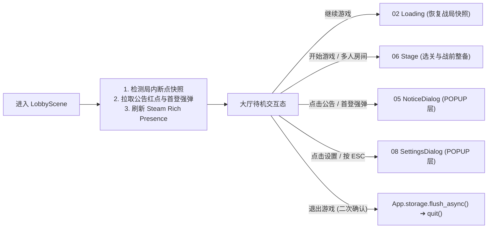

# 04 · 游戏大厅 (Lobby / Main Hub)

> **模块定位**：局外核心导航枢纽（Hub），聚合**单机/联机开局分流、未完结战局断点续玩、玩家档案状态展示、外围养成扩展槽位与系统功能入口**。

---

## 一、 核心界面与功能分区

| 区域 | 包含功能项 | 交互与业务规则 |
| :--- | :--- | :--- |
| **1. 核心行动区** *(主导航列表)* | • **继续游戏** *(动态显隐)* • **单人游戏 / 开始出击** • **多人联机** *(联机模式启用)* • **局外成长 / 图鉴** *(玩法扩展槽)* • **退出至桌面** | • **继续游戏**：仅当检测到有效局内快照（`RunSnapshotModel`）或未结束联机会话时高亮置顶显示；点击新开局时若存在旧快照需二次确认覆盖。 • **单人/多人出击**：携带模式标记跳转 `06_stage` 关卡与战前整备。 • **安全退出**：调用 `App.storage.flush_async()` 确保本地与云端存档落盘完毕后再退出进程。 |
| **2. 玩家档案栏** *(左上/顶部)* | • 平台头像与昵称 • 在线 / 离线模式状态指示灯 • 全局核心货币 / 账号等级摘要 | 监听 `PlayerProfileService.EVENT_PROFILE_UPDATED` 与 `App.auth` 状态实时刷新；离线态下悬停提示“离线模式：重连后将自动同步 Steam Cloud”，支持手动点击尝试重连网关。 |
| **3. 系统工具栏** *(右上常驻)* | • **公告 (`05_notice`)** + 未读红点 • **设置 (`08_settings`)** • **Steam 成就 / 社区快捷入口** | • 首次从登录页进入大厅时，触发一次公告强弹检查（若有未读重大更新或维护预告则自动弹出 `NoticeDialog`）。 |
| **4. 舞台背景区** | • 动态主背景 / 当前选中角色待机展示 | 支持响应手柄/键鼠焦点切换与大厅专属 BGM 平滑淡入（`App.audio`）。 |

---

## 二、 Steam 单机 vs 联机双模策略

1. **Steam 生态原生协同**：
   - **Rich Presence（动态状态）**：进入大厅自动更新 Steam 好友列表状态（如 `"在大厅整备中"`）。
   - **Overlay 与邀请唤醒**：联机模式下监听 Steam `GameLobbyJoinRequested` 回调；当玩家从 Steam 好友聊天点击“加入游戏”时，大厅自动校验版本与房间可用性，直接拉起联机整备流。
2. **断点续玩双轨机制**：
   - **单机断点**：检查 `user://saves/gameplay/run_snapshot.sav` 是否存在且 Schema 兼容，点击「继续游戏」直接构造恢复型 `GameplayEnterParams` 经 `02_loading` 还原战局。
   - **联机重连**：进入大厅时若远端网关/Steam Lobby 报告当前账号仍在活跃对局中，弹出「检测到未结束的联机对局，是否立即重连？」确认框。

---

## 三、 交互与路由流转图

---

## 四、 工程架构与契约映射 (`MSVP`)

- **目录落点**：`src/game/features/lobby/`
  - `model/`：
    - `LobbyEnterParams` (`BaseParams`)：支持携带从战局退回时的提示信息或外部邀请房间 ID（`invite_lobby_id`）。
    - `LobbyState` (`RefCounted`)：维护 `has_resumable_run`、`unread_notice_count`、`is_online` 等视图绑定状态。
  - `service/`：`LobbyService`（聚合玩家档案读取、快照探测、离线重连尝试、安全退游落盘编排）。
  - `presenter/`：`LobbyPresenter`（绑定主菜单路由信号、监听 `Bus` 红点/档案变更事件、调度 `DialogManager` 打开公告/设置/退出确认框）。
  - `view/`：`scene/lobby/`（`LobbyScene` + `LobbyView`）与 `component/profile_bar/`、`component/nav_menu/`。
