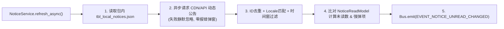

# 05 · 公告系统 (Notice)

> **模块定位**：全局模态公告弹窗（继承 [`BaseDialog`](../../src/game/shared/component/dialog/base_dialog.gd)，挂载于 `POPUP` 层），统一承载**版本更新日志（Patch Notes）、运营活动预告与停服/异常紧急通知**，可在 `03_login` 与 `04_lobby` 随时唤起。

---

## 一、 核心功能清单

1. **本地保底 + 远端动态双源合并**：
   - **包内保底源（Offline-First）**：读取只读静态表 `src/resources/tables/tbl_local_notices.json`（随每次 Steam 版本发版写入更新日志，确保 100% 离线可读）。
   - **远端动态源（Online-Ready）**：通过 `App.net.get_request()` 拉取 CDN 静态 JSON 或网关 `/v1/notices`（绑定 `task_scope.get_token()` 关窗即取消）。
   - **合并与过滤规则**：按唯一 `notice_id` 去重（同 ID 远端覆盖本地） ➔ 按当前语种 `App.locale` 选取标题与正文（缺失回退默认语言） ➔ 按 `App.clock` 过滤生效/过期时间窗 ➔ 按 `pinned`（置顶）与 `priority` 降序排列。
2. **分类页签与富文本排版**：
   - 左侧标题列表（分「系统通知 / 版本更新 / 活动预告」页签，带 `NEW` 未读角标与置顶标签）+ 右侧正文详情区（支持 BBCode 富文本、配图异步缓存加载与外部超链接）。
   - 点击外部链接优先尝试唤起 **Steam Overlay 内置浏览器**（`activateGameOverlayToWebPage`），不可用时回退 `OS.shell_open()`。
3. **未读红点与首登自动强弹**：
   - 选中某条公告即标记已读，全部已读后消除大厅入口红点并广播 `EVENT_NOTICE_UNREAD_CHANGED`。
   - **强弹策略**：携带 `force_popup = true` 的未读紧急公告，或客户端 `version` 升级后的首条更新日志，在进入大厅时自动弹出一次（同会话/已读后不再重复打扰）。

---

## 二、 数据拉取与展现时序

---

## 三、 工程架构与契约映射 (`MSVP`)

- **目录落点**：`src/game/features/notice/`
  - `model/`：
    - `NoticeEntryData` (`BaseParams`)：单条公告结构（`notice_id`、`category`、`title_i18n`、`content_i18n`、`banner_url`、`external_url`、`pinned`、`force_popup`、`start_at_ms`、`end_at_ms`）。
    - `NoticeReadModel` (`BaseParams`)：本地已读状态存盘根，通过 `StorageItem.for_config(&"notice", "notice_read", 1)` 落盘至 `user://config/notice/notice_read.json`（`LOCAL_ONLY`，无需上云）。
    - `NoticeDialogParams` (`BaseParams`)：弹窗打开参数（支持指定默认选中的 `notice_id` 或分类）。
  - `service/`：`NoticeService`（双源拉取合并、`BudgetCache` 内存短效缓存、已读状态更新与红点计数计算）。
  - `presenter/`：`NoticePresenter`（驱动列表切换、正文渲染、外链跳转与关闭落盘）。
  - `view/`：`component/notice_dialog/`（`NoticeDialog extends BaseDialog` + 列表项 `NoticeTabItem`）。
