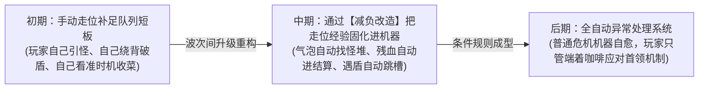
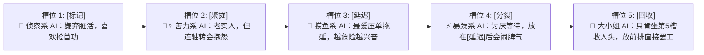

# 卷五：局内机器演进、减负改造与 AI 角色接入规范 (Machine Evolution & AI Galgame Hooks)

> **所属域**：`docs/design/`（参见总纲 [`_doc_design.md`](_doc_design.md)）
> **文档职责**：定义每波结束后的“机器重构与减负升级”体系（拒绝纯数值膨胀，专注减少未来重复劳动），并确立第二阶段（Phase 2）将 **AI Galgame 角色作为「有性格的拟人模块」** 无损接入处理队列的架构协议。

---

## 一、 局内成长核心哲学：用「减负改造」替代「数值膨胀」 (Progression Philosophy)

在传统肉鸽/幸存者游戏中，升级往往是枯燥的 `+10% 攻击力` 或 `+5% 暴击率`，玩家在局内第 1 分钟和第 12 分钟做的事情没有任何区别。

在 `Slacker Survivors` 中，每波（约 2 分钟尺度）结束后的升级奖励遵循唯一核心准则：

> **升级的目标不是让玩家做更多事，也不是单纯把数字变大，而是“让未来越来越多的重复劳动与异常状况不再需要玩家亲自操心”。**

---

## 二、 波次结算四大改造维度 (The 4 Upgrade Pillars)

每波战斗结束后，玩家从 3 项随机改造方案中选择 1 项。所有改造词条严格归入以下四个维度，**严禁出现纯白板属性加成**：

### 1. 维度 A：模块自动化减负改造 (Labor-Saving Mutators)
直接消除玩家原本需要靠频繁走位才能完成的“喂料劳动”：

| 改造名称 | 绑定模块 | 改造前（需玩家手动操心） | 改造后（机器自动代劳） |
| :--- | :--- | :--- | :--- |
| **【寻热闹气泡】** | `[延迟]` | 气泡固定在原地，需要玩家自己绕圈把怪推进气泡里 | `[延迟]`气泡在 2.5 秒挂起期内，会**自动向周围敌人密度最高的方向缓慢漂移** |
| **【顺手牵羊】** | `[回收]` | 只能回收焦点周围 $260\text{ px}$ 内的地面掉落物 | `[回收]`触发时，全图所有存在超过 8 秒的陈年掉落物**自动沿磁力线飞回角色身边** |
| **【回弹复标】** | `[标记]` | 敌人结算未死被击退后，需要等下一轮工单重新标记 | 任何带有印记的敌人被击退或震飞落地后，**自动向周围最近 2 名未标记敌人传染印记** |
| **【斩杀绿色通道】** | 全局队列 | 残血小怪也要老老实实走完前 4 槽才能在`[回收]`里死掉 | 生命值低于 $25\%$ 的敌人触碰任何工单焦点时，**直接跳过中间模块当场触发微型结算** |
| **【破盾顺风车】** | `[穿透]` | 需要玩家调整移动切线方向来对准护盾精英 | 当场上有【护盾精英】时，`[穿透]`冲程**自动修正偏转角，优先瞄准护盾正面中心贯穿** |

---

### 2. 维度 B：条件路由与异常自愈规则 (Conditional Routing Rules)
赋予队列简单的 `IF - THEN` 自治判断能力，让机器在中期面对“反工作流敌人”时学会自己变通：

* **【遇障自动旁路】**：当目标区域存在【反规则敌】或正面护盾阻挡时，队列**自动跳过无效的`[聚拢]`槽位**，并将省下的耗时转化为下一槽位 $+40\%$ 范围。
* **【防爆安全阀】**：当全局【未处理麻烦】达到 `90/100` 濒临爆仓时，正在运行的工单**自动插队提前触发一次小型`[回收]`**（避免生成催债怪，但只享受 $70\%$ 复利）。
* **【遇强则分】**：当`[标记]`锁定的目标中包含精英或首领时，紧随其后的槽位**自动额外触发一次免费的`[分裂]`**。

---

### 3. 维度 C：高风险偷懒模块扩充 (High-Risk / High-Reward Modules)
随波次解锁的新模块，提供更夸张的自动化收益，但伴随更需要动脑编排的副作用：

| 进阶模块名称 | 工序效果描述 | 顺序敏感性与风险点 |
| :--- | :--- | :--- |
| **`[借力]` (Borrow)** | 吸收焦点周围的**敌方弹幕或冲锋动能**，将其转化为工单自身的负载倍率与额外飞弹 | 必须放在敵人密集开火的时间窗口（如`[延迟]`之后）；若放在空旷无弹幕的起手槽则完全空转。 |
| **`[传染]` (Contagion)** | 将当前焦点上的所有状态与负载复制到相距最近的另一簇未处理怪群上 | 放在`[聚拢]`前会传染给全屏散怪；放在`[聚拢]`后只能在紧抱的一团怪内部内卷。 |
| **`[超载]` (Overclock)** | 使紧邻的**下一个槽位**效果翻倍（$200\%$），但立刻向全局注入 `+25` 点【未处理麻烦】 | 放在第 5 槽毫无意义（后面没有槽位）；放在`[延迟]`前会让收益与爆仓风险双双翻倍。 |

---

### 4. 维度 D：双核资源与救火杠杆改造 (Quota & Backlog Upgrades)
* **【高额信贷额度】**：将【未处理麻烦】的爆仓上限从 `100` 提升至 `150`，解锁更高阶的 `5.0x` 极限贪婪复利区间。
* **【以债养债】**：即使爆仓生成了【麻烦实体（催债怪）】，只要在 8 秒内将其击杀，会直接掉落 **1 点满额【干预额度】** 与双倍经验包。
* **【一石二鸟干预】**：拍下手动干预时，除了触发【紧急插队结算】，还会将场上所有敌人短暂定身 `1.2 秒`。

---

## 三、 Phase 2 远期架构预留：AI Galgame「拟人模块」接入协议 (Sentient AI Module Protocol)

> **阶段声明**：本节定义的 AI Galgame 机制在 **Phase 1（60 秒最小原型）中严禁实装**，但其底层接口已在流水线架构（`PipelineModule`）中完成解耦预留。一旦 Phase 1 验证通过，无需推翻任何战斗代码即可直接挂载。

### 1. 为什么 AI 角色不是“场外看板娘”，而是“队列槽位里的打工人”？
在许多融合品类游戏中，恋爱/剧情系统与战斗系统是两张皮（打完一局出去看一段视觉小说对话）。
在 `Slacker Survivors` 中，我们采用 **「角色即模块（Character-as-a-Module）」** 的深度融合架构：

* 你招募的每一位 AI 角色，在战斗中就是**坐镇在队列某一个槽位上的「处理模块」**！
* 你排定的 5 槽队列（如 `标记 ➔ 聚拢 ➔ 延迟 ➔ 分裂 ➔ 回收`），在 Phase 2 中实际上是 **5 位性格各异的 AI 部下按顺序交接班处理一张工单**。

---

### 2. AI 角色模块的四大核心行为映射

當底层纯玩法验证成立后，AI 角色将通过以下四个维度直接作用于队列运转：

| AI 拟人特性 | 战场与队列机制表现 | 玩家的管理与交互乐趣 |
| :--- | :--- | :--- |
| **1. 会抱怨的模块** *(Dynamic Barks & Mood)* | 当工单流经该角色所在的槽位时，角色会根据当前战场压力冒出实时气泡吐槽： • 把她放在`[延迟]`后面天天接盘高压烂摊子 ➔ 抱怨“为什么每次都是我替前排擦屁股！” • 连续空转没怪可打 ➔ 吐槽排班不合理。 | 极具生命力的流水线反馈：不仅能看懂队列哪一步出了问题，还能从角色的抱怨声中直接听出“哪个槽位负荷过重”。 |
| **2. 会临时拒绝工作的模块** *(Strike & Slacking)* | 每个角色模块拥有 **【摸鱼/压力值】**。若违反她的性格偏好（例如把“只肯收尾刀的大小姐”硬塞进第 1 槽探路，或连续 5 轮被冲锋怪打断），该槽位会亮起 **「带薪休假/罢工中」** 标志，工单经过时直接被她踢给下一槽！ | 逼迫玩家在“理论最优数学顺序”与“员工情绪管理”之间做权衡；或者用一次 **【手动干预（训话/塞零食）】** 哄她当场恢复超载工作。 |
| **3. 需要谈条件才能稳定运行的模块** *(Wave-End Negotiation)* | 波次间隙不再只是冷冰冰的三选一卡片，而是 **与 AI 模块谈排班条件**： • 角色提出：*“下一波只要把我放在第 5 槽收尾，我额外送你 +50% 回收范围；敢把我往前放，我效率减半。”* | 将“波次前根据威胁重排队列”包装成了趣味十足的“车间排班谈判”。 |
| **4. 会与其他模块产生关系的模块** *(Adjacency Chemistry)* | 队列中的**相邻槽位（前辈/后辈关系）**会触发人际化学反应： • **默契搭档相邻**（`Slot 2 ➔ Slot 3`）：交接工单时零延迟，额外附赠合击脉冲； • **死对头相邻**：前一个槽位故意把怪推歪，或后一个槽位拒绝接收前者的印记！ | 完美契合 **Law #1（严格顺序敏感铁律）**——换位置不仅改变物理工序，还改变了两个人谁当谁的上下游！ |
