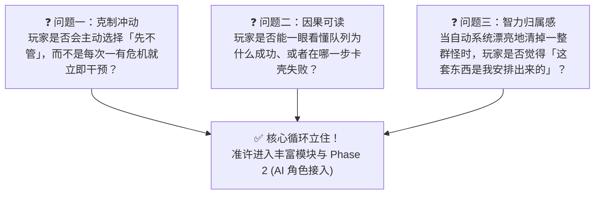
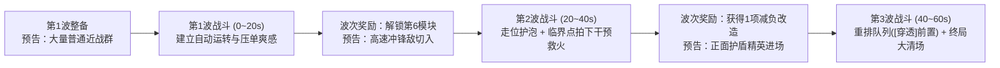

# 卷六：第一阶段 60 秒最小战斗原型规格书 (MVP 60s Prototype Specification)

> **所属域**：`docs/design/`（参见总纲 [`_doc_design.md`](file:///Users/krace/Code/GodotProject/slacker-survivors/docs/design/_doc_design.md)）
> **文档职责**：提供可直接交付程序编码的 **第一版 60 秒无 AI、无剧情最小战斗原型（Vertical Slice）** 完整落地规格书，包含精确数值表、三波次剧本、视觉可读性规范、Godot 4.7 目录映射与三大核心验证门禁。

---

## 一、 原型边界与验证目标 (Prototype Scope & Validation Goals)

### 1. 严格内容锁定（多一事不如少一事）
第一版原型是一个 **纯粹的 60 秒（3 波 × 20 秒）战斗试验场**，严格锁定以下资产范围：

| 模块维度 | 锁定内容 | 严禁混入内容 |
| :--- | :--- | :--- |
| **玩家能力** | • 基础八向移动（`WASD`）<br>• 1 条自动运行的处理队列<br>• 每波 **1 次**手动干预（`Space` / `鼠标右键`）<br>• 1 个短距离紧急位移（`Shift`） | 严禁加入普攻射击键、手动瞄准准星、大招槽、血瓶商店 |
| **队列与模块** | • **5 个**固定顺序槽位<br>• **6 种**可选模块：`[标记]`、`[聚拢]`、`[穿透]`、`[延迟]`、`[分裂]`、`[回收]` | 严禁加入纯数值被动卡（如攻击+10%）、多条并行武器队列 |
| **敌人类型** | • **3 种**：`普通近战群`、`高速冲锋敌`、`护盾精英` | 严禁加入复杂弹幕怪、随机词缀怪 |
| **外围系统** | • 极简波次前队列编排面板 + 威胁预告横幅 | 严禁加入 AI Galgame 对话、好感度、局外天赋树、装备合成 |

---

### 2. 原型唯一使命：验证「灵魂三问」
本原型不追求美术包装与数值长线平衡，只用于回答以下三个生死攸关的设计问题：



---

## 二、 核心实体精确数值设定表 (Exact Prototype Parameters)

### 1. 玩家与场地基础参数
| 参数项 | 字段标识 | 原型基准值 | 设计说明 |
| :--- | :--- | :--- | :--- |
| **竞技场尺寸** | `ARENA_SIZE` | `1600 × 1000 px` | 单屏或微幅平滑跟随视野，确保玩家能看清全场工单流转 |
| **玩家基础移速** | `move_speed` | `210 px/s` | 比普通近战怪（`90 px/s`）快，方便绕弧线放牧引怪 |
| **玩家生命值** | `max_hp` | `5 点`（受击扣 1 点，无敌帧 `0.8s`） | 颗粒度清晰的格数血条 |
| **短距紧急位移** | `dash_distance` / `dash_cd` | 位移 `180 px`（耗时 `0.15s`），冷却 `3.5s` | 用于躲避高速冲锋敌或绕到护盾精英背后 |
| **每波干预额度** | `intervention_quota` | 每波初始重置为 `1 点`（上限 `2 点`） | 单次`[回收]`清除 $\ge 10$ 层麻烦可额外恢复 `1 点` |
| **工单发单冷却** | `packet_cooldown` | 上一轮队列走完后间隔 `1.0s` 自动派发下一单 | 保证场上始终只有 **1 条** 主工单链在清晰运转 |

---

### 2. 六大原型模块参数表 (`PipelineModuleConfig`)
基础工单初始伤害基数 `base_damage = 10`，单轮完整 5 槽运行总耗时约 **4.0 ～ 5.5 秒**：

| 模块 ID | 模块名称 | 驻留耗时 (`step_duration`) | 几何范围参数 | 核心工序与负载变更公式 |
| :--- | :--- | :--- | :--- | :--- |
| `MOD_MARK` | **标记** | `0.5s` | 扫描半径 `220 px` | 锁定每个焦点周围最多 `3` 名无护盾遮挡的敌人，挂上【待办印记】（每枚印记增加 `+3` 麻烦值），**被标敌人成为新焦点** |
| `MOD_PULL` | **聚拢** | `0.8s` | 牵引半径 `180 px`<br>*(对已标记敌 `320 px`)* | 将范围内敌人强行拉向焦点中心（位移速度 `280 px/s`），正面撞上【护盾精英】盾牌时牵引无效 |
| `MOD_PIERCE` | **穿透** | `0.6s` | 直线长 `360 px` × 宽 `48 px` | 沿玩家当前移动切线方向贯穿冲刺，造成 `1.0x` 基础伤害，**直接击碎路径上的正面护盾（使其眩晕暴露背部 2.5s）**，终点成为新焦点 |
| `MOD_DELAY` | **延迟** | `2.5s` | 压单气泡半径 `150 px` | 冻结焦点展开气泡，期间不结算伤害；圈内每有 1 名敌人/掉落物，每秒使工单倍率 `+0.35x`（最高 `4.0x`），同时每秒增加 `+5` 麻烦值；**被冲锋敌撞击则气泡碎裂断链** |
| `MOD_SPLIT` | **分裂** | `0.4s` | 分叉角 `±35°`，外扩 `110 px` | 每个当前焦点裂变为 `2` 个子焦点（单工单上限 `8` 个），每个子焦点继承当前累计倍率的 `75%` |
| `MOD_COLLECT` | **回收** | `0.5s` | 结算/磁吸半径 `260 px` | 引爆所有焦点及全场带印记敌人：$\text{Dmg} = 10 \times \text{Multiplier} \times (1 + 0.25 \times \text{印记数})$；吸回范围内所有地面掉落物并清空对应【未处理麻烦】 |

---

### 3. 唯一手动干预动作规范：【紧急插队结算】 (`Space` / `右键`)
* **消耗**：`1 点` 干预额度（`InterventionQuota`）。
* **触发效果**：
  1. 无论当前工单正停留在第几槽（哪怕正在`[延迟]`读条的第 2.2 秒），**立即跳过中间未执行的模块，当场原地在所有激活焦点处强制执行一次超载版`[回收]`**！
  2. 额外赋予本次结算 **$+0.5\times$ 救火倍率奖励**，并以焦点为中心爆发出半径 `200 px` 的震退冲击波（可直接打断高速冲锋敌的冲锋）。
* **核心博弈体验**：
  - 看着`[延迟]`气泡里的倍率从 `1.2x` 跳到 `2.8x`，同时看到高速冲锋敌脚底的红线已经拉满——**多忍 0.5 秒就是满屏暴富，贪过头 0.1 秒就是竹篮打水一场空**。

---

### 4. 三种原型敌人参数表 (`EnemyArchetypeConfig`)

| 敌人 ID | 名称 | 血量 (`hp`) | 移速 (`speed`) | 视觉几何造型（原型期） | 反工作流机制与行为状态机 |
| :--- | :--- | :--- | :--- | :--- | :--- |
| `ENM_GRUNT` | **普通近战群** | `15` | `90 px/s` | 灰蓝色圆角方块 | 朝玩家平滑聚拢；吃满所有模块控制；一轮正常 `标记➔聚拢➔回收`（约 15~25 伤害）即可成片秒杀。 |
| `ENM_CHARGER` | **高速冲锋敌** | `35` | 游走 `130 px/s`<br>冲锋 `480 px/s` | 亮橙色锐角三角锥 | 每隔 `4.5s` 检索场上的`[延迟]`气泡（无气泡则锁定玩家）➔ 原地蓄力 `0.9s` 并画出醒目红色弹道线 ➔ 直线猛冲 `420 px`。**撞中`[延迟]`气泡直接将其撞碎断链**！ |
| `ENM_SHIELD` | **护盾精英** | `80` | `65 px/s` | 深紫色六边形 + 正面亮青色宽弧盾 | 正面 $120^\circ$ 弧形能量盾**完全阻挡来自正面的`[标记]`与`[聚拢]`**（保护自身及身后扇形区的小怪）；唯有被`[穿透]`击中盾面（破盾眩晕 `2.5s`）或从背后受击才能挂上印记与伤害。 |

---

## 三、 60 秒三波次完整战斗流程剧本 (The 60-Second 3-Wave Script)

每一波固定 **20 秒**，波次开始前弹出 **威胁预告与 5 槽队列编排界面（不计入 20 秒战斗倒计时）**：



### 第一波（`00s ~ 20s`）：建立「安排一次、全场代劳」的基准爽感
* **战前威胁预告**：*“【大量普通近战群】即将合围——建议将`[聚拢]`与`[延迟]`搭配使用，攒一波大的。”*
* **初始默认队列（5 槽）**：`[1.标记] ➔ [2.聚拢] ➔ [3.延迟] ➔ [4.分裂] ➔ [5.回收]`（备用栏放着`[穿透]`）。
* **刷怪时间轴**：
  - `00s`：场地四周刷出 `16 只` 普通近战群；
  - `08s`：追加刷出 `20 只` 普通近战群。
* **预期玩家心流**：
  - 玩家只需慢速绕圈散步，亲眼看着工单跑完 `标记 ➔ 聚拢 ➔ 延迟(憋大招) ➔ 分裂 ➔ 回收`；
  - 第 1 轮工单炸开后地面留下一堆掉落物，压单值升到 `55`（贪婪复利区），第 2 轮工单一把将怪和满地掉落物全部吸干清屏！
  - **全程无需按干预键**，建立“原来不用我动手这么爽”的认知基准。

---

### 第二波（`20s ~ 40s`）：打破时间习惯，逼出「走位护泡」与「第一次救火」
* **战前威胁预告**：*“⚠️ 警告：【高速冲锋敌】出现！它们会优先撞碎你的`[延迟]`气泡！”*
* **刷怪时间轴**：
  - `00s`：`15 只` 普通近战群 + **`2 只` 高速冲锋敌**；
  - `10s`：`18 只` 普通近战群 + **`3 只` 高速冲锋敌**。
* **预期玩家心流**：
  - 若玩家继续像第一波那样站着发呆，第 5 秒时冲锋敌直接一头撞碎正在读条的`[延迟]`气泡（画面弹出醒目的 **`[延迟已打断！]`** 提示，玩家直观理解失败原因）；
  - 第 2 轮工单时，气泡里已经聚了 15 只怪、倍率飙到 `3.1x`，此时 2 只冲锋敌同时拉出红线瞄准气泡！
  - 玩家眼看还有 `0.3 秒` 就要撞上，果断拍下 **`Space`【紧急插队结算】**——轰！气泡提前超载引爆，瞬间秒杀全场并震飞冲锋敌！

---

### 第三波（`40s ~ 60s`）：打破空间习惯，验证「队列重构」与「终局连锁」
* **战前奖励与威胁预告**：
  - **波次间三选一减负改造**（必出）：
    1. `【寻热闹气泡】`（`[延迟]`气泡自动向怪堆漂移）；
    2. `【顺手牵羊】`（`[回收]`吸取全屏掉落物并返还干预充能）；
    3. `【破盾顺风车】`（`[穿透]`自动瞄准护盾精英正面）。
  - **威胁预告**：*“🛡️ 警告：【护盾精英】率队推进！正面护盾将阻挡`[标记]`与`[聚拢]`，请调整队列顺序！”*
* **刷怪时间轴**：
  - `00s`：**`2 只` 护盾精英** 顶在前面 + 身后簇拥 `20 只` 普通近战群 + 侧翼 **`2 只` 高速冲锋敌**；
  - `10s`：再刷 **`1 只` 护盾精英** + `20 只` 普通近战群 + **`2 只` 高速冲锋敌**。
* **预期玩家心流**：
  - 玩家在准备阶段动脑重构队列：把备用栏里的 **`[穿透]`** 拖进第 1 或第 2 槽，排出 **`[1.穿透] ➔ [2.标记] ➔ [3.聚拢] ➔ [4.延迟] ➔ [5.回收]`**；
  - 进入战斗后，玩家用移动切线对准护盾精英，工单第 1 步`[穿透]`直接洞穿正面大盾将其击晕，焦点落在精英背后的密集怪堆中心；
  - 紧接着第 2、3、4 步在敌群腹地完成 `标记 ➔ 聚拢 ➔ 延迟`，并在冲锋敌扑来的一刻拍下干预完成 60 秒终局华丽清屏！

---

## 四、 画面可读性与 HUD 反馈硬性规范 (5~10s Readability Spec)

为确保 **问题二（玩家能一眼看懂队列为什么成功或失败）** 100% 达标，原型 UI 与特效必须严格实现以下 4 项视觉反馈：

```text
+-----------------------------------------------------------------------+
| [第 2/3 波: 00:12]       ⚠️ 威胁: 高速冲锋敌 (狙击延迟气泡)             |
|                                                                       |
|                     ( 敌人集群 ) <--- [虚线牵引] --- (★ 工单焦点)       |
|                                                     [3/5: 延迟 2.8x]  |
|                         [🤖 玩家]                                     |
|                                                                       |
| +-------------------------------------------------------------------+ |
| | 【压单池 TroubleBacklog】: [████████████░░░░] 76/100 (倍率 2.6x!)  | |
| | 【处理队列】: [1.标记] ➔ [2.聚拢] ➔ 【★ 3.延迟 (1.4s)】 ➔ [4.分裂] ➔ [5.回收] | |
| | 【手动干预 (Space)】: [⚡ 紧急插队结算 (剩余: 1/1)]                 | |
| +-------------------------------------------------------------------+ |
+-----------------------------------------------------------------------+
```

1. **工单实体与头顶工序角标（World-Space Packet Badge）**：
   - 战场上的 `WorkPacket` 焦点周围必须有清晰的高对比度几何外环；
   - 焦点正上方直接悬浮显示当前槽位进度与实时倍率（如 **`[3/5 延迟 | 2.4x]`**）。
2. **底部同步走马灯队列条（Synced Queue Bar）**：
   - 屏幕底部常驻显示 5 个槽位卡片，工单走到哪一槽，对应槽位卡片就**放大高亮并播放进度条**。
   - 若某一步空转（如`[标记]`没扫到怪，或`[聚拢]`被护盾挡住），对应槽位卡闪烁灰色 **`[未命中 / 被护盾阻挡]`** 微提示；若`[延迟]`被撞碎，闪烁红色 **`[被打断！]`** 震动反馈。
3. **压单连接线（Backlog Tether Lines）**：
   - 所有已被标记但未结算的敌人、正在读条的气泡，均有一条细微的半透明能量线连向工单中心，直观表现“我已经攒了多少待办成果”。
4. **反工作流敌人强预警（Threat Telegraphs）**：
   - `高速冲锋敌` 蓄力时必须画出直达目标（气泡或玩家）的 **高对比度红色锁定线 + 倒计时收缩框**；
   - `护盾精英` 正面必须渲染明显的 **亮青色 $120^\circ$ 弧形能量屏障**，正面攻击撞上去时产生清晰的弹开火花。

---

## 五、 Godot 4.7 业务层代码落地映射 (Engineering Architecture Blueprint)

严格对齐 [`docs/godot_coding_standards.md`](file:///Users/krace/Code/GodotProject/slacker-survivors/docs/godot_coding_standards.md) 与 [`src/game/_doc_game.md`](file:///Users/krace/Code/GodotProject/slacker-survivors/src/game/_doc_game.md)，60 秒原型在 `src/game/` 下的标准目录拆解如下：

```text
src/game/
├── shared/
│   ├── define/
│   │   └── game_enums.gd                        # ModuleType, EnemyType, WavePhase 枚举定义
│   └── model/
│       └── config/
│           ├── pipeline_module_config.gd        # 模块静态配表 (*Config)
│           ├── enemy_archetype_config.gd        # 敌人静态配表 (*Config)
│           └── wave_stage_config.gd             # 三波次剧本配表 (*Config)
│
└── features/
    ├── pipeline/                                # [模式 B: MES 纯逻辑模块] 工单队列状态机演算
    │   ├── _doc_pipeline.md
    │   ├── model/
    │   │   ├── pipeline_queue_state.gd          # 5 槽队列与冷却状态 (*State, RefCounted)
    │   │   ├── work_packet_context.gd           # 工单焦点、负载与槽位游标 (*Context, RefCounted)
    │   │   └── focus_node_vo.gd                 # 空间焦点值对象 (*VO, RefCounted)
    │   ├── engine/
    │   │   └── pipeline_step_engine.gd          # 6 大模块工序纯逻辑变换算子 (RefCounted)
    │   └── service/
    │       └── pipeline_service.gd              # 队列编排校验、发单调度与手动干预接口 (RefCounted)
    │
    └── battle/                                  # [模式 A: MSVP 交互场景模块] 60 秒战斗试验场
        ├── _doc_battle.md
        ├── model/
        │   ├── battle_session_state.gd          # 玩家血量、干预额度、压单池、波次计时 (*State)
        │   └── battle_enter_params.gd           # 战斗场景入参 (*Params, 继承 BaseParams)
        ├── service/
        │   └── battle_director_service.gd       # 三波次刷怪调度、压单复利计算与胜负判定 (RefCounted)
        ├── view/
        │   ├── battle_scene.tscn / .gd          # 战斗主场景 (继承 BaseScene)
        │   ├── arena_world_view.gd              # 战场 2D 实体渲染容器 (玩家、敌群、工单、预警线)
        │   └── battle_hud_view.gd               # 队列走马灯、压单量表、波次整备编排面板 (继承 BaseView)
        └── presenter/
            └── battle_presenter.gd              # 连接 BattleScene/HUD 与 PipelineService/DirectorService
```

---

## 六、 原型测试验收门禁与调优预案 (Playtest Acceptance Gates)

原型开发完成后，通过以下三项具体可观测指标进行验收测试：

| 验收问题 | 通过标准（Pass Criteria） | 若未通过的症状诊断 | 策划调优预案（Tuning Levers） |
| :--- | :--- | :--- | :--- |
| **Gate 1：主动选择“先不管”** | 玩家在第 2、3 波中，主动保留【手动干预】直到压单值 $\ge 50$ 或冲锋敌锁定气泡后才拍下，而非冷却一好就乱按。 | 玩家一进波次就立刻按掉干预，或者整局忘了按干预。 | • 若乱按：调高底数复利斜率（让低积压时按干预收益极低，高积压时视觉与收益暴涨）；<br>• 若不按：增强第 2 波冲锋敌对`[延迟]`气泡的锁定频率。 |
| **Gate 2：一眼看懂队列成败** | 不看文字说明，测试者能在第 2 波气泡被撞碎、第 3 波聚拢被护盾挡住时，准确口述出“是哪一个模块槽位出了问题”。 | 测试者觉得“莫名其妙怪就没死”或“不知道工单现在在哪”。 | • 放大场上 `WorkPacket` 的当前槽位图标与范围圈；<br>• 延长每个槽位的工序驻留视觉停顿（至少 `0.5s`）；<br>• 增加受阻/打断时的局部顿帧与飘字。 |
| **Gate 3：“是我安排出来的”** | 在第 3 波开始前，测试者主动将`[穿透]`移到`[聚拢]`前，并在看到破盾连锁清场时产生明显的正反馈。 | 测试者全程用默认队列硬莽也能轻松通关，或怎么换顺序感觉都差不多。 | • 确保护盾精英正面 100% 免疫正面的`[标记]`与`[聚拢]`（不调顺序真的会卡单）；<br>• 强化`[穿透]`击碎护盾那一刻的破甲音效与背刺连锁视觉奖励。 |
