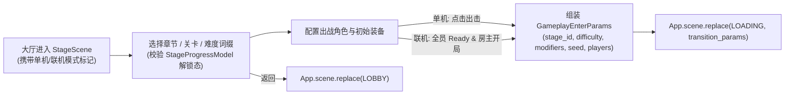

# 06 · 游戏关卡 (Stage)

> **模块定位**：连接大厅（`04_lobby`）与局内战斗（`07_gameplay`）的**章节/关卡/难度选择与战前整备（Pre-Game Setup）**系统，负责校验解锁条件、编排出战配置并产出标准化进局契约 `GameplayEnterParams`。

---

## 一、 核心功能清单

1. **三级关卡结构与解锁判定**：
   - **层级结构**：`章节 (Chapter)` ➔ `关卡节点 (Stage)` ➔ `难度档位与挑战词缀 (Difficulty & Modifiers)`。
   - **解锁规则**：基于 `StageProgressModel` 校验前置关卡首通状态、账号条件或累计星级/评价，未解锁节点清晰展示解锁条件。
   - **战绩与情报预览**：展示当前关卡环境机制说明、主要威胁预告、首通奖励状态、历史最高分/最快通关时长。
2. **战前整备（Loadout）**：
   - 选定本局出战角色/初始流派配置，自动记忆上次出战偏好（存盘于 `StageProgressModel`），减少重复点选。
3. **进局参数装配与资源索引**：
   - 从 `src/resources/stages/stg_<id>.tres` 提取当前关卡依赖的地图/波次表与专属预载资产清单，封装进 `LoadingTransitionParams` 交由 `02_loading` 预热后切入 `07_gameplay`。

---

## 二、 Steam 单机 vs 联机准备流

| 维度 | 单机模式 (Solo) | 联机房间模式 (Co-op / Multiplayer) |
| :--- | :--- | :--- |
| **关卡与词缀决策权** | 玩家自由切换章节、关卡与挑战词缀 | **仅房主（Host）**可修改目标关卡与挑战词缀，变更后实时同步至全房间成员视图 |
| **出战整备与就绪** | 选好配置点击 **「开始出击」** 立即触发进局 | 各成员独立调整自身出战角色并点击 **「准备就绪 (Ready)」**；支持吊起 Steam 好友邀请面板补位 |
| **随机种子 (`seed`) 签发** | 客户端本地生成 64 位随机种子（或支持玩家手动输入固定种子挑战） | 房主点击开局或全员 Ready 后，由主机/权威服统一签发唯一 `seed` 与成员槽位表，确保多端确定性一致 |

---

## 三、 状态流转时序

---

## 四、 工程架构与契约映射 (`MSVP`)

- **目录落点**：`src/game/features/stage/`
  - `model/`：
    - `StageConfig` (`Resource`)：映射 `src/resources/stages/` 下的关卡静态定义（名称、前置关卡 ID、波次表路径、场地资源清单、词缀池）。
    - `StageProgressModel` (`BaseParams`)：持久化存档根，通过 `StorageItem.for_save(&"stage", "stage_progress", 1).with_steam_cloud()` 落盘至 `user://saves/stage/stage_progress.json`（记录已通关关卡、最高难度、最佳战绩与上次整备选择）。
    - `StageEnterParams` (`BaseParams`)：入场参数（单机/联机模式、默认选中章节）。
  - `service/`：`StageService`（关卡解锁拓扑计算、战绩读写与更新、联机房间整备状态同步、组装 `LoadingTransitionParams` + `GameplayEnterParams`）。
  - `presenter/`：`StagePresenter`（响应选关、切换难度、修改出战配置与开局指令）。
  - `view/`：`scene/stage/`（`StageScene` + `StageView`）与 `component/chapter_map/`、`component/modifier_panel/`、`component/room_slots/`。
