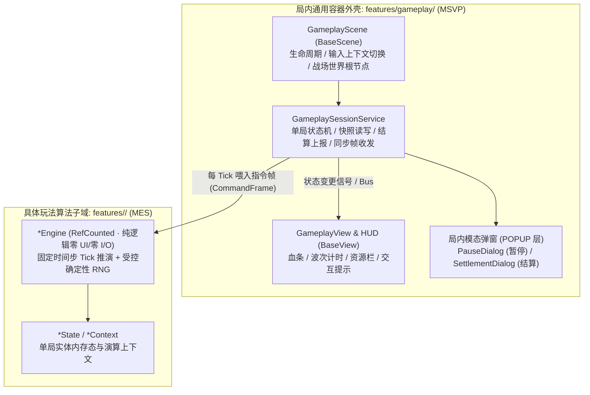

# 07 · 游戏局内核心 (Gameplay)

> **模块定位**：单局核心运行容器与通用战斗底座。严格执行**「局内生命周期外壳（MSVP）与具体玩法规则演算（MES）物理分离」**，使更换或迭代具体玩法机制时无需重写局内流程、HUD 挂载、暂停、断点快照与结算管线。

---

## 一、 双层解耦架构：MSVP 舞台外壳 + MES 演算内核

---

## 二、 单局标准生命周期状态机

| 状态阶段 | 核心动作与规则 | 输入上下文 (`App.input`) |
| :--- | :--- | :--- |
| **`1. INIT`** | 解析 `GameplayEnterParams`、用权威 `seed` 初始化确定性 RNG、装配世界地图与初始玩家实体（若是断点续玩则反序列化 `RunSnapshotModel` 覆盖状态）。 | `SYSTEM`（锁定操作） |
| **`2. READY`** | 镜头就位、开局倒计时/关卡目标横幅展示、更新 Steam Rich Presence（`"第 X 关激战中"`）。 | `GAMEPLAY` |
| **`3. PLAYING`** | 采集玩家输入封装为指令，按固定物理帧驱动 `Engine` 演算；局内里程碑（过波/存档点）触发后台异步快照保存。 | `GAMEPLAY`（自动抑制系统 IME） |
| **`4. PAUSED`** | 按 `ESC` / 手柄 `Start` 或窗口失焦自动触发，弹出 `PauseDialog`（继续游戏 / 打开 `08_settings` / 重新开始 / 放弃返回大厅）。 | `UI`（关闭时启用 `Wait-For-Release` 防误放技能） |
| **`5. SETTLEMENT`** | 达成通关条件或全员阵亡：冻结战斗结算胜负数据、**立即销毁本局中途快照**、写入全局档案与关卡记录、上报 Steam 成就/统计，弹出 `SettlementDialog`。 | `UI` |
| **`6. EXIT`** | 清理对象池与临时实例，构造回厅或重开 `LoadingTransitionParams`，切入 `02_loading` 释放战场资源。 | `SYSTEM` |

---

## 三、 Steam 单机 vs 联机核心差异契约

| 核心机制 | 单机模式 (Solo) | 联机模式 (Co-op / Multiplayer) |
| :--- | :--- | :--- |
| **模拟步进驱动** | 本地 `App.input` 采样直通 `Engine.tick()`，零网络延迟 | 本地输入打包为 `CommandFrame` 经 Steam Networking Sockets (P2P Host) 或专用服广播/权威下发后驱动 `Engine.tick()` |
| **暂停菜单行为** | 呼出 `PauseDialog` 或切后台（可选配置）时置 `SceneTree.paused = true`，**完全冻结战场时间** | 呼出菜单仅压入 `UI` 输入上下文屏蔽本机角色操作，**世界模拟保持实时运转**（除非全员投票暂停） |
| **局内升级/选卡停顿** | 弹三选一等决策窗时直接暂停世界等待单人选择 | 采用限时决策倒计时或全员并行选卡屏障，超时自动默认选择防拖延 |
| **中途容灾恢复** | 关键检查点原子写入 `user://saves/gameplay/run_snapshot.sav`；异常崩溃重启后可从大厅「继续游戏」恢复 | 不写本地快照，依赖房间会话令牌执行断线重连与状态追帧（State Catch-up） |
| **结算与防作弊** | 本地结算写盘（`PlayerProfileService` + `StageService`）并调用 Steamworks API 解锁成就 | 由主机/服务端核验结算摘要签名，通过后下发收益落盘 |

---

## 四、 工程架构与契约映射

- **目录落点**：`src/game/features/gameplay/`（通用容器，MSVP）
  - `model/`：
	- `GameplayEnterParams` (`BaseParams`)：进局标准契约（`stage_id`、`difficulty`、`modifiers`、`seed`、`is_multiplayer`、`resume_snapshot`）。
	- `GameplaySessionState` (`RefCounted`)：单局阶段枚举、存活时长、击杀/得分统计。
	- `RunSnapshotModel` (`BaseParams`)：单机中途恢复快照，绑定 `StorageItem.for_save(&"gameplay", "run_snapshot", 1, "sav").with_compression(true)`（落盘 `user://saves/gameplay/run_snapshot.sav`）。
	- `SettlementResultData` (`BaseParams`)：结算展示与奖励明细载体。
  - `service/`：`GameplaySessionService`（状态机总控、快照检查点编排、结算落盘与 Steam 成就桥接）。
  - `presenter/`：`GameplayPresenter`（同步 HUD 状态、调度暂停与结算弹窗、跳转重开或回大厅）。
  - `view/`：`scene/gameplay/`（`GameplayScene` + `GameplayView`）与 `component/hud/`、`component/pause_dialog/`、`component/settlement_dialog/`。
