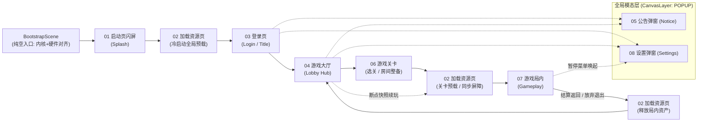

# 游戏功能系统策划总纲与通用架构索引 (System Design & Architecture Index)

> **定位**：面向 **Steam 单机（Offline-First）与联机扩展（Online-Ready）** 兼容的通用游戏产品功能系统底座，严格对齐 [`src/framework/`](../../src/framework/_doc_framework.md) 与 [`src/game/`](../../src/game/_doc_game.md) 的 **MSVP / MES** 架构规范。
> **原则**：先立通用产品骨架，再填具体玩法血肉；单机零后端可独立闭环，联机开启网关与同步层即可平滑演进。

---

## 一、 文档目录拓扑

```text
docs/
├── godot_coding_standards.md      # [工程编码规范] Godot 4.7 静态类型、命名与性能红线
└── design/                        # [功能系统策划域]
	├── _doc_design.md             # [总纲] 全局流转拓扑、Steam 单机/联机双模矩阵、代码映射总表
	├── 01_splash.md               # [模块 01] 启动页闪屏：品牌/合规声明展示、首帧硬件承接
	├── 02_loading.md              # [模块 02] 加载资源页：冷启动预载、跨大场景资源装卸载与联机同步屏障
	├── 03_login.md                # [模块 03] 登录页：Steam 直连/网关换票、离线保底、档案与云存档恢复
	├── 04_lobby.md                # [模块 04] 游戏大厅：主导航中枢、断点续玩、房间入口与社交状态
	├── 05_notice.md               # [模块 05] 公告系统：内置更新日志 + 远端动态公告双源合并与红点
	├── 06_stage.md                # [模块 06] 游戏关卡：章节/难度/词缀选择、战前整备与进局契约组装
	├── 07_gameplay.md             # [模块 07] 游戏局内：单局状态机、HUD/暂停/结算、中途快照与同步抽象
	└── 08_settings.md             # [模块 08] 设置系统：显示(15s回滚)/画质/五路音频/双轨改键/多语言
```

---

## 二、 全生命周期流转总图



---

## 三、 Steam 单机 vs 联机双模架构策略矩阵

| 核心维度 | Steam 纯单机 / 离线模式 (Offline-First) | Steam 联机 / 在线扩展模式 (Online-Ready) | 断网与异常降级策略 |
| :--- | :--- | :--- | :--- |
| **身份鉴权 (`App.auth`)** | `SteamAuthProvider` 采集 `SteamID64` + `LocalPassthroughVerifier` 0ms 本地签发 | 开启 `RemoteGatewayVerifier`：持 Steam WebAPI Ticket 换取后端 JWT + 401 自动续期 | Steam 离线模式保底签发真实 `SteamID64`；网关不可达时自动降级本地离线会话 |
| **存档与配置 (`App.storage`)** | 本地 `.tmp/.bak` 原子自愈写 + `with_steam_cloud()` 自动同步 Steam Cloud | 支持叠加 `with_remote()` 双写自建后端云存档；设备配置 `user://config/` 严禁上云 | 云端拉取超时自动回退本地最新有效存档；版本过高阻断覆写保护原档 |
| **时钟基准 (`App.clock`)** | 本机系统时间 + 单调时钟 `monotonic_msec` | 登录换票同步服务端 `server_time_ms` 校准防作弊权威时钟 | 标记 `is_trusted() == false`，仅限制强时效在线活动，不阻断单机玩法 |
| **公告投递 (`Notice`)** | 读取包内 `src/resources/tables/tbl_local_notices.json` 版本更新日志 | `App.net` 异步拉取 CDN/API 动态公告，按语言与时间窗合并去重 | 请求失败静默吞没网络错误，仅展示包内版本公告，零报错弹窗 |
| **战前与加载 (`Stage/Loading`)** | 单人选关整备 ➔ 生成本地随机种子 `seed` ➔ 加载达 100% 立即进局 | Steam Lobby / 匹配房间全员 `Ready` ➔ 下发统一 `seed` ➔ 加载页 `Ready Barrier` 齐步进局 | 成员加载超时触发房主剔除或单人接管降级，防无限卡死在 99% |
| **局内模拟与暂停 (`Gameplay`)** | 本地输入直驱 `Engine` Tick；打开暂停菜单时 `SceneTree.paused = true` 冻结世界；支持中途快照存盘 | 输入封装为 `CommandFrame` / 状态同步包；打开菜单**不冻结**世界模拟；走断线重连恢复 | 主机掉线支持 Host Migration 或结算保底保存已获收益 |

---

## 四、 八大系统模块与工程落点映射总表

| 序号 | 功能模块 | 形态 | 架构模式 | 目标代码目录 (`src/game/`) | 关键持久化模型与沙盒归属 (`R16`) |
| :--- | :--- | :--- | :--- | :--- | :--- |
| **00** | **引擎冷启动引导** *(前置已就绪)* | 空场景 (`BaseScene`) | 极简引导 | `bootstrap/` | 调 `GameSettingsService.load_and_apply()` 首帧前对齐硬件 |
| **01** | [**启动页闪屏**](01_splash.md) | 全屏场景 (`BaseScene`) | **MSVP** | `features/splash/` | 无独立存盘（读全局首次启动标记控制是否允许跳过） |
| **02** | [**加载资源页**](02_loading.md) | 全屏场景 (`BaseScene`) | **MSVP** | `features/loading/` | 无存盘（纯运行时 `LoadingState` + `LoadingContext`） |
| **03** | [**登录页**](03_login.md) | 全屏场景 (`BaseScene`) | **MSVP** | `features/login/` | 驱动 `shared` 层 `PlayerProfileModel` (`user://saves/shared/player_profile.json` + Steam Cloud) |
| **04** | [**游戏大厅**](04_lobby.md) | 全屏场景 (`BaseScene`) | **MSVP** | `features/lobby/` | 消费 `PlayerProfileModel`；探测 `gameplay` 快照存在性 |
| **05** | [**公告系统**](05_notice.md) | 模态弹窗 (`BaseDialog`) | **MSVP** | `features/notice/` | `NoticeReadModel` (`user://config/notice/notice_read.json`，仅本地) |
| **06** | [**游戏关卡**](06_stage.md) | 全屏场景或子视图 | **MSVP** | `features/stage/` | `StageProgressModel` (`user://saves/stage/stage_progress.json` + Steam Cloud) |
| **07** | [**游戏局内**](07_gameplay.md) | 全屏场景 + 玩法内核 | **MSVP + MES** | `features/gameplay/` + 玩法子域 | `RunSnapshotModel` (`user://saves/gameplay/run_snapshot.sav`，单局检查点快照，结算即焚) |
| **08** | [**设置系统**](08_settings.md) | 模态弹窗 (`BaseDialog`) | **MSVP** | `features/settings/` + `shared` 内核 | 复用 `GameSettingsModel` (`user://config/shared/game_settings.json`，严禁上云) |
