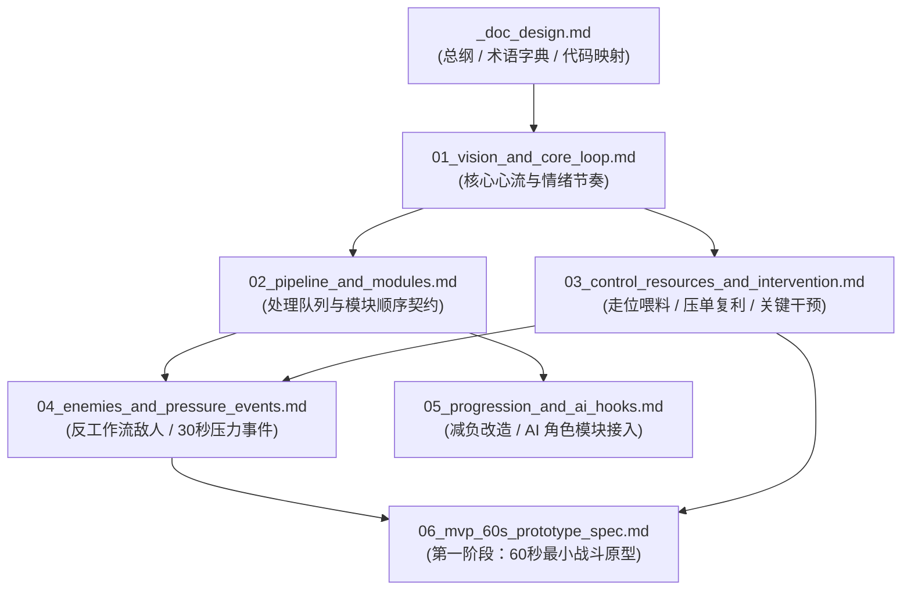

# Slacker Survivors 游戏策划文档总纲与架构索引 (GDD Architecture & Master Index)

> **适用范围**：`Slacker Survivors` 全项目玩法设计、数值配表（`src/resources/configs/`）与业务层实现（`src/game/`）。
> **核心定位**：定义一套**模块化、强契约、可验证、与代码架构（MSVP / MES）严格对齐**的工业级游戏策划文档（GDD）体系，作为人类策划、程序员与 AI Agent 协作的唯一真实数据源（Single Source of Truth, SSOT）。

---

## 一、 策划文档工程架构 (Documentation Topology)

为杜绝传统单文件巨型 GDD 导致的“上下文污染、改一处崩全局、策划文案无法直接转化为代码契约”等顽疾，本项目采用 **渐进式披露（Progressive Disclosure）+ 领域垂直解耦** 的六卷本工业级文档架构：

```text
docs/
├── godot_coding_standards.md                     # [工程技术规范] Godot 4.7 架构设计与 GDScript 编码规范
└── design/                                       # [游戏策划设计域] (遵循领域单数命名法则)
    ├── _doc_design.md                            # [总纲与路由] 策划文档架构、设计宪法、全局术语表与研发映射矩阵
    ├── 01_vision_and_core_loop.md                # [卷一：核心愿景与心流] 一句话定义、核心情绪节拍、四尺度时间乐趣与删减红线
    ├── 02_pipeline_and_modules.md                # [卷二：流水线与模块契约] 工单状态机、顺序敏感铁律、6大原型模块I/O契约与换位矩阵
    ├── 03_control_resources_and_intervention.md  # [卷三：操控、资源与救火] 三大玩家操作、双核资源（干预额度/未处理麻烦）、爆仓与干预机制
    ├── 04_enemies_and_pressure_events.md         # [卷四：反工作流敌人与波次] 8类工作流破坏者、30秒压力预告事件、三阶段战局演进
    ├── 05_progression_and_ai_hooks.md            # [卷五：机器重构与远期扩展] 局内减负升级池、条件路由规则、AI Galgame 拟人模块接入协议
    └── 06_mvp_60s_prototype_spec.md              # [卷六：60秒最小原型规格书] 第一阶段可运行切片：3波剧本、精确参数、UI反馈与三大验证门禁
```



---

## 二、 项目核心定义与三大设计铁律 (The Three Iron Laws)

### 1. 项目一句话北极星 (High Concept)
> **玩家搭建一套只需要偶尔值班的生存机器，然后在战场上尽量不亲自处理问题，直到系统即将失控时，才做一次关键干预。**
>
> **真正的“懒惰爽感”**：不是“角色无脑自动打怪”，而是**“我提前做了一次聪明安排，所以接下来几十秒都不用重复劳动。”**

### 2. 三大不可妥协的策划铁律 (Non-Negotiable Design Rules)

| 铁律编号 | 铁律名称 | 判定标准（Acceptance Criteria） | 严禁出现的反模式（Anti-Patterns） |
| :--- | :--- | :--- | :--- |
| **Law #1** | **严格顺序敏感铁律**<br>*(Order Sensitivity)* | 任何进入队列的模块，与相邻模块交换位置（`A ➔ B` vs `B ➔ A`）后，必须在**空间几何形态**或**时间结算时机**上产生肉眼可见的质变。 | 严禁把“伤害+15%”、“暴击率+10%”等与顺序无关的纯数值属性做成占据队列槽位的模块。 |
| **Law #2** | **高价值低频干预铁律**<br>*(High-Leverage Intervention)* | 玩家的手动干预必须是稀缺且高杠杆的决策（每波有限额度）。每 30 秒围绕一次压力事件决定“继续躺平攒复利”还是“起身救火”。 | 严禁要求玩家持续点击攻击、每秒手动瞄准或高频微操换槽；若玩家每 10 秒都在干预，说明自动化设计失败。 |
| **Law #3** | **反工作流威胁铁律**<br>*(Workflow Disruption)* | 敌人的存在价值是**专门破坏或卡住某种自动化流水线习惯**（打断延迟、正面挡聚拢、偷取地面积压资源），倒逼玩家调整队列或走位。 | 严禁单纯通过堆砌敌人血量（HP 膨胀）与移动速度来制造伪难度。 |

---

## 三、 全局标准术语词典 (Canonical Glossary)

为确保策划文档与代码类名（`class_name`）、配表字段保持 1:1 映射，全工程统一使用以下标准术语：

| 中文标准术语 | 英文代码标识 (Identifier) | 概念定义与职责边界 |
| :--- | :--- | :--- |
| **处理队列 / 流水线** | `ProcessQueue` / `Pipeline` | 玩家编排的固定顺序槽位序列（原型期为 5 个槽位），决定一次基础攻击如何逐步演变为最终清场效果。 |
| **处理模块 / 工序** | `PipelineModule` | 镶嵌在队列槽位中的功能单元（如`[标记]`、`[聚拢]`、`[穿透]`、`[延迟]`、`[分裂]`、`[回收]`），接收上一步焦点并输出新焦点。 |
| **工单包 / 攻击包** | `WorkPacket` | 进入处理队列并投射到战场上的实体化载体。按槽位顺序逐步执行各模块工序，而非高频乱飞的散装子弹。 |
| **作用焦点** | `FocusNode` | 模块执行时的当前空间锚点或目标集合。每个模块本质上都是对 `FocusNode` 集合的几何变换或负载叠加。 |
| **挂载负载** | `PacketPayload` | 随工单流转在焦点上累积的伤害基数、控制力与待结算层数。 |
| **未处理麻烦（压单）** | `TroubleBacklog` | 核心资源之一。场上未及时击杀的精英、未拾取的掉落物、挂起中的`[延迟]`伤害共同构成的积压池。积压越多结算倍率越高，但超限会引发爆仓失控。 |
| **麻烦实体（催债怪）** | `TroubleEntity` | 当 `TroubleBacklog` 超过安全阈值未结算时，由系统强制生成的失控惩罚实体，逼迫玩家立即“还债”。 |
| **干预额度** | `InterventionQuota` | 核心资源之一。代表玩家当前还能“亲自起身插手”的次数，通过队列连续自动完成闭环或高风险行为恢复。 |
| **关键干预（起身救火）** | `ManualIntervention` | 玩家消耗 1 点 `InterventionQuota` 执行的瞬时高价值指令（如插队立即结算、临时旁路、交换相邻模块、强行转向）。 |
| **威胁预告** | `ThreatForecast` | 波次开始前或压力事件前 5~10 秒向玩家公示的敌人机制预警，是玩家决定是否重排队列的决策依据。 |

---

## 四、 策划文档与 Godot 代码架构映射矩阵 (Design-to-Code Mapping)

严格遵循 [`docs/godot_coding_standards.md`](file:///Users/krace/Code/GodotProject/slacker-survivors/docs/godot_coding_standards.md) 与 [`src/game/_doc_game.md`](file:///Users/krace/Code/GodotProject/slacker-survivors/src/game/_doc_game.md) 的 **MSVP / MES 双轨架构**，各策划卷宗对应代码落点如下：

| 策划卷宗 | 架构模式 | 目标代码域 (`src/game/`) | 关键领域模型后缀 (`model/`) |
| :--- | :--- | :--- | :--- |
| **卷二：流水线与模块契约**<br>([`02_pipeline_and_modules.md`](file:///Users/krace/Code/GodotProject/slacker-survivors/docs/design/02_pipeline_and_modules.md)) | **MES**<br>*(纯逻辑演算)* | `features/pipeline/`<br>(`model/`, `engine/`, `service/`) | • `PipelineModuleConfig` (静态配表)<br>• `PipelineQueueState` (队列槽位状态)<br>• `WorkPacketContext` (工单步进上下文) |
| **卷三：操控、资源与救火**<br>([`03_control_resources_and_intervention.md`](file:///Users/krace/Code/GodotProject/slacker-survivors/docs/design/03_control_resources_and_intervention.md)) | **MES + MSVP** | `features/combat/`<br>`features/battle_hud/` | • `CombatResourceState` (干预额度与未处理麻烦)<br>• `InterventionParams` (干预动作入参) |
| **卷四：敌人与波次压力**<br>([`04_enemies_and_pressure_events.md`](file:///Users/krace/Code/GodotProject/slacker-survivors/docs/design/04_enemies_and_pressure_events.md)) | **MES** | `features/wave/`<br>`features/enemy/` | • `EnemyArchetypeConfig` (反工作流敌人配表)<br>• `WavePressureConfig` (30秒压力事件配表)<br>• `WaveRuntimeState` (波次运行状态) |
| **卷五：机器重构与 AI 接入**<br>([`05_progression_and_ai_hooks.md`](file:///Users/krace/Code/GodotProject/slacker-survivors/docs/design/05_progression_and_ai_hooks.md)) | **MSVP** | `features/upgrade/`<br>`features/agent_module/` *(Phase 2)* | • `ModuleUpgradeConfig` (减负改造配表)<br>• `AgentPersonalityState` (AI 角色模块情绪状态) |
| **卷六：60 秒最小原型**<br>([`06_mvp_60s_prototype_spec.md`](file:///Users/krace/Code/GodotProject/slacker-survivors/docs/design/06_mvp_60s_prototype_spec.md)) | **MSVP 场景组合** | `features/battle/` | • `BattleScene` (`BaseScene`)<br>• `BattlePresenter` / `BattleService` |

---

## 五、 文档维护与版本演进准则 (Governance Rules)

1. **先改文档，后动代码**：任何涉及队列槽位规则、模块输入输出逻辑、资源增减公式或新敌人机制的改动，必须先更新 `docs/design/` 下对应的分卷文档，再进入 `src/game/` 编码。
2. **阶段隔离（Phase Gating）**：
   - **Phase 1（当前阶段：MVP 60s 原型）**：严格锁定 [`06_mvp_60s_prototype_spec.md`](file:///Users/krace/Code/GodotProject/slacker-survivors/docs/design/06_mvp_60s_prototype_spec.md) 的裁剪范围（1 种基础工单、5 槽位、6 模块、1 干预、3 敌人），禁止提前混入多武器或 AI 剧情代码。
   - **Phase 2（核心循环跑通后）**：按 [`05_progression_and_ai_hooks.md`](file:///Users/krace/Code/GodotProject/slacker-survivors/docs/design/05_progression_and_ai_hooks.md) 的接口协议，将 AI Galgame 角色作为“具备自主情绪与谈判条件的特殊模块”无损挂载进流水线槽位。
