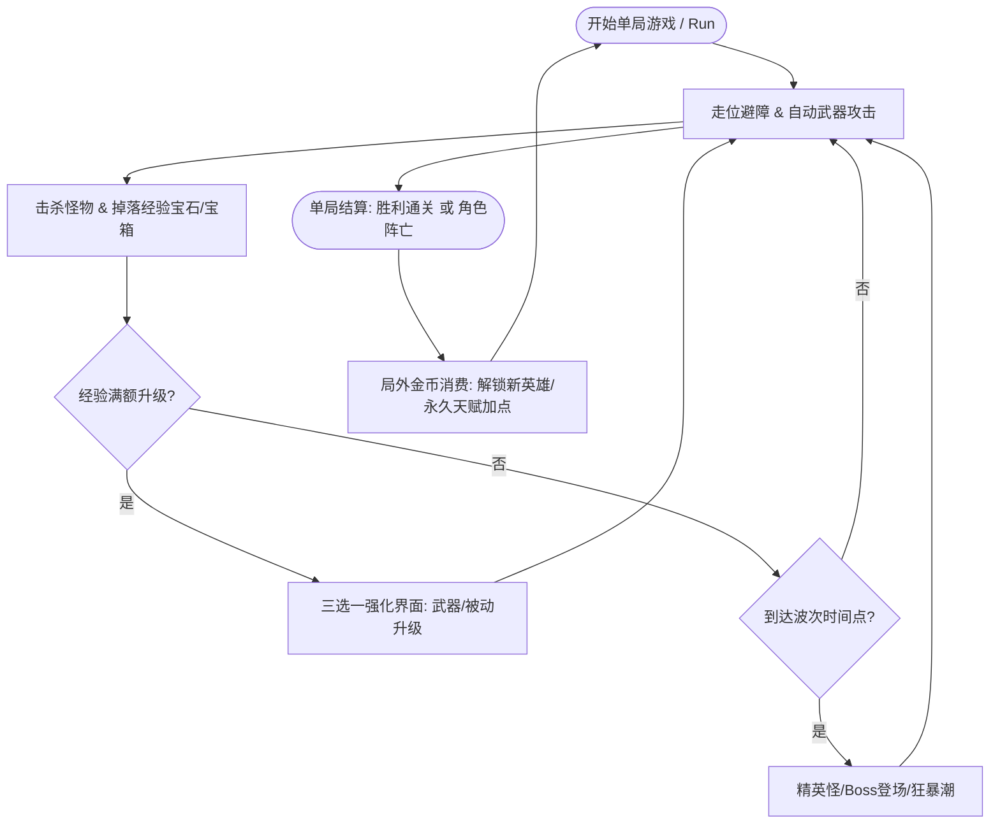

# 🎮 游戏策划与系统设计 (Game Design)

> 🎨 **FileSystem 色彩标识**：🟠 `Orange (橙色)` —— 玩法创意、战斗热度与数值体系

本模块记录 **Slacker Survivors** 的核心玩法循环、系统规则设计与数值成长体系。

---

## 1. 核心玩法循环 (Core Gameplay Loop)

---

## 2. 核心玩法子系统

### 2.1 武器与技能系统 (Weapons & Skills)
- **主动武器 (Active Weapons)**：自动索敌或定时弹幕发射（如回旋飞刀、环绕火球、扩散霰弹）。
- **被动属性 (Passive Items)**：提升角色通用属性（移速、冷却缩减、暴击率、拾取范围等）。
- **进化与合成 (Evolutions / Super Weapons)**：特定满级主动武器 + 对应被动道具 = 合成终极超武。

### 2.2 怪物与波次系统 (Waves & Spawners)
- **时间轴波次**：以时间（0 ~ 15/30分钟）驱动波次难度梯度，控制出怪频率与同屏怪物上限。
- **怪物分类**：
  - *杂兵 (Minions)*：血量低、数量庞大，主要作为经验来源；
  - *精英 (Elites)*：具备特殊词缀（加速、霸体、冰冻光环），击杀必掉宝箱；
  - *首领 (Boss)*：具有固定招式与大范围弹幕，击败进入下一阶段或直接通关。

### 2.3 成长体系 (Progression)
- **局内成长 (Run Progression)**：单局内随机升级构筑（Build），局后数据重置。
- **局外养成 (Meta Progression)**：保留局内获取的货币/碎片，在主菜单升级基础属性树，增强后续单局容错率。

---

## 3. 策划文档撰写指南

后续编写各细分玩法文档时，建议遵循以下标准结构：
1. **设计目的**：该系统给玩家带来什么心流体验？
2. **核心规则**：详细规则判定、状态转换与边界条件。
3. **交互与表现**：界面布局示意、音效与视觉反馈需求。
4. **配置表结构**：对应的数据字段定义（ID、名称、数值乘区等）。

---

- [返回总览](file:///d:/code/GodotProject/slacker-survivors/docs/docs_overview.md)
