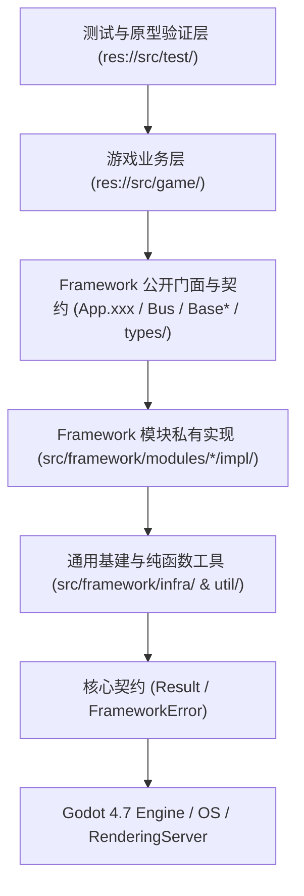

# Godot 4.7 架构设计与 GDScript 编码规范 (Godot Design & Coding Standards)

> **适用范围**：`Slacker Survivors` 全工程（`src/framework/`、`src/game/`、`src/test/` 及自研 `addons/`）。
> **核心目标**：确立**强类型、高内聚、单向依赖、零悬挂异步、零帧尖峰**的工业级 Godot 4.7 研发标准，使人类开发者与 AI Agent 编写的代码在架构层次、语法风格与运行性能上保持 100% 一致。

---

## 一、 核心架构哲学与类型选型 (Architecture & Type Selection)

### 1. 全局单向依赖铁律 (Strict Unidirectional DAG)

全工程严格执行自上而下的单向依赖，严禁任何形式的逆向引用或跨层穿透（由 `check_compliance` 静态门禁强制拦截）：



1. **框架层零业务耦合**：`src/framework/` 严禁引用任何 `src/game/` 或 `src/test/` 的脚本、场景或业务资产路径。
2. **业务共享层零向上依赖**：`src/game/shared/` 严禁反向引用 `src/game/features/` 或 `src/game/bootstrap/`。
3. **私有实现绝对隔离**：`src/game/` 及其他模块只允许面向各模块的公开门面（`Base*`）与公开数据契约（`types/`）编程，**严禁**直接引用或实例化任何模块 `impl/` 目录下的实现类、Adapter 或 Driver。

### 2. Godot 基类选型第一性原理 (`Node` vs `RefCounted` vs `Resource`)

拒绝“万物皆继承 `Node`”的反模式，严格按对象生命周期与职责选择最小成本基类：

| 基类类型 | 选型准则与内存/调度特征 | 工程典型代表 |
| :--- | :--- | :--- |
| **`RefCounted`**<br>*(默认首选)* | **纯逻辑、状态容器、协调器、服务、契约**。<br>不进场景树、零引擎节点遍历开销、离开作用域引用归零即自动释放。 | • 核心契约：[`Result`](file:///Users/krace/Code/GodotProject/slacker-survivors/src/framework/core/contracts/result.gd)、[`FrameworkError`](file:///Users/krace/Code/GodotProject/slacker-survivors/src/framework/core/contracts/framework_error.gd)、[`BaseParams`](file:///Users/krace/Code/GodotProject/slacker-survivors/src/framework/infra/param/base_params.gd)<br>• 基础基建：[`TaskScope`](file:///Users/krace/Code/GodotProject/slacker-survivors/src/framework/infra/async/task_scope.gd)、[`BudgetCache`](file:///Users/krace/Code/GodotProject/slacker-survivors/src/framework/infra/cache/budget_cache.gd)、[`CooldownScheduler`](file:///Users/krace/Code/GodotProject/slacker-survivors/src/framework/infra/scheduler/cooldown_scheduler.gd)、[`SpineController`](file:///Users/krace/Code/GodotProject/slacker-survivors/src/framework/infra/spine/spine_controller.gd)<br>• 逻辑系统：`RuntimeEnvironment`、`FrameworkLogger`、`ClockSystem`、`AssetSystem`、`StorageSystem`、`HapticFeedback`<br>• 业务分层：所有 MSVP 的 `Presenter`、`Service`、`*State`、`*Context` 与 MES 的 `Engine` |
| **`Node` / `Control` / `Node2D`** | **必须挂载场景树（SceneTree）的对象**。<br>需要驱动帧循环（`_process` / `_physics_process`）、拦截硬件输入（`_input`）、挂载可视子树（`CanvasLayer` / `Control`）或持有引擎功能节点（`HTTPRequest` / `AudioStreamPlayer` / `VideoStreamPlayer`）。 | • 场景与视图基类：[`BaseScene`](file:///Users/krace/Code/GodotProject/slacker-survivors/src/framework/modules/scene/base_scene.gd)、[`BaseView`](file:///Users/krace/Code/GodotProject/slacker-survivors/src/framework/modules/display/base_view.gd)、[`BaseDialog`](file:///Users/krace/Code/GodotProject/slacker-survivors/src/game/shared/component/dialog/base_dialog.gd)、[`BaseTextureButton`](file:///Users/krace/Code/GodotProject/slacker-survivors/src/game/shared/component/button/base_texture_button.gd)<br>• 节点型系统：`InputSystem`、`NetworkClient`、`SceneRouter`、`DisplaySystem`、`AudioSystem`、`VideoPlayer` |
| **`Resource`** | **编辑器可视化检视与 `.tres` 磁盘序列化资产**。<br>用于静态策划配置表或跨环境只读资源配置。 | • [`LocaleConfig`](file:///Users/krace/Code/GodotProject/slacker-survivors/src/framework/modules/locale/types/locale_config.gd) 及业务静态配表 `*Config` |
| **纯静态工具类**<br>*(Static Utils)* | **无状态纯函数集合**。<br>全部方法声明为 `static func`，严禁持有可变静态状态或业务引用。 | • [`src/framework/util/`](file:///Users/krace/Code/GodotProject/slacker-survivors/src/framework/util/_doc_util.md) 下的 `NodeUtils`、`FileUtils`、`CoordUtils`、`MemoryUtils`、`TimeUtils`、`FileCodecUtils`、`ResourceCodecUtils` |

---

## 二、 目录组织与命名规范 (Directory & Naming Conventions)

### 1. 目录单复数黄金法则 (Singular vs Plural Rule)

> **核心原则**：
> - **领域 / 系统 / 能力 / 架构职能 ➔ 统一单数 (Singular)**：表达“这是什么能力或哪一层逻辑”。
> - **同质资源 / 切片集合 / 公开类型容器 ➔ 统一复数 (Plural)**：表达“这里存放了多个同质对象、文件或模块”。

| 目录层级 | 语义定位 | 命名规则 | 标准正例 | 严禁反例 |
| :--- | :--- | :--- | :--- | :--- |
| **顶层源码域** | 架构核心层 | **单数** | `src/framework/`, `src/game/`, `src/test/` | `frameworks/`, `games/`, `tests/` |
| **基建与工具子域** | 垂直技术能力域 | **单数** | `infra/async/`, `infra/cache/`, `infra/param/`, `infra/scheduler/`, `infra/spine/`, `util/file/`, `util/coord/`, `util/codec/` | `params/`（复数）、`utils/files/` |
| **框架模块目录** | 独立子系统域 | **单数** | `modules/asset/`, `modules/audio/`, `modules/clock/`, `modules/display/`, `modules/env/`, `modules/haptic/`, `modules/input/`, `modules/locale/`, `modules/logger/`, `modules/network/`, `modules/scene/`, `modules/storage/`, `modules/video/` | `log/`（非完整名词）、`ui/` |
| **业务共享三支柱** | 跨模块共享内核职能 | **单数** | `shared/model/`, `shared/service/`, `shared/component/` | `define/`、`models/`、`components/`、`constants/`、`events/`、`msvp/` |
| **模块内架构分层** | MSVP / MES 职能目录 | **单数** | `model/`, `service/`, `view/`, `presenter/`, `engine/` | `models/`, `views/`, `services/` |
| **容器与集合目录** | 存放多个同质资产、业务切片、类型、驱动或任务 | **复数** | `src/assets/videos/`, `src/assets/textures/`, `src/resources/configs/`, `src/game/features/`, `types/`, `drivers/`, `adapters/`, `tasks/`, `addons/`, `docs/` | `video/`（资产目录用单数）、`type/`、`driver/` |

### 2. 代码标识符命名规范 (Identifier Casing)

| 元素类型 | 命名风格 | 规则与工程示例 |
| :--- | :--- | :--- |
| **脚本与场景文件名** | `snake_case` | 与 `class_name` 严格保持 1:1 语义对应：`SplashPresenter` ➔ `splash_presenter.gd` |
| **类名 (`class_name`)** | `PascalCase` | `BaseSceneRouter`、`GameSettingsService`、`InputChord`、`CooldownScheduler` |
| **`Base` 前缀约束** | `Base<Role>` | **仅限**真正供子类继承的基类（`BaseScene`、`BaseView`、`BaseDialog`、`BaseParams`）及模块公开抽象门面（`BaseAudioSystem`、`BaseStorageSystem`）；`impl/` 内部实现类严禁使用 `Base` 前缀 |
| **枚举名与枚举值** | `PascalCase` / `CONSTANT_CASE` | `enum WindowMode { WINDOWED, BORDERLESS_WINDOWED, FULLSCREEN }` |
| **公开常量** | `CONSTANT_CASE` | `const MODULE_ID: StringName = &"audio"`、`const BUS_MASTER: StringName = &"Master"` |
| **私有常量** | `_CONSTANT_CASE` | `const _DEFAULT_MAX_BYTES: int = 32 * 1024 * 1024`、`const _MAX_RECURSION_DEPTH: int = 8` |
| **公开属性与方法** | `snake_case` | `var current_device: int`、`func play_bgm(...) -> void`、`func is_ok() -> bool` |
| **私有属性与方法** | `_snake_case` | 凡不对外暴露的内部状态、辅助函数、信号回调必须以 `_` 开头：`var _stack: Array`、`func _evaluate_for_current_frame()` |
| **未使用形参** | `_param_name` | 重写虚方法或信号回调中未消费的参数必须加 `_` 前缀消除编译器告警：`func _on_enter(_params: BaseParams = null) -> void:` |
| **信号 (`signal`)** | `snake_case` *(过去分词)* | **只表达已发生的事实**，严禁用祈使动词：`signal opened`、`signal state_changed(new_state: int, old_state: int)`、`signal retry_requested` |
| **信号回调方法** | `_on_<source>_<signal>` | `func _on_retry_button_pressed() -> void:`、`func _on_state_changed() -> void:` |

### 3. 业务 `model/` 领域后缀强制标准 (Model Suffixes)

在 `src/game/shared/model/` 与 `src/game/features/*/model/` 下，严禁将所有数据类笼统命名为 `XxxModel` 或将多个领域数据类堆叠在单一文件中，必须遵循**“一类一文件（`1 class_name = 1 .gd`）”**并按数据生命周期使用 7 大标准后缀：

- **`*Config`**：静态只读策划配表（`HeroConfig`、`WeaponConfig`）；
- **`*Req` / `*Resp`**：与服务端通信的网络协议契约（上行请求 `*Req`，下行响应 `*Resp`，继承 [`BaseParams`](file:///d:/code/GodotProject/slacker-survivors/src/framework/infra/param/base_params.gd)）；
- **`*Model`**：跨周期持久化存档聚合根，继承 [`BaseParams`](file:///d:/code/GodotProject/slacker-survivors/src/framework/infra/param/base_params.gd)（[`PlayerProfileModel`](file:///d:/code/GodotProject/slacker-survivors/src/game/shared/model/save/player_profile_model.gd)、[`GameSettingsModel`](file:///d:/code/GodotProject/slacker-survivors/src/game/shared/model/save/game_settings_model.gd)）；
- **`*State`**：单局战斗或当前界面的高频易变运行时状态（[`SplashBootState`](file:///d:/code/GodotProject/slacker-survivors/src/game/features/splash/model/splash_boot_state.gd)）；
- **`*Data`**：内嵌于父容器的子数据块、背包/排行榜列表子项（[`DisplaySettingsData`](file:///d:/code/GodotProject/slacker-survivors/src/game/shared/model/data/display_settings_data.gd)、`RewardItemData`）；
- **`*Params`**：跨场景路由（`App.scene`）或开弹窗（`DialogManager`）的瞬态强类型入参/出参包，继承 [`BaseParams`](file:///d:/code/GodotProject/slacker-survivors/src/framework/infra/param/base_params.gd)（[`SplashEnterParams`](file:///d:/code/GodotProject/slacker-survivors/src/game/features/splash/model/splash_enter_params.gd)）；
- **`*Context`**：MES 引擎推演或多步管线的共享上下文（[`SplashBootContext`](file:///d:/code/GodotProject/slacker-survivors/src/game/features/splash/model/splash_boot_context.gd)）。

### 4. 美术与媒体资产 (`src/assets/`) 命名与拓扑

资产按 **「媒介容器 × 架构域 × 语义角色」三轴正交**治理，完整规范见 [`src/assets/_doc_assets.md`](file:///d:/code/GodotProject/slacker-survivors/src/assets/_doc_assets.md)：

- **目录**：`<媒介容器(复数)>/<架构域(单数)>/[<主体分组>/]`，架构域只能是 `shared`（Rule of 2+）或与 `src/game/features/<feature>/` 逐字同名；`audio/` 额外按总线分 `bgm/ sfx/ vox/ amb/` 子容器；
- **文件名**：`<type_prefix>_<domain>_<subject>[_<variant>][_<state|channel|direction>][_<locale>][_<index>].<ext>`，全小写 `snake_case`，第 2 段必须等于架构域目录名（如 `textures/splash/btn_splash_retry_normal.svg`、`audio/sfx/battle/sfx_battle_hit_01.wav`）；
- **依赖**：`src/framework/` 禁止引用任何资产；`features/<f>/` 只能引用 `<f>/` 与 `shared/` 域资产；DCC 源文件（`.psd` / `.blend` / `.spine` …）严禁进入 `src/assets/`。

### 5. 本地沙盒持久化与缓存 (`user://`) 拓扑与二级架构域规范

本地可读写沙盒卷（`user://`）按 **「一级生命周期分区 × 二级架构归属域」** 双层结构治理（封顶 2 层目录，严禁在 `user://` 或一级分区根部散落业务文件），完整规范见 [`src/framework/modules/storage/_doc_storage.md`](file:///d:/code/GodotProject/slacker-survivors/src/framework/modules/storage/_doc_storage.md)：

- **一级分区（5 大职能区）**：
  - `user://config/<domain>/`：设备级本地配置（如显示/分辨率/画质/键位，明文 `.json`，不随云存档跨设备覆盖）；
  - `user://saves/<domain>/`：玩家核心进度存档（`.json` 或压缩/加密 `.sav`，纳入 `.tmp/.bak` 自愈与云存档同步）；
  - `user://cache/<module>/`：可随时安全清空的衍生缓存（`cache/res/`、`cache/video/`、`cache/net/`）；
  - `user://tmp/<module>/`：瞬态事务与流式下载中转区（`tmp/storage/`）；
  - `user://logs/`：引擎日志与 `logs/crash/` 崩溃诊断快照。
- **二级架构域与代码归属约束（由 `check_compliance` 门禁强制校验）**：
  - `src/game/` 下**严禁裸写 `"user://..."` 字符串字面量**，且仅允许 `model/` 下的 `*Model` 持久化类通过 [`StorageItem.for_config(domain, subject, version)`](file:///d:/code/GodotProject/slacker-survivors/src/framework/modules/storage/types/storage_item.gd#L52) 或 [`StorageItem.for_save(domain, subject, version, ext)`](file:///d:/code/GodotProject/slacker-survivors/src/framework/modules/storage/types/storage_item.gd#L71) 声明存储项；
  - `src/game/shared/model/save/` 下的模型，`STORAGE_DOMAIN` 必须为 `&"shared"`；`src/game/features/<feature>/model/` 下的模型，`STORAGE_DOMAIN` 必须与 `<feature>` 目录名逐字一致。

---

## 三、 GDScript 脚本内部结构与排版规范 (Script Structure & Formatting)

### 1. 单文件标准声明顺序

每个 `.gd` 文件内部必须严格遵循自上而下的标准结构，并使用 `#region` / `#endregion` 组织逻辑区块：

```gdscript
@abstract # (可选：仅抽象基类或门面契约使用 @abstract / @tool)
class_name ExampleSystem
extends Node

## 一句话概述该类的核心定位（Module / Role Summary）。[br]
##
## [b]核心职责：[/b][br]
## 1. 职责一说明；[br]
## 2. 职责二说明。

#region Signals & Enums
signal state_changed(new_state: int, old_state: int)

enum State {
	IDLE = 0,
	RUNNING = 1,
}
#endregion

#region Module Dependency Manifest (仅 Framework 模块主实现类声明)
const MODULE_ID: StringName = &"example"
const REQUIRED_MODULES: Array[StringName] = [&"asset"]
const OPTIONAL_MODULES: Array[StringName] = [&"logger"]
#endregion

#region Constants & Exports
const _MAX_RETRY_COUNT: int = 3

@export_group("Configuration")
@export var auto_start: bool = true
#endregion

#region Public Properties & Private State
var current_state: int = State.IDLE

var _asset_system: BaseAssetSystem = null
var _logger: BaseFrameworkLogger = null
var _is_disposed: bool = false

@onready var _content_root: Control = $UI/ContentRoot
#endregion


#region Lifecycle
func _init(asset_system: BaseAssetSystem = null, logger: BaseFrameworkLogger = null) -> void:
	_asset_system = asset_system
	_logger = logger


func _ready() -> void:
	pass


func _exit_tree() -> void:
	pass


func initialize() -> Result:
	return Result.ok()


func dispose() -> void:
	_is_disposed = true
#endregion


#region Public API
## 对外公开方法必须包含 ## 文档注释与完整静态类型签名。
func execute_action(action_id: StringName, timeout_sec: float = 5.0) -> Result:
	if action_id.is_empty():
		return Result.err_code("Example.InvalidParam", "action_id cannot be empty.")
	return Result.ok()
#endregion


#region Internal Helpers & Signal Handlers
func _log_info(msg: String) -> void:
	if _logger != null:
		_logger.info("Example", msg)
	else:
		FrameworkLogger.print_raw(LogLevel.INFO, "Example", msg)
#endregion
```

### 2. 代码格式与空白字符约定

- **缩进**：统一使用 **Tab（制表符）** 缩进，严禁混用空格缩进。
- **空行间距**：顶层函数（`func`）与函数之间、以及主要 `#region` 区块之间统一保留 **2 个空行**；属性组与内部代码块之间保留 **1 个空行**。
- **行宽与多行拆行**：单行建议不超过 `110` 字符；多参数函数声明或长参数调用按每行一参拆行，右括号 `)` 与首行对齐；链式 Builder 调用（如 `VideoPlayOptions`、`SpineController`、`StorageItem`）使用行尾 `\` 缩进对齐。
- **早返回守卫（Guard Clauses）**：优先在函数开头校验非法参数、空引用或非就绪状态并立即 `return`，将核心逻辑保持在最浅缩进层级（嵌套深度原则上不超过 3 层）。

---

## 四、 强类型与现代 GDScript 4.7 语法规范 (Static Typing & Modern Syntax)

### 1. 100% 静态类型注解铁律

全项目启用 Godot Headless 全量脚本静态编译校验（[check_syntax.gd](file:///Users/krace/Code/GodotProject/slacker-survivors/.agents/skills/framework-aware/scripts/check_syntax.gd)），任何类型推断歧义或未声明类型的签名均被视为不合规：

1. **函数签名全显式**：所有函数的每个参数及返回值必须显式标注类型（无返回值必须写 `-> void`，返回动态值必须写 `-> Variant`）。
2. **安全处理 `Variant` 解包**：
   - 从 `Result.value`、`Dictionary.get()`、`Array` 索引、`PackedScene.instantiate()` 取值时，**严禁**直接使用 `:=` 触发 `Variant` 隐式推导告警；
   - 必须显式声明目标类型并配合 `as` 安全强转或值转换函数：
	 ```gdscript
	 # 错误：res.value 是 Variant，直接 := 会丢失静态类型保障或触发编译器警告
	 var tex := res.value

	 # 正确：显式声明类型 + as 转换
	 var tex: Texture2D = res.value as Texture2D
	 var count: int = int(dict.get("count", 0))
	 var ratio: float = clampf(float(dict.get("ratio", 1.0)), 0.0, 1.0)
	 ```
3. **强类型集合优先**：凡元素类型同质的数组，必须声明为 `Array[T]`（如 `Array[StringName]`、`Array[InputChord]`、`Array[BootTask]`）或紧凑内存数组 `PackedStringArray` / `PackedByteArray` / `PackedInt32Array`。

### 2. 高频标识符强制使用 `StringName` (`&"..."`)

- 在 Godot 4 中，`StringName` 在引擎底层维护全局唯一字符串拘留池（String Interning），比较复杂度为 $O(1)$ 指针比对。
- **强制使用 `&"..."` 的场景**：
  1. 输入动作名：`App.input.is_action_just_pressed(&"ultimate")`、`App.input.get_vector(&"move_left", &"move_right", &"move_up", &"move_down")`；
  2. 模块 ID 与依赖清单：`const MODULE_ID: StringName = &"storage"`；
  3. 领域事件名：`Bus.emit(PlayerProfileService.EVENT_PROFILE_UPDATED, payload)`（其中常量定义为 `const EVENT_PROFILE_UPDATED: StringName = &"game:profile_updated"`）；
  4. 缓存槽位与存储 Key：`BudgetCache.read(&"key")`、`StorageItem.new(PlayerProfileModel.STORAGE_KEY, ...)`；
  5. 音频总线名称：`&"Master"`、`&"BGM"`、`&"SFX"`。

### 3. 原生 `@abstract` 契约与编译期警告治理

- 框架公开门面基类（`Base*`）与抽象任务基类（`BootTask`、`StorageDriver`、`VideoPlayerAdapter`）统一使用 Godot 4.7 原生 `@abstract` 类注解与 `@abstract func` 抽象方法声明，由编译器强制保障派生类实现完整契约。
- 严禁全局关闭 GDScript 警告；仅当框架事件总线等特殊设计存在“本文件声明信号、外部文件触发 `emit`”时，才允许精准添加 `@warning_ignore("unused_signal")`。

### 4. 全局类引用：`class_name` 直呼，禁止冗余 `preload` 别名

- 凡已声明 `class_name` 的脚本（如 `FileUtils`、`CryptoUtils`、`Result`、`BaseParams`），**一律直接使用全局类名**引用其静态方法、常量与类型：`CryptoUtils.decrypt_bytes(...)`。
- **严禁**再写 `const _CryptoUtils = preload("res://src/framework/util/crypto/crypto_utils.gd")` 这类路径别名：它与全局名指向同一个 `GDScript` 类对象（并非实例化），却会造成同一文件两种引用风格混用、路径硬编码导致移动文件即断链。
- 若新建 `class_name` 后 Headless 校验报 `Identifier "Xxx" not declared`，原因是全局类缓存未刷新：运行 `check_compliance.ps1`（内置缓存同步）或执行一次 `godot --headless --editor --quit`，**而不是**用 `preload` 绕过。
- `preload` 脚本别名仅允许用于**未声明 `class_name`** 的脚本（如 `addons/` 插件内部类，刻意不污染全局命名空间）。

---

## 五、 通信解耦与依赖注入铁律 (Communication & Dependency Injection)

### 1. 三级通信边界

| 通信方向 | 唯一合法手段 | 规范说明与正反对比 |
| :--- | :--- | :--- |
| **1. 父节点 ➔ 子节点**<br>`Presenter` ➔ `View` | **直接调用公开方法 / 属性** | 父节点持有子节点 `@onready` 引用，或 `Presenter` 持有 `View` 引用，直接调用 `_view.render_progress(ratio, text)`。 |
| **2. 子节点 ➔ 父节点**<br>`View` ➔ `Presenter` | **发射强类型 `signal`** | 子控件或 `View` 仅向外发射 `signal retry_requested`，**严禁**调用 `get_parent().on_retry()` 或在 `View` 内直接调用 `Service`。 |
| **3. 跨业务模块**<br>`Feature A` ↔ `Feature B` | **全局事件总线 (`Bus`)** | 由 `Service` 层调用 `Bus.emit(XxxService.EVENT_XXX, payload)` 广播客观事实；节点侧优先使用 `Bus.on_scoped(XxxService.EVENT_XXX, self, _on_xxx)` 订阅，随节点退树自动解绑。 |

### 2. 显式依赖注入 (DI) vs 服务定位器 (`App.xxx`)

- **业务层 (`src/game/`) 与测试层 (`src/test/`)**：
  - 允许且应当通过全局门面 `App.<service>` 调用 13 大系统能力（`App.env`、`App.logger`、`App.clock`、`App.asset`、`App.input`、`App.haptic`、`App.net`、`App.storage`、`App.locale`、`App.scene`、`App.display`、`App.audio`、`App.video`）。
- **框架层内部 (`src/framework/modules/`、`infra/`、`util/`)**：
  - **绝对禁止**在代码中出现 `App.xxx` 调用！
  - 模块间依赖必须在主实现类中显式声明 `MODULE_ID`、`REQUIRED_MODULES` 与 `OPTIONAL_MODULES`，并由唯一组合根 [`FrameworkRuntime`](file:///Users/krace/Code/GodotProject/slacker-survivors/src/framework/core/runtime/framework_runtime.gd) 通过 `_init(...)` 或 `set_xxx(...)` 注入抽象门面类型（`Base*`）。

---

## 六、 业务层垂直切片规范：MSVP 与 MES (Gameplay Slice Standards)

在 `src/game/features/<feature>/` 下开发业务模块时，根据是否包含 UI 交互界面，严格采用 **MSVP** 或 **MES** 子目录分层（详参 [_doc_game.md](file:///Users/krace/Code/GodotProject/slacker-survivors/src/game/_doc_game.md)）：

| 分层目录 | 所属架构 | 继承基类 | 允许做的事 | 绝对禁止的事 (Anti-Patterns) |
| :--- | :--- | :--- | :--- | :--- |
| **`model/`** | MSVP / MES | `BaseParams` / `RefCounted` / `Resource` | 定义强类型字段、默认值、`sanitize()` 边界钳制、状态变更 `signal` | 严禁引用任何 `Node` / `Control`；严禁调用 `App.storage` / `App.net` 执行 I/O |
| **`engine/`** | MES | `RefCounted` | 纯数学伤害公式、波次生成、状态机推演（无状态或基于 `*Context` 演算） | 严禁引用 UI 节点；严禁读写磁盘存档或发起网络请求（保持 100% 纯计算可单测） |
| **`service/`** | MSVP / MES | `RefCounted` | 业务规则校验、编排 `Engine`、调用 `App.storage` / `App.net`、更新 `Model`、发送 `Bus.emit` | 严禁直接查找或修改 `View` 控件节点；严禁编写界面 `Tween` 动画 |
| **`view/`** | MSVP | `BaseScene` / `BaseView` / `BaseDialog` / `Control` | 视觉排版、阻尼插值、`Tween` 动效、暴露 `render_*()` 渲染接口、捕获用户操作并发射 `signal` | 严禁编写业务规则计算（如扣金币、算伤害）；严禁直接读写 `App.storage` / `App.net` |
| **`presenter/`** | MSVP | `RefCounted` | 连接 `View` 交互信号与 `Service` 方法；监听 `Model`/`Bus` 信号并调用 `View.render_*()`；在 `dispose()` 中解绑信号 | 保持薄胶水层：不写重型玩法公式（归 `service/engine`），不直接操作 `View` 内部深层子节点（归 `view`） |

### 场景、局部预制体与通用 UI 控件强制规范

1. **`view/` 内部二级分类与领域单元包规范 (`scene/<domain>/` + `component/<domain>/`)**：
   - 严禁在 `features/<feature>/view/` 根目录下直接平铺 `.tscn` 与 `.gd` 文件；
   - **`view/scene/<domain>/`**（主场景单元，文件夹按精简领域单数名词命名，如 `view/scene/splash/`）：存放由 `App.scene` 路由切换的顶层舞台，内部包裹 **`1 个 .tscn + 多个职责分离的 .gd`**（如 [`splash_scene.tscn`](file:///Users/krace/Code/GodotProject/slacker-survivors/src/game/features/splash/view/scene/splash/splash_scene.tscn) + [`splash_scene.gd`](file:///Users/krace/Code/GodotProject/slacker-survivors/src/game/features/splash/view/scene/splash/splash_scene.gd) + [`splash_view.gd`](file:///Users/krace/Code/GodotProject/slacker-survivors/src/game/features/splash/view/scene/splash/splash_view.gd)）；
   - **`view/component/<domain>/`**（局部预制体/弹窗单元，对齐 `shared/component/button/` 风格，文件夹按精简领域单数名词命名，如 `view/component/progress/`）：内部文件与类名**严禁使用赘述的 `_component` / `Component` 后缀**，统一按具体 UI 语义角色命名（`*Panel`、`*Bar`、`*Card`、`*Slot`、`*Item`、`*Button`、`*Dialog`），如 [`boot_progress_panel.tscn`](file:///Users/krace/Code/GodotProject/slacker-survivors/src/game/features/splash/view/component/progress/boot_progress_panel.tscn) + [`boot_progress_panel.gd`](file:///Users/krace/Code/GodotProject/slacker-survivors/src/game/features/splash/view/component/progress/boot_progress_panel.gd) + [`boot_progress_bar.gd`](file:///Users/krace/Code/GodotProject/slacker-survivors/src/game/features/splash/view/component/progress/boot_progress_bar.gd)。
2. **顶层场景根节点**：必须继承 [`BaseScene`](file:///Users/krace/Code/GodotProject/slacker-survivors/src/framework/modules/scene/base_scene.gd)，重写 `_on_enter(params: BaseParams = null)`、`_on_exit()`、`_on_pause()`、`_on_resume(params: BaseParams = null)` 钩子；严禁直接调用 `get_tree().change_scene_to_file()`，切场景统一走 `await App.scene.replace(...)` / `push(...)` / `pop(...)`。
3. **场景内 UI 根节点**：名称固定为 `UI`，脚本继承 [`BaseView`](file:///Users/krace/Code/GodotProject/slacker-survivors/src/framework/modules/display/base_view.gd)（自动获享异形屏安全区逆矩阵适配与 `task_scope` 生命周期守卫）。
4. **模态弹窗**：必须继承 [`BaseDialog`](file:///Users/krace/Code/GodotProject/slacker-survivors/src/game/shared/component/dialog/base_dialog.gd)（基类位于 `src/game/shared/component/dialog/`），具体业务弹窗放置在对应模块的 `features/<feature>/view/component/<domain>/` 下，统一通过 [`DialogManager.open(...)`](file:///Users/krace/Code/GodotProject/slacker-survivors/src/game/shared/component/dialog/dialog_manager.gd) 打开（自动压入 `InputContextType.Context.UI` 屏蔽局内战斗按键并在关闭时启用 Wait-For-Release 防穿透）。
5. **交互按钮**：统一使用 [`BaseTextureButton`](file:///Users/krace/Code/GodotProject/slacker-survivors/src/game/shared/component/button/base_texture_button.gd)，基类已内置按压缩放 Tween、点击音效与 `App.haptic.light()` 震动反馈，业务侧仅连接 `pressed` 信号，严禁重复手写缩放补间与音效代码。

---

## 七、 异步并发、内存安全与错误处理规范 (Async, Memory Safety & Error Handling)

### 1. 可失败操作统一返回 `Result`

凡涉及磁盘读写、网络请求、资源加载、键位录制、存档迁移等可能失败的操作，**必须返回 [`Result`](file:///Users/krace/Code/GodotProject/slacker-survivors/src/framework/core/contracts/result.gd)**，错误码遵循 `"{Module}.{Reason}"` 标准格式：

```gdscript
# 构造标准错误或携带上下文的可重试错误
if not FileUtils.file_exists(save_path):
	return Result.err_code(StorageError.NOT_FOUND, "Save file not found: %s" % save_path)

# 调用方必须显式检查 is_err()，严禁静默吞没错误
var res := await App.storage.read_async(PlayerProfileModel.storage_item())
if res.is_err():
	App.logger.error("Profile", "[%s] 加载档案失败: %s" % [res.error_code(), res.error_message()])
	return
```

### 2. 异步任务生命周期绑定 (`TaskScope` 防 UAF 铁律)

Godot 4 的 `await` 协程在等待期间若宿主节点被销毁（如玩家快速切走场景或关闭弹窗），协程恢复后继续访问节点成员会直接引发 **Use-After-Free (`previously freed instance`) 崩溃**。全工程强制执行以下防护准则：

1. **在 `BaseScene` / `BaseView` / `BaseDialog` 内部**：
   - 执行受保护的异步任务、并发收集（`gather`）、竞态抢占（`race`）或延时等待（`sleep`）时，统一使用宿主自带的 `task_scope`（[`TaskScope`](file:///Users/krace/Code/GodotProject/slacker-survivors/src/framework/infra/async/task_scope.gd)）；
   - 发起网络请求时传入 `task_scope.get_token()`（[`CancellationToken`](file:///Users/krace/Code/GodotProject/slacker-survivors/src/framework/infra/async/cancellation_token.gd)），界面关闭或场景退栈时自动中止传输并拦截过期回调。
2. **在普通 `Node` 内部延时等待**：
   - 统一使用静态守卫方法 `if (await TaskScope.wait(self, 0.5)).is_err(): return`，**严禁**裸写 `await get_tree().create_timer(0.5).timeout` 后不检查实例有效性直接操作节点。

```gdscript
# 黄金范式：绑定 BaseScene / BaseView 的 task_scope 并发加载与网络请求
func _on_enter(_params: BaseParams = null) -> void:
	var batch_res := await task_scope.gather([
		func(_token: CancellationToken) -> Result:
			return await App.asset.load("res://src/assets/textures/lobby/tex_lobby_banner.png"),
		func(token: CancellationToken) -> Result:
			return await App.net.get_request("/v1/season/info", {}, PackedStringArray(), token),
	], 8.0)

	if batch_res.is_err():
		# 若等待期间场景已退出，batch_res.error_code() == "Async.Cancelled"，安全短路退出！
		return
```

### 3. `RefCounted` 循环引用与信号泄漏防护

1. **Presenter / 控制器显式 `dispose()`**：`RefCounted` 子类（如 `SplashPresenter`）若持有 `Node`（如 `_view`）引用并连接了信号，必须在 `View._on_exit()` 中调用 `_presenter.dispose()` 断开信号并将 `_view = null` 置空。
2. **全局 `Bus` 订阅优先使用 `on_scoped`**：在任何 `Node` 子类中订阅动态领域事件，一律使用 `Bus.on_scoped(XxxService.EVENT_XXX, self, _on_xxx)`，确保节点退树时自动注销回调。
3. **底层基建持有宿主节点使用 `instance_id`**：如 `TaskScope`、`SpinePool` 等长生命周期辅助对象引用宿主 `Node` 时，内部仅存储 `host.get_instance_id()` 并通过 `instance_from_id()` 动态还原，从根源斩断引用环路。

---

## 八、 性能预算与防卡顿红线 (Performance & Anti-Hitch Rules)

针对幸存者（割草）品类同屏高频怪潮、密集弹幕与大量受击反馈的性能特征，编码时必须遵守以下 5 条硬性性能红线：

1. **热路径同步直通（Zero-Coroutine Fast Path）**：
   - 高频触发的音效播放（`App.audio.play_sfx()`）与已预热贴图读取（`App.asset.get_cached()`）必须走同步内存缓存直通，**零 `await` 协程状态机分配、零帧延迟**。
2. **帧循环内零开方与零堆分配（Zero-Sqrt & Zero-Alloc in `_process`）**：
   - 在 `_process` / `_physics_process` 索敌、拾取范围、圆环与扇形判定中，统一调用 [`CoordUtils`](file:///Users/krace/Code/GodotProject/slacker-survivors/src/framework/util/coord/coord_utils.gd)（`is_within_radius`、`is_within_annulus`、`is_within_cone`），内部全链路采用平方距离与点积平方比较，杜绝高频 `sqrt` 与 `atan2` 开销。
3. **Spine 骨骼动画池化、视口内真预热与分频错峰（[`SpinePool`](file:///Users/krace/Code/GodotProject/slacker-survivors/src/framework/infra/spine/spine_pool.gd)）**：
   - **严禁**在战斗帧内直接对复杂 `SpineSprite` 执行新建实例化（会引发 C++ `spine::Skeleton` 深拷贝与网格缓冲分配卡顿）；
   - 必须在加载期调用 `await _spine_pool.warmup_batch(...)` 在视口安全角完成 GPU 混合管线真预热，战斗期通过 `_spine_pool.acquire(...)` / `play_oneshot(...)` 0ms 借出，并对同屏怪群调用 `_spine_pool.register_staggered(ctrl, 30.0)` 开启 30FPS 奇偶帧错峰步进。
4. **高频音效与震动防爆节流**：
   - 音效统一经由 `App.audio.play_sfx()`（内置 16 通道空闲优先声道池与 `30ms` 同音限频）；
   - 触觉反馈统一经由 `App.haptic.light() / medium() / heavy()`（内置 `25ms` 怪潮节流窗与高优先级防打断保护）。
5. **显示与渲染管线幂等短路**：
   - 切换窗口模式、分辨率、VSync、MSAA/FXAA 抗锯齿统一调用 `App.display`（或 `GameSettingsService`），底层内置当前状态比对短路，严禁直接裸调 `DisplayServer.window_set_mode` 导致重复重建 OS 窗口与 GPU 交换链。

---

## 九、 日志、文档注释与自动化质量门禁 (Logging, Docstrings & Quality Gate)

### 1. 日志输出规范（严禁裸 `print()`）

- `src/framework/` 与 `src/game/` 中**严禁残留原生 `print()`**（由 `check_compliance` 扫描拦截）。
- 统一使用 `App.logger.debug(tag, msg)` / `info(tag, msg)` / `warn(tag, msg)` / `error(tag, msg)`；在 `App.logger` 尚未就绪或无依赖注入的底层纯工具类中，使用 `FrameworkLogger.print_raw(LogLevel.INFO, tag, msg)`。
- 敏感鉴权凭据（如 `Bearer Token`、加密密钥 `encryption_key`）严禁明文打入日志。

### 2. GDScript `##` 文档注释规范

- 所有公开类（`class_name`）、公开属性、信号与公开方法必须使用双井号 `##` 编写文档注释。
- 跨类引用统一使用 Godot 原生 BBCode 链接标签：`[ClassName]`、`[method ClassName.method]`、`[member ClassName.prop]`、`[signal ClassName.sig]`、`[enum ClassName.Enum]`、`[param arg_name]`、`[code]inline_code[/code]`，换行使用 `[br]`。

### 3. 提交前自动化合规与编译门禁

每次完成功能开发或架构重构后，必须执行工程内置的自动化合规与 Godot Headless 全量语法编译检查脚本，确保 **0 Errors, 0 Warnings**：

```bash
# macOS / Linux (Bash)
bash .agents/skills/framework-aware/scripts/check_compliance.sh

# Windows / Cross-Platform (PowerShell)
pwsh .agents/skills/framework-aware/scripts/check_compliance.ps1
```

门禁脚本将自动核验以下 14 项工程铁律：
1. 网络门面统一使用 `App.net`（禁用 `App.network`）；
2. 参数契约单数路径 `infra/param/`；
3. 视频资产复数容器路径 `assets/videos/`；
4. 日志模块路径 `modules/logger/`；
5. 显示层解耦（业务弹窗/飘字隔离于 `src/game/shared/component/`）；
6. `src/game/shared/` 三支柱架构（`model/service/component`）与零向上依赖；
7. `src/framework/` 零反向依赖 `src/game/` 或 `src/test/`；
8. `framework/modules|infra|util` 内部零隐式 `App.xxx` 调用（强制构造 DI）；
9. 13 大核心模块完整声明 `MODULE_ID` / `REQUIRED_MODULES` / `OPTIONAL_MODULES`；
10. `src/game/` 零跨界引用 `impl/` 内部私有实现类；
11. 废弃工具类清零（统一收敛至 `FileCodecUtils`、`ResourceCodecUtils`、`TaskScope`、`SpinePool`）；
12. Godot Headless 全项目 `.gd` 脚本静态类型与语法编译 100% 通过，且无裸 `print()` 残留；
13. `src/assets/` 资产拓扑、命名与归属合规（容器/扩展名/前缀白名单、文件名域段 == 目录域、零跨 Feature 资产引用、框架零资产引用）；
14. `src/` 内零冗余脚本别名（已声明 `class_name` 的脚本禁止 `preload` / `load` 起别名，统一直呼全局类名）。
