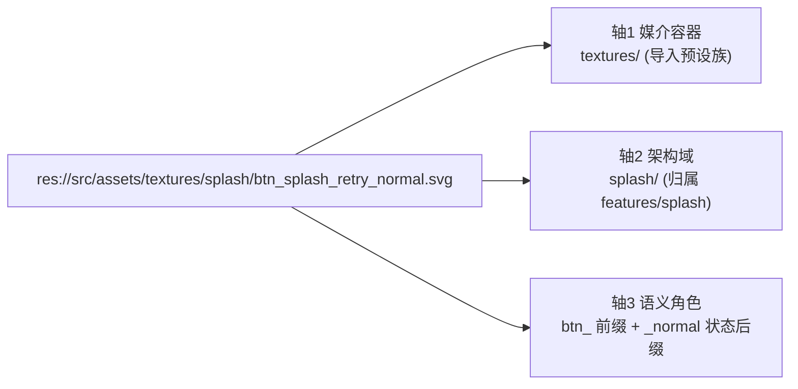
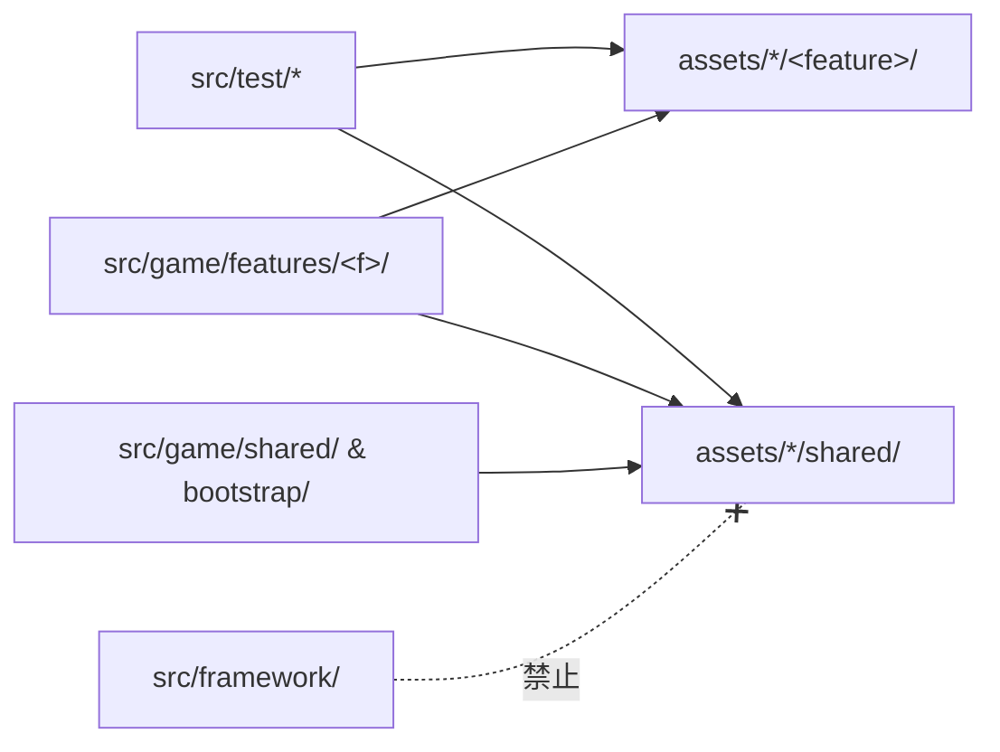
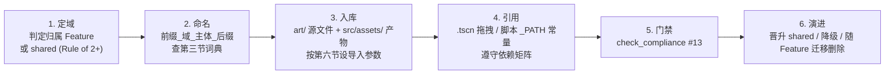

# Assets · 美术与媒体资产工程管理规范 (Asset Engineering Standard)

> **适用范围**：`res://src/assets/` 下全部运行时美术、音频、视频、字体、着色器与材质资产；`src/test/<feature>/assets/` 测试素材同样遵循本规范的命名与容器规则。
> **核心目标**：以**「媒介容器 × 架构域 × 语义角色」三轴正交**治理资产，使任意一个资产文件做到——**看路径知归属、看文件名知用途、看依赖知边界**，并由 `check_compliance` 门禁自动拦截违规。
> **上位规范**：[`docs/godot_coding_standards.md`](../../docs/godot_coding_standards.md)（单复数黄金法则）、[`src/game/_doc_game.md`](../game/_doc_game.md)（垂直业务模块）、[`src/game/shared/_doc_shared.md`](../game/shared/_doc_shared.md)（Rule of 2+）。

---

## 一、 三轴正交治理模型 (Three-Axis Model)

| 治理轴 | 回答的问题 | 编码位置 | 取值来源 |
| :--- | :--- | :--- | :--- |
| **轴 1：媒介容器 (Media)** | 这是什么介质、走哪套导入管线？ | 一级目录（复数） | 本文第二节容器白名单 |
| **轴 2：架构域 (Domain)** | 归哪个业务模块所有、谁有权引用？ | 二级目录（单数）+ 文件名第 2 段 | `shared` 或 `src/game/features/<feature>/` 同名 |
| **轴 3：语义角色 (Role)** | 在游戏里扮演什么角色、处于什么状态？ | 文件名前缀 + 后缀 | 本文第三节前缀 / 后缀词典 |



> **设计依据**：一级按媒介切分保证「**同一容器 = 同一导入预设族**」（贴图压缩、音频循环、视频编码完全不同），便于批量调参与审计；二级按架构域切分保证资产与代码模块 **1:1 镜像**，模块删除/拆分时资产可整包迁移。

---

## 二、 目录拓扑规范 (Directory Topology)

### 1. 标准拓扑

```text
src/assets/
├── _doc_assets.md                      # 本规范
├── textures/                           # [容器] 2D 位图/矢量图/3D 外置贴图
│   ├── shared/                         # [架构域] 跨 2+ 模块共享（Rule of 2+）
│   └── splash/                         # [架构域] 与 src/game/features/splash/ 1:1 镜像
│       ├── tex_splash_opening_cg.png
│       └── btn_splash_retry_normal.svg
├── spines/                             # [容器] Spine 骨骼动画 (.skel/.atlas/.png/_data.tres)
├── models/                             # [容器] glTF 2.0 模型 (.glb)
├── materials/                          # [容器] Material / ParticleProcessMaterial (.tres)
├── shaders/                            # [容器] .gdshader / .gdshaderinc
├── themes/                             # [容器] Theme / StyleBox (.tres)
├── fonts/                              # [容器] 字体文件与 FontVariation
├── audio/                              # [媒介组] 音频（不可数名词豁免复数，对齐 App.audio）
│   ├── bgm/                            # [容器] 背景音乐 → BGM 总线
│   ├── sfx/                            # [容器] 音效 → SFX 总线
│   ├── vox/                            # [容器] 语音/台词
│   └── amb/                            # [容器] 环境音
└── videos/                             # [容器] CG 与过场视频
```

**层级深度铁律**：`<容器>/<架构域>/[<主体分组>/]<文件>`，`audio/` 额外多一层子容器：`audio/<bgm|sfx|vox|amb>/<架构域>/[<主体分组>/]<文件>`。**严禁超过该深度**，严禁文件直接平铺在容器根目录。

### 2. 一级：媒介容器白名单（复数）

| 容器 | 承载内容 | 允许扩展名 | 允许前缀 | 导入预设族 |
| :--- | :--- | :--- | :--- | :--- |
| `textures/` | UI 图、CG、图标、世界精灵、特效贴图、3D 外置贴图、`AtlasTexture`/`SpriteFrames` | `png` `svg` `webp` `jpg` `jpeg` `exr` `hdr` `tres` | `tex_` `spr_` `sht_` `atl_` `ui_` `btn_` `ico_` `fx_` | 2D 无损 / 3D VRAM 压缩 |
| `spines/` | Spine 导出三件套 + `SpineSkeletonDataResource` | `skel` `spine-json` `atlas` `png` `tres` | `spn_` | spine-godot 导入器 |
| `models/` | glTF 2.0 模型（禁止 `.blend` / `.fbx` 进入） | `glb` `gltf` `bin` | `mdl_` `skm_` | Scene 导入器 |
| `materials/` | 材质与粒子过程材质 | `tres` | `mat_` `ptc_` | — |
| `shaders/` | 着色器与着色器头文件 | `gdshader` `gdshaderinc` | `shd_` | — |
| `themes/` | 全局/模块 `Theme` 与独立 `StyleBox` | `tres` | `thm_` `sbx_` | — |
| `fonts/` | 字体源与 `FontVariation` | `ttf` `otf` `woff` `woff2` `tres` | `fnt_` | 字体导入器 |
| `audio/bgm/` | 背景音乐（循环由 `BgmPlayer` 负责，**导入层不勾选 loop**） | `ogg` `mp3` | `bgm_` | 流式 Vorbis |
| `audio/sfx/` | 短音效 | `wav` `ogg` | `sfx_` | 内存常驻 WAV |
| `audio/vox/` | 语音/台词 | `ogg` `mp3` | `vox_` | 流式 Vorbis |
| `audio/amb/` | 环境底噪 | `ogg` | `amb_` | 流式 Vorbis |
| `videos/` | CG 与过场（PC `.mp4` + 兜底 `.ogv` **同名双轨**） | `ogv` `mp4` `webm` | `vid_` | 不导入（流式读取） |

> 门禁自动忽略：`*.import`、`*.uid`、`.gitkeep`、`.gdignore`、`_doc_*.md`。

### 3. 二级：架构域（单数，与代码模块 1:1 镜像）

| 架构域目录 | 归属 | 准入规则 |
| :--- | :--- | :--- |
| `shared/` | `src/game/shared/` 跨模块共享内核 | **Rule of 2+**：至少被 2 个独立 Feature（或 `bootstrap`）引用才可准入；严禁预防性共享 |
| `<feature>/` | `src/game/features/<feature>/` | 目录名**必须**与 Feature 目录名逐字一致（如 `splash`、`battle`、`pipeline`、`enemy`、`wave`、`battle_hud`） |

- **晋升 (Promote)**：当第 2 个 Feature 需要引用 `textures/battle/ico_battle_coin.png` 时，将其迁移并改名为 `textures/shared/ico_shared_coin.png`，同步修改全部引用。
- **降级 (Demote)**：`shared/` 中资产若引用方缩减为 1 个 Feature，下个迭代应迁回该 Feature 域。
- **毕业随迁**：Feature 被拆分/删除时，其全部架构域目录随之整包迁移/删除，不得遗留孤儿资产。
- **测试素材**：放 `src/test/<feature>/assets/<容器>/` 下（测试目录本身即架构域，省略二级），文件名第 2 段使用测试模块名；正式代码严禁引用。

### 4. 三级：主体分组（可选，单数）

仅当一个架构域目录下文件数 **> 12**，或同一主体拥有多个文件（序列帧、Spine 三件套、多状态按钮）时启用，按**游戏主体**命名而非按类型命名：

- ✅ `textures/enemy/rusher/`、`spines/enemy/rusher/`、`audio/sfx/battle/pickup/`
- ❌ `textures/enemy/icons/`、`textures/enemy/pngs/`（类型已由前缀表达，禁止重复分类）

---

## 三、 文件命名规范 (File Naming)

### 1. 命名语法

```text
<type_prefix>_<domain>_<subject>[_<variant>][_<state|channel|direction>][_<locale>][_<index>].<ext>
```

| 段位 | 必选 | 规则 | 示例 |
| :--- | :--- | :--- | :--- |
| `type_prefix` | ✅ | 语义类型前缀，必须属于所在容器的允许前缀（第二节表） | `btn` `sfx` `spr` |
| `domain` | ✅ | **必须与二级架构域目录名完全一致** | `splash` `shared` `battle_hud` |
| `subject` | ✅ | 主体名词，1~3 个单词，描述「是什么」 | `retry` `rusher` `opening_cg` |
| `variant` | ⬜ | 同主体的皮肤/形态/档次变体 | `elite` `gold` `phase2` |
| `state/channel/direction` | ⬜ | 取自第 3 节后缀词典 | `pressed` `normalmap` `left` |
| `locale` | ⬜ | 本地化资产，小写区域码 | `zh_cn` `en` `ja` |
| `index` | ⬜ | 序号，**至少 2 位补零**；序列帧 3 位 | `01` `002` |

**字符集与长度硬约束**：

1. 全小写 ASCII `snake_case`，正则 `^[a-z][a-z0-9]*(_[a-z0-9]+)*$`（主干名）；
2. **严禁**空格、连字符、中文、大写、主干名中出现额外的 `.`（`name.v2.png` ❌）；
3. 主干名长度 ≤ **64** 字符；
4. 纯数字段必须 ≥ 2 位（`_1` ❌ → `_01` ✅）。

> **为什么强制全小写**：Windows/macOS 文件系统大小写不敏感，而导出后的 `.pck` 与 Android/Linux 文件系统大小写敏感。`Splash_CG.png` 在编辑器能加载、上真机即 404，是 Godot 项目最常见的线上事故之一。

### 2. 类型前缀词典 (Type Prefix)

| 前缀 | 全称 | 容器 | 语义与适用场景 |
| :--- | :--- | :--- | :--- |
| `tex_` | Texture | `textures/` | 通用贴图：背景、CG、插画、地表平铺、3D 材质外置贴图（配合通道后缀） |
| `spr_` | Sprite | `textures/` | 世界内精灵单帧/序列帧：角色、敌人、子弹、掉落物、工单包 |
| `sht_` | Sheet | `textures/` | 多帧合一精灵表及其 `SpriteFrames`（`sht_<d>_<s>_frames.tres`） |
| `atl_` | Atlas | `textures/` | 打包图集及其 `AtlasTexture` 切片 |
| `ui_` | UI Skin | `textures/` | UI 皮肤块：面板底框、九宫格、分割线、遮罩、进度条底/填充 |
| `btn_` | Button | `textures/` | 按钮贴图，**必须**带状态后缀（对应 `TextureButton` 槽位） |
| `ico_` | Icon | `textures/` | 图标：物品、模块、货币、技能、状态 Buff |
| `fx_` | Effect | `textures/` | 特效贴图：粒子、光晕、拖尾、噪声、溶解遮罩 |
| `spn_` | Spine | `spines/` | Spine 骨骼（`.skel` + `.atlas` + `.png` 同名族 + `_data.tres`） |
| `mdl_` | Static Model | `models/` | 静态模型：道具、建筑、环境（导出 `export_apply=True`） |
| `skm_` | Skinned Model | `models/` | 带骨骼/动画模型：角色、敌人（导出 `export_skins=True`） |
| `mat_` | Material | `materials/` | `StandardMaterial3D` / `ShaderMaterial` / `CanvasItemMaterial` |
| `ptc_` | Particle | `materials/` | `ParticleProcessMaterial` |
| `shd_` | Shader | `shaders/` | `.gdshader` / `.gdshaderinc` |
| `thm_` | Theme | `themes/` | `Theme` 资源 |
| `sbx_` | StyleBox | `themes/` | 独立复用的 `StyleBoxFlat` / `StyleBoxTexture` |
| `fnt_` | Font | `fonts/` | 字体文件与 `FontVariation`（`fnt_<d>_<family>_<weight>`） |
| `bgm_` | Background Music | `audio/bgm/` | 背景音乐、胜负 Stinger |
| `sfx_` | Sound Effect | `audio/sfx/` | 交互/战斗/拾取音效 |
| `vox_` | Voice | `audio/vox/` | 角色语音、旁白 |
| `amb_` | Ambience | `audio/amb/` | 环境底噪（办公室空调、键盘声） |
| `vid_` | Video | `videos/` | CG、过场、背景动态视频 |

### 3. 后缀词典 (Suffix Dictionary)

| 类别 | 合法后缀 | 说明 |
| :--- | :--- | :--- |
| **UI 交互状态** | `_normal` `_hover` `_pressed` `_disabled` `_focused` `_mask` | 与 `TextureButton.texture_*` / `texture_click_mask` 槽位**逐字对齐**，`btn_` 必选其一 |
| **选择/开关态** | `_on` `_off` `_selected` `_locked` | 开关、页签、锁定格子 |
| **PBR 通道** | `_albedo` `_normalmap` `_orm` `_roughness` `_metallic` `_ao` `_emission` `_height` | 法线贴图用 `_normalmap` 以避免与按钮 `_normal` 冲突；导入时 `compress/normal_map=1` |
| **方向** | `_up` `_down` `_left` `_right`；八方向 `_n` `_ne` `_e` `_se` `_s` `_sw` `_w` `_nw` | 序列帧/方向精灵 |
| **动作** | `_idle` `_walk` `_run` `_attack` `_hit` `_death` `_spawn` | 序列帧动作名，与 Spine/AnimationPlayer 动画名保持一致 |
| **音频形态** | `_loop` `_stinger` `_start` `_end` | `_loop` 仅作语义标注，循环行为仍由 `BgmPlayer` 控制 |
| **资源角色** | `_frames`（SpriteFrames）`_data`（SpineSkeletonData）`_inc`（shader include） | 派生 `.tres` 资源与源文件同名族区分 |
| **LOD/倍率** | `_lod0` `_lod1` … `_2x` | 多精度版本 |
| **本地化** | `_zh_cn` `_zh_tw` `_en` `_ja` | 配合 Project Settings → Localization → Remaps |
| **序号** | `_01`…`_99`；序列帧 `_001`…`_999` | 随机变体音效、序列帧 |

**后缀顺序固定**：`variant → state/channel/direction/action → locale → index`。示例：`spr_enemy_rusher_elite_walk_left_001.png`。

### 4. 同名族规则 (Asset Family)

| 资产族 | 规则 | 示例 |
| :--- | :--- | :--- |
| **Spine 三件套** | 主干名完全一致，仅扩展名不同；数据资源加 `_data` | `spn_enemy_rusher.skel` / `.atlas` / `.png` + `spn_enemy_rusher_data.tres` |
| **视频双轨** | PC 高清 `.mp4` 与兜底 `.ogv` 同主干名，便于 `App.video` 按平台替换扩展名 | `vid_splash_opening.mp4` + `vid_splash_opening.ogv` |
| **按钮状态组** | 主干相同，仅状态后缀不同 | `btn_shared_confirm_normal.png` / `_pressed.png` / `_disabled.png` |
| **PBR 贴图组** | 主干与模型主体一致 | `tex_office_desk_albedo.png` / `_normalmap.png` / `_orm.png` |

### 5. 禁用词 (Forbidden Tokens)

主干名中**严禁**出现以下任一独立段位——版本管理是 Git 的职责，不是文件名的职责：

`final` `new` `old` `copy` `tmp` `temp` `bak` `backup` `test` `v1` `v2` … `v\d+`

### 6. 正反例对照

| ❌ 反例 | 违规原因 | ✅ 正例 |
| :--- | :--- | :--- |
| `textures/ui/splash_cg.png` | 二级按类型 `ui/` 而非架构域；缺前缀 | `textures/splash/tex_splash_opening_cg.png` |
| `textures/ui/btn_minimal_retry.svg` | 缺架构域；缺状态后缀 | `textures/splash/btn_splash_retry_normal.svg` |
| `audio/click.wav` | 缺子容器与架构域；缺前缀 | `audio/sfx/shared/sfx_shared_ui_click_01.wav` |
| `textures/characters/Player-Idle.png` | 大写、连字符、类型目录 | `textures/battle/spr_battle_player_idle_001.png` |
| `spines/boss_01.tres` | 缺架构域、缺前缀、序号语义不清 | `spines/enemy/spn_enemy_boss_auditor_data.tres` |
| `sfx_hit_final_v2.wav` | 禁用词 `final`、`v2` | `audio/sfx/battle/sfx_battle_hit_02.wav` |
| `textures/battle/ico_shared_coin.png` | 文件名域 `shared` ≠ 目录域 `battle` | `textures/shared/ico_shared_coin.png` |

---

## 四、 架构依赖与引用规范 (Dependency & Reference)

### 1. 资产引用依赖矩阵

资产引用方向必须与代码的单向 DAG 完全一致：

| 引用方（代码 / 场景 / `.tres`） | 允许引用的资产架构域 | 违规处理 |
| :--- | :--- | :--- |
| `src/framework/**` | **禁止引用任何 `src/assets/`**（框架零业务资产） | 门禁 FAIL |
| `src/game/bootstrap/**` | `shared/` | 门禁 FAIL |
| `src/game/shared/**` | `shared/` | 门禁 FAIL |
| `src/game/features/<f>/**` | `<f>/` + `shared/` | 门禁 FAIL（跨 Feature 引用 → 晋升到 `shared/`） |
| `src/test/**` | 全部（测试豁免） | — |
| `src/assets/**`（材质→贴图、Theme→字体） | 同域 + `shared/` | 人工 Review |



### 2. 代码内引用方式

1. **场景 (`.tscn`) 优先**：静态资产一律在编辑器中拖拽绑定（自动写入 `uid://` + `path`），重命名/移动时由编辑器与 UID 自愈。
2. **脚本内路径常量**：需动态加载时，在消费脚本顶部声明私有常量，命名 `_<PREFIX>_<SUBJECT>_PATH`，严禁在函数体内散写字面量：
   ```gdscript
   const _SFX_HIT_PATH: String = "res://src/assets/audio/sfx/battle/sfx_battle_hit_01.wav"
   const _SPN_RUSHER_DATA_PATH: String = "res://src/assets/spines/enemy/spn_enemy_rusher_data.tres"
   ```
3. **跨模块共享路径**：当 `shared/` 资产被 2+ 个模块在**脚本中**按路径引用时，按需在 `src/game/shared/model/config/game_assets.gd`（`class_name GameAssets`，与 `GameScenes` 同属静态路径配置表，按容器嵌套 `class Textures` / `class Sfx` …）集中登记，严禁预防性创建空表。
4. **加载与生命周期**：统一走 `App.asset.load()` / `preload_batch()` / `get_cached()`；首屏与常驻资产（如 `shared/` 通用 UI 图集）在启动预热任务中 `preload_batch` 并按需 `pin()`；音效统一 `App.audio.play_sfx(path)`；视频统一 `App.video`。

---

## 五、 源产分离与版本管理 (Source vs Runtime)

1. **`src/assets/` 只放引擎可直接导入的运行时产物**。`.psd` `.psb` `.kra` `.aseprite` `.clip` `.xcf` `.ai` `.fig` `.blend` `.fbx` `.spine` 工程等 DCC 源文件**严禁**进入（扩展名白名单门禁拦截）。
2. **DCC 源工程仓**：统一放在工程根目录 `art/`（必须含 `.gdignore` 阻止 Godot 扫描），内部**镜像** `src/assets/` 的「容器/架构域」拓扑，主干名与产物一致：
   ```text
   art/                                   # .gdignore
   ├── textures/splash/tex_splash_opening_cg.psd
   ├── spines/enemy/spn_enemy_rusher.spine
   └── models/office/mdl_office_desk.blend + build_mdl_office_desk.py
   ```
   `src/test/<feature>/blender/` 测试原型沿用 [`godot_export_contract.md`](../../.agents/skills/blender-pipeline/references/godot_export_contract.md) 的就近源产分离约定。
3. **Git LFS**：音视频、模型、字体、DCC 源文件已在 [`.gitattributes`](../../.gitattributes) 纳入 LFS；新增二进制类型时必须先补 LFS 规则再提交。
4. **`.import` 必须随资产一起提交、一起移动**：它持有资源 `uid` 与导入参数。移动资产请在 Godot 编辑器 FileSystem 中拖拽，或使用 `git mv` 同时移动 `xxx.png` 与 `xxx.png.import`。

---

## 六、 导入预设基线 (Import Baseline)

| 资产类型 | 关键导入参数 | 理由 |
| :--- | :--- | :--- |
| UI / CG（`ui_` `btn_` `ico_` `tex_` 2D） | `compress/mode=Lossless`，`mipmaps/generate=false` | 像素精确、无多余显存 |
| 世界精灵（`spr_` `sht_` `fx_`） | `Lossless`；大量同屏时改 `VRAM Compressed` | 怪潮同屏数量大，需平衡显存 |
| 3D 外置贴图（`tex_*_albedo/orm`） | `VRAM Compressed`，`mipmaps/generate=true` | 3D 采样需 mip 链 |
| 法线贴图（`*_normalmap`） | `compress/normal_map=Enable` | 正确通道压缩 |
| `bgm_` `vox_` `amb_` | Ogg Vorbis 流式，**不在导入层勾选 loop** | 循环由 `BgmPlayer` 的 `finished` 信号驱动 |
| `sfx_` | WAV，`edit/loop_mode=Disabled`，可开 `compress/mode=QOA` | 低延迟热路径，配合 `play_sfx` 同步直通 |
| SVG（`btn_` `ico_`） | 按目标显示尺寸设 `svg/scale`，禁止运行时放大 | 避免模糊 |

---

## 七、 资产生命周期工作流 (Lifecycle)



---

## 八、 自动化门禁 (Quality Gate #13)

[`check_compliance.py`](../../.agents/skills/framework-aware/scripts/check_compliance.py) 第 13 项「Asset topology & naming」自动核验：

| 校验项 | 级别 |
| :--- | :--- |
| 文件位于合法 `<容器>/<架构域>/[<分组>/]` 深度，容器属于白名单 | FAIL |
| 扩展名属于该容器白名单（拦截 DCC 源文件） | FAIL |
| 主干名满足小写 `snake_case`、≤ 64 字符、纯数字段 ≥ 2 位、无禁用词 | FAIL |
| 前缀属于该容器允许前缀，且第 2 段 == 架构域目录名 | FAIL |
| `src/framework/` 引用 `res://src/assets/` | FAIL |
| `src/game/features/<f>/` 引用非 `<f>`/`shared` 域资产；`shared/`、`bootstrap/` 引用非 `shared` 域资产 | FAIL |
| 架构域目录既不是 `shared` 也没有同名 `src/game/features/<domain>/` | WARN |

---

## 九、 存量迁移记录 (Migration Log)

| 原路径 | 新路径 | 引用方 |
| :--- | :--- | :--- |
| `textures/ui/splash_cg.png` | `textures/splash/tex_splash_opening_cg.png` | `features/splash` 主场景；`test/display` 两个测试场景（测试豁免） |
| `textures/ui/btn_minimal_retry.svg` | `textures/splash/btn_splash_retry_normal.svg` | `features/splash` 进度面板 |
| `textures/characters/`、`textures/ui/` | 删除（按类型分目录，违反二级架构域规则） | — |
