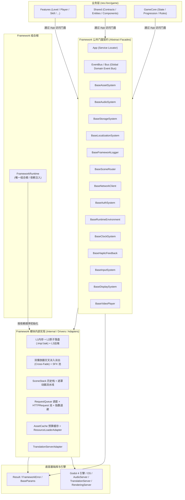

# Framework · 架构设计与模块规范

> Framework 是游戏业务（`res://src/game/`）之下的纯技术基建层。
> 它提供**强类型、高内聚、稳定解耦**的能力契约，严格隔离并封装 Godot 引擎原生 API、操作系统文件 I/O、音频流调度、网络传输及存储的实现细节。

```text
src/framework/
├── core/      # 共享契约、Autoload、Runtime 组合根
├── modules/   # 按垂直领域划分的技术模块（四层：模块名、公开门面、内部实现、底层适配器）
├── infra/     # 缓存、参数、调度器等通用基建
└── util/      # 无状态工具与编解码器
```

---

## 一、 全局分层与依赖拓扑



### 核心分层红线（Architecture Rules）
1. **依赖单向不可逆**：`Game → Framework → Godot Engine / OS`。Framework 严禁以任何形式引用 `res://src/game/` 或业务资源路径（杜绝在框架内硬编码业务贴图、音效或配置）。
2. **面向门面契约编程**：业务模块仅通过 `App.{service}` 访问各模块对外暴露的公共门面，严禁直接实例化或操作 `internal/` 目录下的驱动类。
3. **唯一装配点**：`FrameworkRuntime` 是全工程唯一获准实例化 Framework 具体实现类、组装服务依赖并控制生命周期的区域；`App.gd` 只提供门面和系统事件入口。

---

## 二、 核心设计原则

| 原则 | 约束与具体实践 |
|---|---|
| **稳定门面 (Stable Facade)** | 业务只依赖模块公开接口。方法语义和参数保持绝对向下兼容，内部技术替换（如重构落盘算法）对业务零感知。 |
| **封装实现细节 (Information Hiding)** | 原子落盘 `.tmp` 替换、双写自愈 `.bak`、HTTP 状态机、多语言回退等细节完全封装在 `internal/` 或 `drivers/`，严禁外溢。 |
| **单一职责 (Single Responsibility)** | 一个模块只解决一个垂直技术领域的问题，不承载 Feature 业务规则（如 Audio 只管音量分组与淡变，不管通关逻辑）。 |
| **生命周期明确 (Lifecycle Control)** | 摒弃随意乱写全局常驻节点。核心服务统一挂载在 `App` 节点下，由 `FrameworkRuntime` 按依赖拓扑顺序初始化并逆序释放。 |
| **结果导向与容错 (Result-Oriented)** | 可预期失败绝不静默吞没，统一返回不可变强类型 `Result` 并携带标准错误码 `{Module}.{Reason}`。 |
| **约定优于配置 (Convention over Configuration)** | 提供合理的智能默认行为（如 Locale 无翻译表时安全降级、Scene 自动压栈唤醒、Storage 自动穿透回灌）。 |
| **纯基建无业务耦合 (Zero Asset Coupling)** | 框架内不硬编码业务音频路径与贴图；业务级通用控件（如 `BaseTextureButton`、`BaseDialog`）收敛在 `src/game/shared/component/`。 |

---

## 三、 四层架构与命名规则

将技术模块命名划分为四层：**模块名、公开门面、内部实现、底层适配器**，形成清晰的系统级层次感。

| 层次 | 命名形式 | 说明与示例 |
|---|---|---|
| **模块目录** | 单数能力名 | `asset/`、`scene/`、`storage/`、`network/`、`logger/`、`input/` |
| **公开门面** | `base_<role>.gd` | `base_storage_system.gd` (`BaseStorageSystem`)、`base_scene_router.gd` (`BaseSceneRouter`) |
| **配置对象** | `<feature>_config` | `locale_config.gd` (`LocaleConfig`) |
| **数据对象** | 具体名词 (收敛在 `types/`) | `storage_item.gd` (`StorageItem`)、`network_request.gd` (`NetworkRequest`) |
| **状态机** | `<feature>_stack` / `<feature>_state` | `scene_stack.gd` (`SceneStack` 场景历史栈) |
| **队列** | `<feature>_queue` | `request_queue.gd` (`RequestQueue`) |
| **缓存** | `<feature>_cache` | `asset_cache.gd` (`AssetCache`)、`storage_cache.gd` (`StorageCache`) |
| **驱动** | `<backend>_<domain>_driver` (收敛在 `impl/drivers/`) | `memory_storage_driver.gd`、`disk_storage_driver.gd` |
| **引擎适配器** | `<engine>_adapter` (收敛在 `impl/`) | `resource_loader_adapter.gd`、`translation_server_adapter.gd`、`input_map_adapter.gd` |

`Base` 只用于真正允许业务继承的类型（如 `BaseScene`、`BaseDialog`、`BaseView`、`BaseTextureButton`）及抽象门面契约（如 `BaseStorageSystem`、`BaseRuntimeEnvironment` 等）。内部实现直接表达职责，绝不前缀 `Base`。

---

## 四、 模块矩阵与公共契约速查
 
| 模块 | 目录路径 | 核心门面 / 入口 | 核心价值与设计特性 | 详细设计文档 |
|---|---|---|---|---|
| **Core** | `src/framework/core/` | `Result` / `FrameworkError` / `App` / `EventBus` / `FrameworkRuntime` | 运行时组合根、全局服务门面、领域事件总线与统一错误抽象 | [_doc_core.md](core/_doc_core.md) |
| **Modules** | `src/framework/modules/` | `App.xxx` | 四层技术基建体系，包含运行环境、日志、时间、资源、存储、网络等垂直能力 | [_doc_modules.md](modules/_doc_modules.md) |
| **Asset** | `src/framework/modules/asset/` | `BaseAssetSystem` (`App.asset`) | 资源异步加载、并发合并与预算缓存系统 | [_doc_asset.md](modules/asset/_doc_asset.md) |
| **Audio** | `src/framework/modules/audio/` | `BaseAudioSystem` (`App.audio`) | BGM 双音轨交叉淡入淡出（Cross-Fade）、SFX 播放器池、音量分组系统 | [_doc_audio.md](modules/audio/_doc_audio.md) |
| **Storage** | `src/framework/modules/storage/` | `BaseStorageSystem` (`App.storage`) | L1内存 + L2磁盘原子安全落盘 + L3远端三级介质驱动、故障双写自愈系统 | [_doc_storage.md](modules/storage/_doc_storage.md) |
| **Locale** | `src/framework/modules/locale/` | `BaseLocalizationSystem` (`App.locale`) | 多语言切换与原生 TranslationServer 联动，无配置时安全降级本地化系统 | [_doc_locale.md](modules/locale/_doc_locale.md) |
| **Logger** | `src/framework/modules/logger/` | `BaseFrameworkLogger` (`App.logger`) | 分级日志记录器（Debug/Info/Warn/Error）、Tag 分类染色与未初始化保底 | [_doc_logger.md](modules/logger/_doc_logger.md) |
| **Scene** | `src/framework/modules/scene/` | `BaseSceneRouter` (`App.scene`) / `BaseScene` | 4大场景动词（Load/Push/Pop/Replace）、场景历史栈、Apple 级流式转场路由 | [_doc_scene.md](modules/scene/_doc_scene.md) |
| **Network** | `src/framework/modules/network/` | `BaseNetworkClient` (`App.net`) | HTTP 请求队列调度、指数退避重试、Token 鉴权注入网络通信客户端 | [_doc_network.md](modules/network/_doc_network.md) |
| **Auth** | `src/framework/modules/auth/` | `BaseAuthSystem` (`App.auth`) | 跨平台身份认证（Steam/Apple/Google/Guest）、单机/网关双模验签与 401 自动续期 | [_doc_auth.md](modules/auth/_doc_auth.md) |
| **Env** | `src/framework/modules/env/` | `BaseRuntimeEnvironment` (`App.env`) | 运行环境（Local/Emulator/Dev/Test/Prod）判定与只读诊断上下文 | [_doc_env.md](modules/env/_doc_env.md) |
| **Clock** | `src/framework/modules/clock/` | `BaseClockSystem` (`App.clock`) | 防作弊单调权威时钟、服务器 Unix 毫秒校准与时钟系统 | [_doc_clock.md](modules/clock/_doc_clock.md) |
| **Haptic** | `src/framework/modules/haptic/` | `BaseHapticFeedback` (`App.haptic`) | 触觉振动统一裁决、振动节奏模式、硬件震动执行器（含手柄马达联动） | [_doc_haptic.md](modules/haptic/_doc_haptic.md) |
| **Input** | `src/framework/modules/input/` | `BaseInputSystem` (`App.input`) | 键鼠/手柄双轨双槽隔离映射、`InputChord` 组合键优先消费、二段式免勾选录制与增量持久化 | [_doc_input.md](modules/input/_doc_input.md) |
| **Display** | `src/framework/modules/display/` | `BaseDisplaySystem` (`App.display`) / `BaseView` | 窗口/全屏状态机、分辨率钳制、宽高比拉伸策略、异形屏安全区（Safe Area）投影与五大 CanvasLayer 分层管理 | [_doc_display.md](modules/display/_doc_display.md) |
| **Video** | `src/framework/modules/video/` | `BaseVideoPlayer` (`App.video`) | 视频播放控制、开源专业插件（EIRTeam.FFmpeg）动态桥接与 BGM 避让播放器 | [_doc_video.md](modules/video/_doc_video.md) |
| **Infra** | `src/framework/infra/` | `TaskScope` / `CancellationToken` / `BudgetCache` / `CooldownScheduler` / `BaseParams` / `SpineController` / `SpinePool` / `ShaderWarmer` | 通用基建组件：异步任务生命周期作用域与并发编排、LRU 缓存预算、异步冷却防抖调度、强类型参数契约、Spine 骨骼流式控制与享元对象池、零实例化预制体材质穿透提取与分帧 GPU PSO 预热基建 | [_doc_async.md](infra/async/_doc_async.md) / [_doc_cache.md](infra/cache/_doc_cache.md) / [_doc_param.md](infra/param/_doc_param.md) / [_doc_scheduler.md](infra/scheduler/_doc_scheduler.md) / [_doc_spine.md](infra/spine/_doc_spine.md) / [_doc_shader.md](infra/shader/_doc_shader.md) |
| **Util** | `src/framework/util/` | `NodeUtils` / `FileUtils` / `ResourceCodecUtils` / `FileCodecUtils` 等 | 跨平台无状态纯函数工具集与资源编解码器 | [_doc_util.md](util/_doc_util.md) |
| **Governance** | `src/framework/` | `_doc_module_standard.md` | 模块依赖矩阵、12 维设计模板与五大完成验收标准 | [_doc_module_standard.md](_doc_module_standard.md) |

---

## 五、 核心编程约定与代码规范

### 1. 结果与错误处理规范 (Result & FrameworkError)
- **可预期失败**：如场景不存在、存档校验损坏、网络超时，**必须返回 `Result`**。
- **标准化错误码**：遵循 `{Module}.{Reason}` 结构，例如：
  - `Scene.NotFound`
  - `Storage.IOError`
  - `Storage.Tampered`
  - `Network.Timeout`
  - `Locale.NotLoaded`
- **代码示例**：
  ```gdscript
  var res := await App.scene.replace(GameScenes.Scene.SPLASH)
  if res.is_err():
	  App.logger.error("Scene", "切换场景失败: %s - %s" % [res.error_code(), res.error_message()])
	  return
  ```
