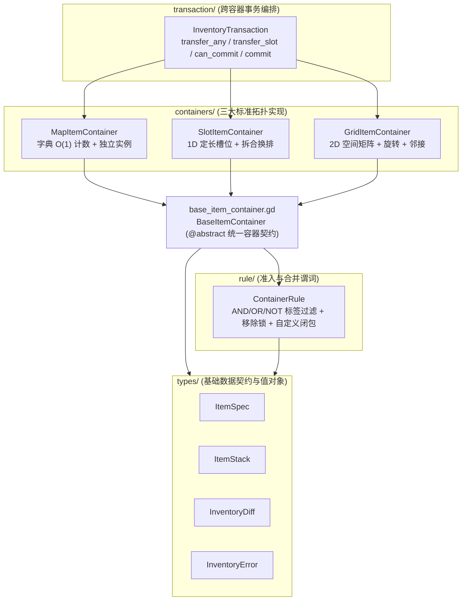

# Framework · Infra · Inventory (通用容器拓扑与跨容器原子事务基建)

> 纯内存（`RefCounted`）、零 `SceneTree` 依赖、零磁盘/网络 I/O、零业务数值耦合的背包与通用容器原子基础设施。
> 按正交职责划分为**「顶层抽象门面 + `types/` 数据契约 + `rule/` 准入算子 + `containers/` 多态容器实现 + `transaction/` 跨容器事务协调器」**五大物理分层。

```text
src/framework/infra/inventory/
├── _doc_inventory.md                     # 本文档
├── base_item_container.gd                # [顶层抽象门面] BaseItemContainer (@abstract 统一容器契约 + 全局单调 UID 水位管理)
├── types/                                # [公开数据契约与值对象子包 · 复数容器]
│   ├── inventory_error.gd                #   InventoryError 标准化二段式错误码常量表 ("Inventory.*")
│   ├── item_spec.gd                      #   ItemSpec 物品静态规格最小描述符 (继承 BaseParams)
│   ├── item_stack.gd                     #   ItemStack 最小运行时物品载荷单元 (继承 BaseParams)
│   └── inventory_diff.gd                 #   InventoryDiff 结构化增量变更单 (经济净增减 + UI 局部脏槽/UID/ID)
├── rule/                                 # [准入与合并规则算子子包 · 单数职能域]
│   └── container_rule.gd                 #   ContainerRule 容器标签白黑名单、移除锁与自定义准入/合并谓词算子
├── containers/                           # [多态容器拓扑实现子包 · 复数同质集合]
│   ├── map_item_container.gd             #   MapItemContainer 字典聚合 O(1) 计数 + 独立个体双轨混合容器
│   ├── slot_item_container.gd            #   SlotItemContainer 定长一维槽位数组容器 (放/取/合/拆/换/整理/安全扩缩容)
│   └── grid_item_container.gd            #   GridItemContainer 二维空间矩阵网格容器 (W×H 占地/旋转/连续寻位/邻接扫描)
└── transaction/                          # [跨容器原子事务编排子包 · 单数职能域]
	└── inventory_transaction.gd          #   InventoryTransaction 跨容器转移/换装互换 + 快照回滚批量配方事务器
```

---

## 一、 职责边界（「做什么」与「绝不做什么」）

- **做（基建原子）**：
  - 管理 `item_id`、全局单调 `uid`、数量 `count`、堆叠上限 `max_stack`、分类 `tags`、网格占地 `grid_size`、朝向 `rotated` 与透传字典 `meta`；
  - 执行容量预判、堆叠等价判定、拆分、槽位移动互换、二维异形矩形碰撞与自动旋转排布、邻接边缘扫描、跨容器双向互换与快照回滚事务；
  - 每次变更同步产出精确的 [`InventoryDiff`](types/inventory_diff.gd)，并提供纯净 `Dictionary` 快照编解码（`capture_snapshot` / `restore_snapshot`）。
- **绝不做（留给业务层组合）**：
  - 不感知任何具体玩法数值（攻击力、品质色、价格、冷却）；
  - 不直接读取外部策划导表文件（统一通过 `Callable` 反查 [`ItemSpec`](types/item_spec.gd)）；
  - 不直接调用存储、网络、全局事件总线或任何 UI `Node`。

---

## 二、 子包依赖拓扑与核心职责速查



| 子包分层 | 类与文件 | 角色定位 | 关键公开方法 |
| :--- | :--- | :--- | :--- |
| **Root** | [`BaseItemContainer`](base_item_container.gd) | 抽象容器门面 | `get_total_count()`、`has_enough()`、`can_add()`、`add()`、`remove_by_id()`、`capture_snapshot()` |
| **`types/`** | [`InventoryError`](types/inventory_error.gd) | 错误码常量表 | `INVALID_PARAM`、`RULE_REJECTED`、`CAPACITY_FULL`、`INSUFFICIENT_ITEM`、`COLLISION` 等 |
| **`types/`** | [`ItemSpec`](types/item_spec.gd) | 静态规格描述符 | `ItemSpec.create(...)`、`ItemSpec.resolver_from_dict(dict)`、`get_effective_size(rotated)` |
| **`types/`** | [`ItemStack`](types/item_stack.gd) | 运行时物品载荷 | `ItemStack.create(...)`、`can_merge_with(other, max_stack)`、`split_off(count)`、`clone_stack()` |
| **`types/`** | [`InventoryDiff`](types/inventory_diff.gd) | 增量变更单 | `added_totals`、`removed_totals`、`changed_slots`、`changed_uids`、`changed_item_ids` |
| **`rule/`** | [`ContainerRule`](rule/container_rule.gd) | 准入与合并算子 | `with_all_tags()`、`with_any_tags()`、`with_blocked_tags()`、`with_accept_predicate()`、`evaluate_accept()` |
| **`containers/`** | [`MapItemContainer`](containers/map_item_container.gd) | 字典混合容器 | `add()`、`remove_by_id()`、`remove_by_uid()`、`get_total_count()`、`get_unique_count()` |
| **`containers/`** | [`SlotItemContainer`](containers/slot_item_container.gd) | 一维槽位容器 | `add_at()`、`remove_at()`、`move_or_merge()`、`split_at()`、`sort()`、`resize_capacity()` |
| **`containers/`** | [`GridItemContainer`](containers/grid_item_container.gd) | 二维网格容器 | `place_at()`、`move_item()`、`rotate_item()`、`find_first_fit()`、`get_adjacent_uids()` |
| **`transaction/`** | [`InventoryTransaction`](transaction/inventory_transaction.gd) | 跨容器事务协调器 | `transfer_any()`、`transfer_slot()`、`take_by_id()`、`give()`、`can_commit()`、`commit()` |

---

## 三、 标准错误码速查 (`InventoryError`)

| 常量名 | 错误码字符串 | 触发条件 |
| :--- | :--- | :--- |
| `INVALID_PARAM` | `"Inventory.InvalidParam"` | 数量 `<= 0`、空 `item_id`、非法拆分范围或空容器引用 |
| `OUT_OF_BOUNDS` | `"Inventory.OutOfBounds"` | 一维槽位索引或二维网格矩形超出容器边界 |
| `SPEC_NOT_FOUND` | `"Inventory.SpecNotFound"` | 开启 `strict_spec` 时未能解析对应 `item_id` 的 `ItemSpec` |
| `RULE_REJECTED` | `"Inventory.RuleRejected"` | 命中黑名单标签、缺失必需标签、移除被锁定或自定义谓词拒绝 |
| `CAPACITY_FULL` | `"Inventory.CapacityFull"` | 槽位已满、网格无法排布、超出单堆上限或缩容区间存在占用 |
| `INSUFFICIENT_ITEM` | `"Inventory.InsufficientItem"` | 扣减或转出数量大于当前实际持有量 |
| `ITEM_NOT_FOUND` | `"Inventory.ItemNotFound"` | 指定槽位、网格坐标或 `uid` 处不存在物品 |
| `MERGE_INCOMPATIBLE` | `"Inventory.MergeIncompatible"` | 定点合并时物品 ID 不同、不可堆叠或 `meta` 元数据不等价 |
| `ROTATION_FORBIDDEN` | `"Inventory.RotationForbidden"` | 对 `rotatable == false` 的物品请求旋转放置 |
| `COLLISION` | `"Inventory.Collision"` | 二维网格目标矩形区域存在多物重叠或不可合并阻挡 |
| `SWAP_REJECTED` | `"Inventory.SwapRejected"` | 跨容器互换时非整堆移动或双向 `ContainerRule` 校验未通过 |

---

## 四、 黄金调用范式

```gdscript
# 1. 构建物品规格表与解析器（业务层可替换为查询导表缓存）
var specs: Dictionary = {
	&"gold": ItemSpec.create(&"gold", 999999, [&"currency"]),
	&"ore_iron": ItemSpec.create(&"ore_iron", 10, [&"material"]),
	&"sword_iron": ItemSpec.create(&"sword_iron", 1, [&"equip", &"weapon"], Vector2i(1, 3)),
}
var resolver: Callable = ItemSpec.resolver_from_dict(specs)

# 2. 创建钱包（Map）、主背包（Slot）与仅限武器的主手装备槽（Slot + ContainerRule）
var wallet := MapItemContainer.new(&"wallet", 0, resolver)
var bag := SlotItemContainer.new(&"bag", 16, resolver)
var weapon_slot := SlotItemContainer.new(
	&"equip_weapon",
	1,
	resolver,
	ContainerRule.new().with_all_tags([&"weapon"])
)

wallet.add(ItemStack.create(&"gold", 1000))
bag.add(ItemStack.create(&"ore_iron", 10))

# 3. 执行多容器原子锻造事务（即使此时背包已满，消耗 10 个铁矿腾出空槽后依然能成功放入铁剑；任一步失败全量回滚）
var craft_tx := InventoryTransaction.new() \
	.take_by_id(wallet, &"gold", 300) \
	.take_by_id(bag, &"ore_iron", 10) \
	.give(bag, ItemStack.create(&"sword_iron", 1, {"atk": 25}))

var craft_res: Result = craft_tx.commit()
if craft_res.is_ok():
	var diff: InventoryDiff = craft_res.value as InventoryDiff
	var bag_diff: InventoryDiff = diff.get_container_diff(&"bag")
	# 上层仅需根据 bag_diff.changed_slots 局部刷新受影响的 UI 格子

# 4. 一键穿戴或换装（若武器槽已有旧武器，自动双向校验并互换回背包原槽位）
var equip_res: Result = InventoryTransaction.transfer_slot(bag, 0, weapon_slot, 0)
```
