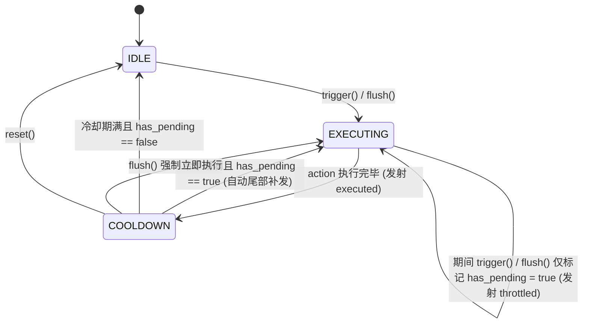

# Framework · Infra · Scheduler (异步冷却防抖与串行互斥调度基建)

> 基于**显式有限状态机 (FSM)** 与**单定时器模型 (Single-Timer Invariant)** 的异步冷却防抖调度基础设施（[`CooldownScheduler`](cooldown_scheduler.gd)）。
> 统一协调速率限制 (Rate Limiting)、尾部延迟合并 (Trailing Debounce) 与并发串行互斥 (Execution Mutex)。
> - **负责**：保证两次执行间隔 $\ge$ 冷却时长、执行中或冷却期内的多次高频触发自动合并为单次尾部补发、支持同步函数与异步协程执行体。
> - **不负责**：不持久化调用参数、不提供多优先级任务队列或帧内时间切片调度。

```text
src/framework/infra/scheduler/
├── _doc_scheduler.md       # 本文档
└── cooldown_scheduler.gd   # 异步冷却节流调度器核心实现 (CooldownScheduler)
```

---

## 一、 状态机流转拓扑与核心机制



1. **三态闭环驱动 (`State`)**：
   - `IDLE`（空闲就绪）：无任务运行且冷却已结束，`trigger()` 立即转入 `EXECUTING` 执行；
   - `EXECUTING`（正在执行）：目标 `action`（支持 `await` 异步协程）正在运行。此阶段任何 `trigger()` 或 `flush()` 均绝不重入，仅将 `_has_pending` 置为 `true` 并触发 `throttled` 信号，确保并发串行互斥；
   - `COOLDOWN`（冷却等待）：任务执行完毕后进入单定时器冷却倒计时，期满时若 `_has_pending == true` 则自动闭环转入 `EXECUTING` 补发一次，否则回归 `IDLE`。
2. **单定时器不变量（Single-Timer Invariant）**：
   - 无论高频调用多少次 `trigger()`，同一时刻至多存在一个 `SceneTreeTimer` 冷却协程，彻底根除高频事件引发的定时器雪崩。
3. **可观测性指标与信号切面**：
   - **只读属性**：`state`、`is_executing`、`has_pending`、`remaining_cooldown`（剩余冷却秒数）、`is_busy`（非 `IDLE` 或有挂起任务）；
   - **信号切面**：`executed`（实质性执行完成）、`throttled`（触发被合并排队）、`state_changed(old_state, new_state)`。

---

## 二、 使用范式

```gdscript
# 1. 实例化调度器（冷却 5.0 秒，绑定异步云存档同步回调与日志 Tag）
var sync_scheduler := CooldownScheduler.new(5.0, func() -> void:
	await App.storage.write_async(
		PlayerProfileModel.storage_item(),
		PlayerProfileService.get_current().to_dict(),
		StorageWriteMode.LOCAL_FIRST
	)
, "ProfileCloudSync")

# 2. 监听状态机流转或节流事件
sync_scheduler.state_changed.connect(func(old_state: int, new_state: int) -> void:
	App.logger.debug("Sync", "Scheduler state: %d -> %d" % [old_state, new_state])
)

# 3. 高频触发：首次立即执行，后续 5 秒内的多次触发自动合并，冷却期满尾部补发一次
sync_scheduler.trigger()
sync_scheduler.trigger()
sync_scheduler.trigger()

# 4. 关键节点（如切场景前）忽略冷却限制立即刷入
sync_scheduler.flush()

# 5. 取消排队中的尾部待发任务，或彻底重置回 IDLE
sync_scheduler.cancel()
sync_scheduler.reset()
```
