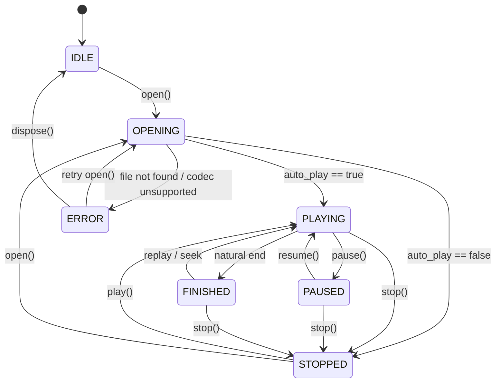

# Framework · Video (跨平台视频播放与硬件加速驱动)

> 统一视频播放控制门面。封装底层跨平台解码器差异，透明桥接 `addons/` 中的官方跨端插件（PC 桌面端 FFmpeg GDExtension、Android ExoPlayer 原生插件、iOS AVPlayer 原生插件）与引擎内置软解播放器，提供极简纯粹的播放控制 API 与 BGM 自动避让协同。

```text
src/framework/modules/video/
├── _doc_video.md                          # 本文档
├── base_video_player.gd                   # 门面抽象基类 BaseVideoPlayer (App.video，详尽注释)
│
├── types/                                 # [公开契约] 外部业务与门面参数实体
│   ├── video_error.gd                     # 标准错误码命名空间 (VideoError)
│   ├── video_playback_state.gd            # 状态机定义与流转守卫 (VideoPlaybackState)
│   ├── video_play_options.gd              # 播放配置实体 (继承 BaseParams，支持流式 Builder 与字典序列化)
│   └── video_backend_type.gd              # 驱动类型枚举 (AUTO, ADDON_FFMPEG, NATIVE_MOBILE, ENGINE_THEORA)
│
└── impl/                                  # [私有收敛] 内部实现与组件
    ├── video_player.gd                    # 门面核心实现 (实现 BaseVideoPlayer，调度多端管线与音画避让)
    ├── components/                        # 内部私有视觉组件
    │   └── video_cutscene_overlay.gd      # 全屏剧情过场渲染遮罩层 (纯黑防穿透底衬、居中 TextureRect 与跳过交互)
    └── adapters/                          # 跨平台桥接适配器层
        ├── video_player_adapter.gd        # 适配器基类接口 (带生命周期与能力查询)
        ├── addon_video_adapter.gd         # 桥接 PC 桌面端 (Win/Mac/Linux) FFmpeg GDExtension
        ├── native_mobile_video_adapter.gd # 桥接 移动端 (Android ExoPlayer / iOS AVPlayer) 原生插件
        └── engine_video_adapter.gd        # 兜底桥接 原生 VideoStreamPlayer (OGV Theora 免插件保底)

# 外部插件与跨平台预编译底座目录 (addons/):
addons/
├── ffmpeg/                                # GDExtension FFmpeg (PC 桌面与高级解码底座)
│   ├── ffmpeg.gdextension                 # GDExtension 跨平台描述 (Win/Linux/Mac)
│   ├── plugin.cfg                         # 编辑器插件声明
│   ├── export_plugin.gd                   # 跨平台导出插件 (自动打包 Windows DLL 与 Linux .so)
│   ├── win64/                             # Windows x86_64 全套 DLL + build_windows.bat + 说明
│   ├── linux64/                           # Linux x86_64 全套 .so + build_linux.sh + 说明
│   └── macos/                             # macOS 通用双架构 Framework/Dylib + build_macos.sh + 说明
├── video_player_android/                  # Android 原生硬件加速底座 (Media3 ExoPlayer)
│   ├── plugin.cfg                         # Godot 插件描述
│   ├── export_plugin.gd                   # Godot 导出插件 (自动注册 .gdap)
│   ├── godot_video_player.gdap            # Android 依赖描述 (Media3 ExoPlayer)
│   ├── godot_video_player.aar             # 预编译就绪 AAR 归档 (包含完整 classes.jar)
│   ├── build.gradle                       # Android Library Gradle 构建脚本
│   ├── build_android.sh                   # 打包与 --check 校验脚本 (支持 Gradle 与 javac 自动回退)
│   └── src/                               # 完整 Java 原生源码
└── video_player_ios/                      # iOS 原生硬件加速底座 (AVPlayer)
    ├── plugin.cfg                         # Godot 插件描述
    ├── export_plugin.gd                   # Godot 导出插件 (自动注册 .gdip)
    ├── godot_video_player.gdip            # iOS 依赖描述 (链接 AVFoundation/AVKit)
    ├── godot_video_player.a               # 预编译就绪静态库 (arm64 真实设备支持，导出注册入口)
    ├── build_ios.sh                       # 静态库一键构建与 --check 校验脚本
    └── src/                               # 完整 Objective-C++ 原生源码
```

---

## 核心设计特性

1. **外部插件全解耦 (Addon Decoupling)**：
   - 业务代码严禁直接 import 或依赖 `addons/` 插件私有类名。全工程统一面向 `App.video` 编程。
   - `AddonVideoAdapter` 采用 `ClassDB` 动态反射探测技术，按需桥接 `FFmpegVideoStream`；
   - `NativeMobileVideoAdapter` 采用 `Engine.has_singleton(...)` 动态探测，精准桥接 Android `GodotVideoPlayer` 与 iOS `AVPlayer`；即使开发机未安装对应平台的二进制，也绝无语法报错，全员协作零障碍。
2. **多端双轨驱动策略 (Dual-Track Architecture)**：
   - **PC / 桌面端 (Windows / Linux / macOS)**：优先通过 `AddonVideoAdapter` 驱动，支持 MP4/MKV/H.264/H.265/VP9 全格式高清解码与 3D 材质投射。
   - **移动端 (Android / iOS)**：在导出预设启用并验证原生插件后，通过 `NativeMobileVideoAdapter` (ExoPlayer / AVPlayer) 驱动；插件不可用时返回标准错误或使用 `.ogv` fallback。
3. **渐进式优雅降级 (Graceful Degradation)**：
   - 当目标平台未启用专业插件或缺少外部动态库时，自动降级至内置 `EngineVideoAdapter`（`VideoStreamTheora`，播放 `.ogv`），绝不崩溃。
4. **状态机强约束流转 (State Machine Integrity)**：
   - `VideoPlaybackState` 内置合法状态流转矩阵 `VALID_TRANSITIONS`，严禁非法跳跃；提供 `is_active()` 与 `is_terminal()` 状态语义快速判断。
5. **参数契约实体化 (BaseParams Integration)**：
   - `VideoPlayOptions` 继承框架统一的 `BaseParams`，不仅支持流式链式配置（Fluent Builder），更原生具备 Dictionary 自动双向映射，场景间传参零样板代码。
6. **视觉呈现与播放逻辑解耦**：
   - 全屏过场视觉逻辑收敛于 `VideoCutsceneOverlay`，负责纯黑底衬、画面比例对齐与跳过按钮平滑淡入，`VideoPlayer` 专注音视频时序与生命周期。
7. **显式依赖注入与正交音频避让 (Explicit DI & Orthogonal Audio Ducking)**：
   - `VideoPlayer` 声明 `MODULE_ID = &"video"` 与 `OPTIONAL_MODULES = [&"audio", &"logger"]`，由 `FrameworkRuntime` 显式构造注入 `BaseAudioSystem` 与 `BaseFrameworkLogger`，零 `App.xxx` 隐式耦合。
   - 视频播放时调用 `_audio_system.duck_bgm(0.0, duck_fade_seconds)` 进行**正交音画避让**（不污染用户设定的 BGM 音量滑块值）；视频停止、自然结束或异常退出时自动调用 `unduck_bgm(duck_fade_seconds)` 平滑恢复，并通过递增 `_operation_token` 与 `300s` 超时守卫杜绝异步过场协程竞态悬挂。

---

## 状态机流转图 (State Transition Diagram)



---

## 全平台底座就绪状态 (Platform Matrix)

| 平台 | 默认适配器 | 底座插件目录 | 二进制状态 | 交付文件 |
| :--- | :--- | :--- | :--- | :--- |
| **Windows 64位** | `AddonVideoAdapter` (FFmpeg) | `addons/ffmpeg/win64/` | 预编译就绪，已配导出插件 | 全套 FFmpeg DLL + libgdffmpeg DLL + 导出保护 |
| **Linux 64位** | `AddonVideoAdapter` (FFmpeg) | `addons/ffmpeg/linux64/` | 预编译就绪，已配导出插件 | 全套 FFmpeg .so + libgdffmpeg .so + 导出保护 |
| **macOS** | `AddonVideoAdapter` (FFmpeg) | `addons/ffmpeg/macos/` | 编译就绪 (Universal arm64/x86_64) | 全套 FFmpeg dylib + libgdffmpeg.framework |
| **Android** | `NativeMobileVideoAdapter` (ExoPlayer) | `addons/video_player_android/` | 预编译就绪，默认打包完成 (含完整 classes.jar) | `godot_video_player.aar`, `.gdap`, 导出插件 |
| **iOS** | `NativeMobileVideoAdapter` (AVPlayer) | `addons/video_player_ios/` | 预编译就绪，默认打包完成 (arm64 静态库导出注册入口) | `godot_video_player.a`, `.gdip`, 导出插件 |

---

## 使用范式

### 1. 现代链式配置与基础播放
```gdscript
# 使用 Fluent Builder 构建强类型播放配置
var options := VideoPlayOptions.new() \
    .with_loop(false) \
    .with_auto_play(true) \
    .with_duck_bgm(true, 0.5) \
    .with_volume(0.9)

# 打开并播放视频
var result := App.video.open("res://src/assets/videos/intro.mp4", options)
if result.is_err():
    App.logger.error("Video", "打开视频失败 [%s]: %s" % [result.error_code(), result.error_message()])
    return

# 监听播放完成
App.video.playback_finished.connect(func():
    App.logger.info("Video", "剧情视频播放完毕，进入主界面")
    App.scene.replace(GameScenes.Scene.SPLASH)
, CONNECT_ONE_SHOT)
```

### 2. 全屏剧情过场播放 (跨端自适应)
```gdscript
# 配置前 3 秒禁止跳过，3 秒后平滑淡出跳过按钮
var cutscene_opts := VideoPlayOptions.new() \
    .with_skip(true, 3.0) \
    .with_duck_bgm(true, 0.4)

# 过场调用是异步的；完成或玩家跳过之后自动继续后续业务流程
var result := await App.video.play_cutscene("res://src/assets/videos/cg_opening.mp4", cutscene_opts)
if result.is_err():
    App.logger.error("Video", "过场播放异常: %s" % result.error_message())
    return

App.scene.replace("res://src/game/features/splash/view/splash_scene.tscn")
```

### 3. 将视频纹理绑定至 UI / 材质画面
```gdscript
@onready var screen: TextureRect = $VideoScreen

func _process(_delta: float) -> void:
    if App.video.is_playing() and screen.texture == null:
        screen.texture = App.video.get_video_texture()

# 原生移动端播放器使用系统 Overlay，通常不会提供 Texture2D；
# 需要纹理合成时请使用可输出 VideoStream 的桌面/引擎后端。
```

### 4. 播放控制 (暂停 / 恢复 / 跳转 / 状态监听)
```gdscript
# 状态机监听
App.video.state_changed.connect(func(new_state: int, old_state: int):
    App.logger.debug("Video", "状态跃迁: %s -> %s" % [
        VideoPlaybackState.to_string_name(old_state),
        VideoPlaybackState.to_string_name(new_state)
    ])
)

# 暂停与恢复 (全端生效，无论是原生 ExoPlayer/AVPlayer 还是桌面端 FFmpeg)
App.video.pause()
App.video.resume()

# 跳转至第 15 秒
App.video.seek(15.0)

# 停止播放并恢复 BGM
App.video.stop()
```
