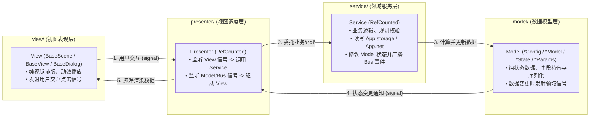
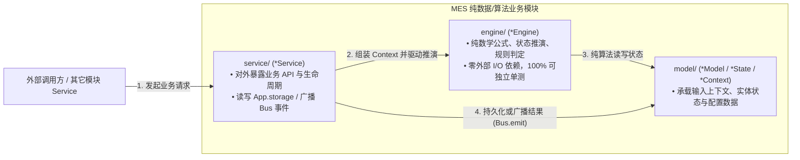

# Game Layer Architecture (游戏业务层架构规范)

> 游戏业务层（`src/game/`）构建在 `src/framework/` 之上，是具体玩法逻辑、用户交互、场景流转与美术资产的承载空间。
> 业务层摒弃笨重的空壳继承基类，采用**“垂直业务模块（Vertical Slice）子目录分层”**：
> - **交互与界面驱动模块**采用 **MSVP (`model/` - `service/` - `view/` - `presenter/`)** 子目录架构；
> - **纯数据与算法演算驱动模块**采用 **MES (`model/` - `engine/` - `service/`)** 子目录架构；
> - 数据层（`model/`）内部通过**严格的领域架构后缀（Suffixes）**区分数据生命周期与职责边界。

---

## 一、 顶层工程目录规范

```text
src/
├── assets/                      # [原始美术与音频素材]
│   ├── audio/                   # 音效与音乐 (bgm/, sfx/)
│   ├── textures/                # 纹理贴图 (ui/, characters/)
│   ├── fonts/                   # 字体文件
│   └── videos/                  # CG 与动画过场视频 (.mp4, .ogv)
│
├── resources/                   # [Godot 资源与静态配置表]
│   ├── configs/                 # 游戏策划数值配置、关卡表、物品表
│   └── data/                    # 静态数据定义
│
├── framework/                   # [通用游戏引擎基建层]
│   └── (core, modules, infra, util)
│
└── game/                        # [游戏玩法与业务逻辑层]
    ├── _doc_game.md             # 本架构规范文档
    │
    ├── bootstrap/               # 引擎极简纯空启动器 (仅承载内核装配、硬件预设对齐与首棒交接)
    │   ├── _doc_bootstrap.md
    │   ├── bootstrap_scene.gd   # 引擎主入口空场景 (run/main_scene，0 UI 渲染开销)
    │   └── bootstrap_scene.tscn
    │
    ├── shared/                  # 业务层跨模块共享内核 (顶层四支柱 + 二级子域分包)
    │   ├── _doc_shared.md
    │   ├── define/              # [支柱 1] 静态契约定义 (GameConstants, GameEvents, GameEnums)
    │   ├── model/               # [支柱 2] 共享数据模型 (save/ 持久化模型, config/ 配置, vo/ 值对象)
    │   ├── service/             # [支柱 3] 共享业务服务 (settings/ 设置服务, profile/ 档案服务)
    │   └── component/           # [支柱 4] 通用无业务流 UI 组件 (button/, dialog/, toast/, widget/)
    │
    └── features/                # 核心垂直业务功能模块集合 (按模块特征采用 MSVP 或 MES 子目录架构)
        ├── splash/              # [MSVP 标杆模块] 闪屏展示与加权业务启动管线 (model/, service/, view/, presenter/)
        ├── <ui_feature>/        # [模式 A: MSVP 交互模块] (model/, service/, view/, presenter/)
        └── <data_feature>/      # [模式 B: MES 算法/数据模块] (model/, engine/, service/)
```

---

## 二、 垂直模块双轨架构规范：MSVP 与 MES

在 `src/game/features/` 下开发具体功能模块时，**不通过强行继承空壳基类来堆砌概念**，而是根据模块是否包含 UI 视图，选择 **MSVP** 或 **MES** 子文件夹架构组织代码。

### 1. 模式 A：MSVP 架构（面向交互与界面表现模块）

适用于**大多数包含 UI 界面、弹窗或场景交互的业务模块**（如 `lobby` 大厅、`talent` 天赋树、`shop` 商店、`backpack` 背包、`settlement` 结算、`settings` 设置面板）：

```text
src/game/features/<feature_name>/
├── _doc_<feature_name>.md
├── model/                       # 数据结构与状态定义 (按架构后缀区分领域)
├── service/                     # 业务规则校验、App.* 存储/网络读写、Model 修改
├── view/                        # 场景 (.tscn) 与视图节点脚本 (BaseScene / BaseView / BaseDialog / Control)
└── presenter/                   # 视图与业务中介胶水 (监听 View 交互 -> 调 Service；监听 Model/Bus -> 刷 View)
```



### 2. 模式 B：MES 架构（面向纯数据与核心算法演算模块）

适用于**无直接 UI 界面、聚焦底层核心玩法公式、状态推演与高频计算的纯逻辑业务模块**（如 `combat` 战斗数值演算、`wave` 刷怪波次生成、`buff` 状态效果机、`offline` 离线挂机收益推演）：

```text
src/game/features/<feature_name>/
├── _doc_<feature_name>.md
├── model/                       # 领域数据实体、运行时状态 (*State) 与计算上下文 (*Context)
├── engine/                      # 纯净算法与规则推演引擎 (*Engine，无状态/纯计算，不碰外部 I/O)
└── service/                     # 模块对外服务门面 (*Service，编排 Engine 计算、管理生命周期、对接 App.* 与 Bus)
```



### 3. 各子目录职责与硬性红线

| 子目录 | 适用模式 | 核心职责 | 硬性禁止事项 (Strict Anti-Patterns) |
| :--- | :--- | :--- | :--- |
| **`model/`** | MSVP / MES | 持有纯数据结构、运行态字段与序列化映射；状态变化时发射 `signal` | **严禁**引用任何 UI 节点；**严禁**调用 `App.net` / `App.storage` 执行 I/O。 |
| **`engine/`** | MES | 核心数值公式、波次/掉落生成算法、复杂状态机推演（`class_name XxxEngine`） | **严禁**引用 UI 节点；**严禁**直接读写磁盘存档或发起网络请求，保持纯函数/纯算法特性。 |
| **`service/`** | MSVP / MES | 业务流程编排、规则校验、调用 `Engine`、读写 `App.*` 门面、更新 `Model`、发送 `Bus.emit` | **严禁**直接查找或修改具体 View 控件节点；**严禁**编写界面 Tween 补间动画。 |
| **`view/`** | MSVP | 继承 [`BaseScene`](file:///d:/code/GodotProject/slacker-survivors/src/framework/modules/scene/base_scene.gd) / [`BaseView`](file:///d:/code/GodotProject/slacker-survivors/src/framework/modules/display/base_view.gd) / [`BaseDialog`](file:///d:/code/GodotProject/slacker-survivors/src/game/shared/component/dialog/base_dialog.gd) 或 `Control`；负责节点排版、动效播放、捕获输入并抛出 `signal` | **严禁**编写业务规则计算（如扣减金币、伤害公式）；**严禁**直接篡改持久化 Model。 |
| **`presenter/`** | MSVP | 连接 `View` 与 `Service`/`Model` 的胶水层；管理信号连接与界面销毁解绑 | **保持薄层**。不写复杂玩法算法（归 `service/` 或 `engine/`），不直接操作底层子节点树（归 `view/`）。 |

---

## 三、 `model/` 数据结构领域后缀规范 (Model Architectural Suffixes)

为了杜绝在 `model/` 目录中将所有数据结构笼统命名为 `XxxModel` 造成的语义混乱，所有位于 `src/game/shared/model/` 及 `src/game/features/*/model/` 下的数据类，**必须根据其数据生命周期与领域职责采用以下标准后缀**：

| 架构后缀 | 领域语义与职责定位 | 推荐继承基类 | 生命周期与读写特征 | 典型命名示例 |
| :--- | :--- | :--- | :--- | :--- |
| **`*Config`** | **静态策划配表模型**：承载武器基础数值、关卡波次表、天赋树静态配置 | `Resource` 或 [`BaseParams`](file:///d:/code/GodotProject/slacker-survivors/src/framework/infra/param/base_params.gd) | **全局只读**。启动或进场时从 `res://src/resources/configs/` 加载，运行期严禁修改。 | `HeroConfig`<br>`WeaponConfig`<br>`StageWaveConfig` |
| **`*Model`** | **核心业务/持久档案模型**：承载跨周期持久化档案或模块主干业务实体 | [`BaseParams`](file:///d:/code/GodotProject/slacker-survivors/src/framework/infra/param/base_params.gd) | **持久/长周期**。自带 `to_dict()` / `from_dict()` 反射序列化与 `data_changed` 信号，与 `App.storage` 映射。 | [`PlayerProfileModel`](file:///d:/code/GodotProject/slacker-survivors/src/game/shared/model/save/player_profile_model.gd)<br>[`GameSettingsModel`](file:///d:/code/GodotProject/slacker-survivors/src/game/shared/model/save/game_settings_model.gd) |
| **`*State`** | **运行时动态状态模型**：承载单局战斗、单个实体或当前界面的高频易变内存状态 | `RefCounted` 或 [`BaseParams`](file:///d:/code/GodotProject/slacker-survivors/src/framework/infra/param/base_params.gd) | **局内/会话期**。随帧更新或交互高频变动，退出关卡或关闭模块时重置销毁。 | [`SplashBootState`](file:///d:/code/GodotProject/slacker-survivors/src/game/features/splash/model/splash_boot_state.gd)<br>`BattleRunState`<br>`WaveSpawnState` |
| **`*Params`** | **传输契约入参模型**：用于切场景（`App.scene`）、开弹窗（`DialogManager`）或跨模块调用的强类型参数包 | [`BaseParams`](file:///d:/code/GodotProject/slacker-survivors/src/framework/infra/param/base_params.gd) | **瞬态传输**。构造并透传后即完成使命，替代松散易错的裸 `Dictionary` 传参。 | [`SplashEnterParams`](file:///d:/code/GodotProject/slacker-survivors/src/game/features/splash/model/splash_enter_params.gd)<br>`BattleEnterParams` |
| **`*Context`** | **引擎计算/管线上下文**：在 MES 的 `Engine` 演算或流水线（Pipeline）多步骤间传递中间状态与耗时指标 | `RefCounted` 或 [`BaseParams`](file:///d:/code/GodotProject/slacker-survivors/src/framework/infra/param/base_params.gd) | **单次演算/管线期**。贯穿一次复杂公式推导或启动流程，聚合输入与阶段产出。 | [`SplashBootContext`](file:///d:/code/GodotProject/slacker-survivors/src/game/features/splash/model/splash_boot_context.gd)<br>`DamageCalcContext` |
| **`*VO` / `*Data`** | **轻量值对象 / 子条目结构**：复合模型内部的列表子项、展示用不可变数据包 | [`BaseParams`](file:///d:/code/GodotProject/slacker-survivors/src/framework/infra/param/base_params.gd) 或 `RefCounted` | **依附于父模型或单次渲染**。无独立生命周期管理。 | `RewardItemData`<br>`StatModifierVO` |

---

## 四、 启动与跨模块协作

1. **统一启动入口（空入口 `bootstrap/` 交接 + 垂直模块 `features/splash/` 管线）**：
   - 引擎默认启动主场景（`run/main_scene`）配置为纯空入口 [`res://src/game/bootstrap/bootstrap_scene.tscn`](file:///d:/code/GodotProject/slacker-survivors/src/game/bootstrap/bootstrap_scene.tscn)（[`BootstrapScene`](file:///d:/code/GodotProject/slacker-survivors/src/game/bootstrap/bootstrap_scene.gd)）；
   - `BootstrapScene` 在渲染首帧 UI 前率先完成 `await App.bootstrap()` 框架内核装配与 [`GameSettingsService.load_and_apply()`](file:///d:/code/GodotProject/slacker-survivors/src/game/shared/service/settings/game_settings_service.gd) 硬件参数同步（窗口/分辨率/Locale/音量），随后无感移交至 [`features/splash`](file:///d:/code/GodotProject/slacker-survivors/src/game/features/splash/_doc_splash.md) 模块的 [`SplashScene`](file:///d:/code/GodotProject/slacker-survivors/src/game/features/splash/view/splash_scene.gd)；
   - `SplashScene` 通过 [`SplashPresenter`](file:///d:/code/GodotProject/slacker-survivors/src/game/features/splash/presenter/splash_presenter.gd) 委托 [`SplashBootService`](file:///d:/code/GodotProject/slacker-survivors/src/game/features/splash/service/splash_boot_service.gd) 顺序执行加权业务任务（配表装载 ➔ 会话同步 ➔ [`PlayerProfileService`](file:///d:/code/GodotProject/slacker-survivors/src/game/shared/service/profile/player_profile_service.gd) 档案恢复 ➔ 资源预热 ➔ 首屏路由裁决），完成后广播 `GameEvents.BOOTSTRAP_COMPLETED` 并自动流转至目标场景。
2. **跨模块解耦通讯**：
   - `features/` 下的各个垂直模块之间**严禁直接交叉 import 对方的内部 `Presenter`、`View` 或私有 `State`**；
   - 跨模块事实通知统一使用全局事件总线 [`Bus.emit(GameEvents.XXX, payload)`](file:///d:/code/GodotProject/slacker-survivors/src/game/shared/define/game_events.gd) 与 `Bus.on(GameEvents.XXX, callback)` 进行异步解耦通讯；
   - 跨模块共享的数据模型、服务、组件与静态契约统一收敛在 [`src/game/shared/`](file:///d:/code/GodotProject/slacker-survivors/src/game/shared/_doc_shared.md)。
