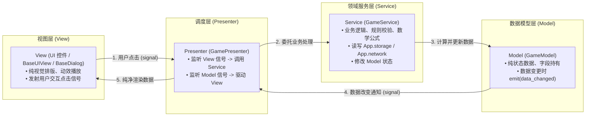

# Game Layer Architecture (游戏业务层架构规范)

> 游戏业务层（`src/game/`）构建在 `src/framework/` 之上，是具体玩法逻辑、用户交互、场景流转与美术资产的承载空间。
> 采用 **MSVP (Model-Service-View-Presenter)** 架构组织所有业务子模块，彻底实现**表现渲染与业务规则的彻底解耦**。

---

## 一、 顶层工程目录规范

```text
src/
├── assets/                      # [原始美术与音频素材]
│   ├── audio/                   # 音效与音乐 (bgm/, sfx/)
│   ├── textures/                # 纹理贴图 (ui/, characters/)
│   ├── fonts/                   # 字体文件
│   └── video/                   # CG 与动画过场视频 (.mp4, .ogv)
│
├── resources/                   # [Godot 资源与静态配置表]
│   ├── configs/                 # 游戏策划数值配置、关卡表、物品表
│   ├── themes/                  # UI 主题与样式盒 (.tres)
│   └── data/                    # 静态数据定义
│
├── framework/                   # [通用游戏引擎基建层]
│   └── (core, modules, infra, util, components)
│
└── game/                        # [游戏玩法与业务逻辑层]
    ├── _doc_game.md             # 本架构规范文档
    │
    ├── bootstrap/               # 启动装配与首发场景
    │   ├── _doc_bootstrap.md
    │   ├── game_bootstrapper.gd # 启动流水线调度
    │   ├── splash_scene.gd      # 首发闪屏场景 (继承 BaseScene)
    │   └── splash_scene.tscn
    │
    ├── shared/                  # 业务层跨模块共享基础
    │   ├── _doc_shared.md
    │   ├── msvp/                # MSVP 架构四要素核心基类 (GameModel, GameService, GamePresenter)
    │   ├── constants/           # 业务全局常量 (GameConstants)
    │   └── events/              # 跨模块领域事件 (GameEvents)
    │
    └── features/                # 核心功能模块集合
        ├── lobby/               # 大厅功能模块
        │   ├── _doc_lobby.md
        │   └── main_menu/       # [子模块] 主选单 (MSVP)
        ├── battle/              # 战斗功能模块
        │   ├── _doc_battle.md
        │   ├── battle_scene.*   # 战斗场景生命周期
        │   ├── hud/             # [子模块] 战斗抬头显示 (MSVP)
        │   └── upgrade_selection/ # [子模块] 肉鸽升级选卡 (MSVP)
        └── ...                  # 其它业务功能模块
```

---

## 二、 MSVP 架构核心规范 (Model - Service - View - Presenter)

在传统 MVP 中，Presenter 往往容易演化为上千行的“巨石类”（上帝类），既要处理网络与存档，又要计算公式，还要刷新 UI。
为解决此问题，框架引入 **MSVP 四层分工**：



### 1. 各角色职责与硬性铁律

| 角色 | 推荐基类 | 核心职责 | 硬性禁止事项 (Strict Anti-Patterns) |
| :--- | :--- | :--- | :--- |
| **Model** | [`GameModel`](file:///Users/krace/Code/GodotProject/slacker-survivors/src/game/shared/msvp/game_model.gd) | 持有状态数据；在数据变动时发射 `data_changed` | **严禁**引用任何 UI 控件节点；**严禁**处理网络或存储请求。 |
| **Service** | [`GameService`](file:///Users/krace/Code/GodotProject/slacker-survivors/src/game/shared/msvp/game_service.gd) | 纯粹业务逻辑、数值公式、玩法规则校验；读写 `App.*` 门面；修改 Model | **严禁**直接操作或修改 View 节点控件；**严禁**写进退场补间动画。 |
| **View** | [`BaseUIView`](file:///Users/krace/Code/GodotProject/slacker-survivors/src/framework/modules/ui/base_ui_view.gd) / [`BaseDialog`](file:///Users/krace/Code/GodotProject/slacker-survivors/src/framework/modules/ui/base_dialog.gd) | UI 节点排版、播放补间动画、安全区适配；捕获点击并以 signal 抛出 | **严禁**写业务逻辑（如金币扣减、胜负判定）；**严禁**直接修改 Model。 |
| **Presenter**| [`GamePresenter`](file:///Users/krace/Code/GodotProject/slacker-survivors/src/game/shared/msvp/game_presenter.gd) | 充当 View 与 Model/Service 的粘合胶水；生命周期注册与反注册 | **保持薄层**。不写复杂游戏规则算法（归 Service），不手写节点动画（归 View）。 |

---

## 三、 启动与跨模块协作

1. **统一启动入口**：
   - 游戏默认启动主场景配置为 [`res://src/game/bootstrap/splash_scene.tscn`](file:///Users/krace/Code/GodotProject/slacker-survivors/src/game/bootstrap/splash_scene.tscn)；
   - 闪屏场景由 [`GameBootstrapper`](file:///Users/krace/Code/GodotProject/slacker-survivors/src/game/bootstrap/game_bootstrapper.gd) 自动完成 `await App.bootstrap()` 框架初始化与玩家存档加载，完成后平滑跳转至大厅；
2. **跨模块通讯**：
   - 模块与模块之间杜绝直接交叉 import 对方的内部 Presenter 或 Service；
   - 统一使用全局事件总线 [`Bus.emit(GameEvents.XXX, payload)`](file:///Users/krace/Code/GodotProject/slacker-survivors/src/game/shared/events/game_events.gd) 进行异步解耦通讯。
