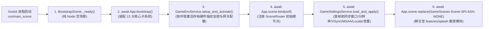

# Game · Bootstrap (极简纯空引擎启动器与硬件预设交接)

> 游戏工程唯一引擎启动主入口（`project.godot` 中的 `run/main_scene`）。
> 严格遵循**「启动器极简纯粹」**原则：本目录**仅挂载零 UI 开销的纯空场景 (`BootstrapScene`)**，负责在渲染任何业务画面前完成 **Framework 内核装配 (`App.bootstrap()`)**、**全局运行环境与存档安全策略激活 (`GameEnvService.setup_and_activate()`)** 与 **早期设备硬件预设对齐 (`GameSettingsService.load_and_apply()`)**，随后立即无感移交控制权至业务模块 [`src/game/features/splash/`](../features/splash/_doc_splash.md)。

---

## 一、 目录结构规范

```text
src/game/bootstrap/
├── _doc_bootstrap.md                # 本架构规范文档
├── bootstrap_scene.gd               # 极简空启动器脚本 (BootstrapScene extends BaseScene)
└── bootstrap_scene.tscn             # 纯 Node 空场景文件 (0 UI 控件 · 0 渲染负担)
```

---

## 二、 核心启动与交接时序



---

## 三、 为什么采用「空场景 `BootstrapScene` + 垂直模块 `features/splash`」分离架构？

1. **彻底根除首帧画面闪烁、语言跳变与启动爆音**：
   - 若将带 UI 的闪屏场景直接设为 `run/main_scene`，引擎会在读取玩家本地设置前先以工程默认窗口尺寸、默认语言和未静音音量渲染首帧，随后再 resize 窗口或切换语言，导致肉眼可见的窗口跳变与闪屏；
   - 由纯空 `BootstrapScene` 先行完成 `App.bootstrap()` 与 `GameSettingsService.load_and_apply()`，确保当 [`SplashScene`](../features/splash/view/scene/splash/splash_scene.gd) 渲染第 1 帧像素时，分辨率、画质抗锯齿、多语言与音频总线已 100% 处于玩家偏好状态。
2. **职责边界清晰正交**：
   - `src/game/bootstrap/` 只管**「引擎内核拉起 ➔ 硬件环境对齐 ➔ 首棒交接」**，永不膨胀；
   - 具体的品牌闪屏界面、进度条阻尼动效、业务配表/档案加权加载管线与异常断点重试，完整收敛在 [`src/game/features/splash/`](../features/splash/_doc_splash.md) 中，严格遵循业务层标准 **MSVP (`model/` - `service/` - `view/` - `presenter/`)** 架构。
