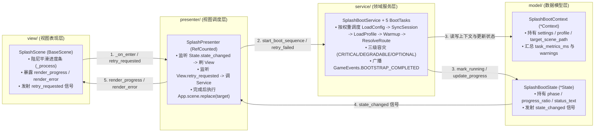

# Feature · Splash (闪屏展示与加权业务启动管线模块)

> 承接 [`BootstrapScene`](file:///Users/krace/Code/GodotProject/slacker-survivors/src/game/bootstrap/bootstrap_scene.gd) 首棒交接的业务启动加载模块，同时也是 `src/game/features/` 下标准 **MSVP (`model/` - `service/` - `view/` - `presenter/`)** 垂直架构的标杆实现。

---

## 一、 MSVP 标准目录结构

```text
src/game/features/splash/
├── _doc_splash.md                           # 本模块架构与流程规范文档
│
├── model/                                   # [M - 数据模型层] 严格按领域后缀区分职责（零 I/O、零 UI 引用）
│   ├── splash_enter_params.gd               # [*Params] 切入闪屏场景的强类型入参契约 (SplashEnterParams)
│   ├── splash_boot_context.gd               # [*Context] 业务启动管线共享上下文与耗时瀑布诊断 (SplashBootContext)
│   └── splash_boot_state.gd                 # [*State] 闪屏加载运行时响应式状态模型 (SplashBootState)
│
├── service/                                 # [S - 领域服务层] 加权业务启动管线、三级容灾与断点重试（零 UI 耦合）
│   ├── splash_boot_service.gd               # 业务启动管线总控服务 (SplashBootService)
│   ├── boot_task.gd                         # 启动任务抽象契约与 FailurePolicy 枚举 (BootTask)
│   └── tasks/                               # 声明式权重业务启动微任务集合
│       ├── load_config_task.gd              # 任务 1 (CRITICAL, w=20): 注册全局存储契约与装载静态配置
│       ├── sync_session_task.gd             # 任务 2 (DEGRADABLE, w=15): 激活环境策略与探测权威时钟校准
│       ├── load_profile_task.gd             # 任务 3 (CRITICAL, w=25): 调用 PlayerProfileService 加载/初始化玩家基础档案
│       ├── warmup_assets_task.gd            # 任务 4 (OPTIONAL, w=25): 分帧预热首屏核心资源
│       └── resolve_route_task.gd            # 任务 5 (CRITICAL, w=15): 终局首屏目标路由裁决 (Override > 默认目标场景)
│
├── presenter/                               # [P - 视图调度层] 连接 View 与 Service/State 的中介胶水
│   └── splash_presenter.gd                  # 监听 SplashBootState 驱动视图；响应重试交互并调度终局路由 (SplashPresenter)
│
└── view/                                    # [V - 视图表现层] 纯视觉排版、阻尼进度条插值与交互信号发射
    ├── splash_scene.gd                      # 闪屏场景视图脚本 (SplashScene extends BaseScene)
    └── splash_scene.tscn                    # 闪屏场景排版 (.tscn，含品牌标题、进度条、状态文案与错误重试按钮)
```

---

## 二、 MSVP 数据流与职责闭环



---

## 三、 三级容灾策略 (`BootTask.FailurePolicy`) 与原地断点重试

| 容灾级别 | 枚举值 | 触发行为 | 对应任务 |
| :--- | :--- | :--- | :--- |
| **致命阻断** | `FailurePolicy.CRITICAL` | 挂起管线、保留当前失败索引 `_current_task_index`，并将 [`SplashBootState`](file:///Users/krace/Code/GodotProject/slacker-survivors/src/game/features/splash/model/splash_boot_state.gd) 置为 `FAILED`，触发 [`SplashScene`](file:///Users/krace/Code/GodotProject/slacker-survivors/src/game/features/splash/view/splash_scene.gd) 展示重试按钮；点击重试时调用 `retry_failed()` 从失败任务**原地续跑**，绝不重复执行前置已完成任务。 | [`LoadConfigTask`](file:///Users/krace/Code/GodotProject/slacker-survivors/src/game/features/splash/service/tasks/load_config_task.gd)、[`LoadProfileTask`](file:///Users/krace/Code/GodotProject/slacker-survivors/src/game/features/splash/service/tasks/load_profile_task.gd)、[`ResolveRouteTask`](file:///Users/krace/Code/GodotProject/slacker-survivors/src/game/features/splash/service/tasks/resolve_route_task.gd) |
| **优雅降级** | `FailurePolicy.DEGRADABLE` | 将异常原因记入 [`SplashBootContext.warnings`](file:///Users/krace/Code/GodotProject/slacker-survivors/src/game/features/splash/model/splash_boot_context.gd)，自动标记 `is_offline_mode = true` 并继续后续任务，保障单机离线可玩性。 | [`SyncSessionTask`](file:///Users/krace/Code/GodotProject/slacker-survivors/src/game/features/splash/service/tasks/sync_session_task.gd) |
| **可选优化** | `FailurePolicy.OPTIONAL` | 记入日志后静默跳过，绝不因非核心预热资产缺失阻断玩家进入游戏。 | [`WarmupAssetsTask`](file:///Users/krace/Code/GodotProject/slacker-survivors/src/game/features/splash/service/tasks/warmup_assets_task.gd) |
