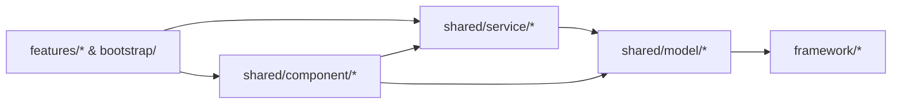

# Game · Shared (跨模块业务共享内核与防膨胀架构规范)

> 游戏业务层全模块通用的共享内核（Shared Kernel）：对齐 **MSVP** 的 `M-S-V` 分层，仅承载跨 **2 个及以上独立业务模块**共同依赖的共享数据模型（`model/`）、跨模块业务服务（`service/`）与无业务流通用交互组件（`component/`）。

---

## 一、 顶层三支柱（M-S-V 对齐）+ 二级子域分包架构

为防止随着游戏版本迭代导致 `shared/` 退化为平铺数十个文件的“公共垃圾桶”，同时消除按词性堆砌的 `define/` 大杂烩反模式，`src/game/shared/` 严格执行 **“一级按 M-S-V 架构职能分 3 柱（单数），二级按功能子域分包（深度封顶 2 层），枚举/常量/事件遵循高内聚就近归属原则”**：

```text
src/game/shared/
├── _doc_shared.md                            # 本架构规范文档
│
├── model/                                    # [支柱 1 · M] 共享数据模型层（纯数据结构 + 内聚枚举/Key + 序列化/自愈校验）
│   ├── save/                                 # 子域 A：持久化存档聚合根模型 (*Model，继承 BaseParams，内聚 STORAGE_DOMAIN = &"shared" 与 storage_item() 对接 App.storage)
│   │   ├── game_settings_model.gd            # 游戏全局偏好设置存档聚合根 (GameSettingsModel -> user://config/shared/game_settings.json)
│   │   └── player_profile_model.gd           # 玩家全局持久化基础档案模型 (PlayerProfileModel -> user://saves/shared/player_profile.json)
│   ├── data/                                 # 子域 B：内嵌子数据块与跨模块通用条目 (*Data / *Params / *Req / *Resp，内聚所属业务枚举)
│   │   ├── display_settings_data.gd          # 显示与窗口设置子数据块 (DisplaySettingsData)
│   │   ├── graphics_settings_data.gd         # 画质与视口渲染子数据块 (GraphicsSettingsData: 内聚 QualityPreset / ShadowQuality)
│   │   ├── audio_settings_data.gd            # 音频与正交静音子数据块 (AudioSettingsData)
│   │   ├── control_settings_data.gd          # 操作、震动与改键子数据块 (ControlSettingsData: 内聚 VirtualJoystickMode)
│   │   └── general_settings_data.gd          # 语言与通用偏好子数据块 (GeneralSettingsData)
│   └── config/                               # 子域 C：跨模块静态配置表与路由配置 (*Config / GameScenes)
│       └── game_scenes.gd                    # [插件自动注入 · 严禁手改] 路由级场景配置表 (GameScenes: Scene / Dialog / Component)
│
├── service/                                  # [支柱 2 · S] 共享业务服务层（跨模块状态协调、底层硬件/存档编排与领域事件 EVENT_* 发布）
│   ├── settings/                             # 子域 A：全局游戏设置服务
│   │   └── game_settings_service.gd          # 协调 GameSettingsModel <-> App.*，广播 EVENT_SETTINGS_CHANGED / EVENT_QUALITY_PRESET_CHANGED
│   └── profile/                              # 子域 B：玩家全局档案服务
│       └── player_profile_service.gd         # 协调 PlayerProfileModel 读写、会话登录记录与 EVENT_PROFILE_UPDATED 广播
│
└── component/                                # [支柱 3 · V] 跨模块通用 UI 组件与容器调度（无特定业务流）
	├── button/                               # 子域 A：通用交互按钮族
	│   └── base_texture_button.gd            # 通用贴图按钮 (BaseTextureButton: 缩放/音效/震动/滑动消抖中继)
	├── dialog/                               # 子域 B：模态弹窗基类与栈调度器
	│   ├── base_dialog.gd                    # 模态弹窗业务基类 (BaseDialog，继承 BaseView)
	│   └── dialog_manager.gd                 # 模态弹窗 LIFO 堆栈、暗色遮罩与返回键调度器 (DialogManager)
	├── toast/                                # 子域 C：非阻塞轻提示调度
	│   └── toast_manager.gd                  # 全局轻量飘字提示调度组件 (ToastManager)
	└── widget/                               # 子域 D：(随项目扩展) 跨模块通用原子 UI 挂件 (如物品格、顶部货币栏)
```

---

## 二、 防膨胀三大架构铁律 (Anti-Bloat Iron Rules)

### 铁律 1：`Rule of 2+`（至少 2 个独立模块引用才准入）
- **严禁预防性共享**：任何类如果当前仅被 **1 个** Feature 使用（例如仅 `battle` 使用的波次状态或技能槽），**必须**留在 `src/game/features/<feature>/` 内部。
- **按需晋升（Promote）**：只有当第 2 个独立模块（如 `lobby`、`shop` 或 `bootstrap`）真正产生复用需求时，才将其提炼迁入 `src/game/shared/` 对应子域。

### 铁律 2：原子组件（`component/`）与业务面板（`features/`）严格分离
- **`shared/component/` 只放“无业务流”的通用底座与原子控件**：
  - 如 [`BaseDialog`](file:///Users/krace/Code/GodotProject/slacker-survivors/src/game/shared/component/dialog/base_dialog.gd)、[`DialogManager`](file:///Users/krace/Code/GodotProject/slacker-survivors/src/game/shared/component/dialog/dialog_manager.gd)、[`ToastManager`](file:///Users/krace/Code/GodotProject/slacker-survivors/src/game/shared/component/toast/toast_manager.gd)、[`BaseTextureButton`](file:///Users/krace/Code/GodotProject/slacker-survivors/src/game/shared/component/button/base_texture_button.gd)。它们只负责通用交互反馈与容器调度，绝不包含具体业务规则。
- **完整业务弹窗/面板严禁放入 `shared/component/`**：
  - 例如“设置面板（SettingsDialog）”、“商店购买弹窗”、“暂停菜单”，即便可从大厅和战斗两处打开，依然属于拥有独立 MSVP 闭环的业务功能，必须放在 `src/game/features/<feature>/view/` 下，仅在弹出时通过 `DialogManager.open(...)` 挂载。

### 铁律 3：严格单向依赖链（DAG）与上浮毕业机制

1. **外部隔离红线**：`src/game/shared/` **严禁**反向引用任何 `src/game/features/` 或 `src/game/bootstrap/` 代码（由 `check_compliance` 静态门禁强制拦截，仅自动生成的静态路径路由表 `model/config/game_scenes.gd` 豁免）。
2. **内部单向红线**：
   - `model/` 仅承载数据结构、内聚枚举/常量、范围校验（`sanitize()`）与序列化，严禁直接调用 `App.*` 或引用 `service/`、`component/`；
   - `service/` 负责连接 `model/` 与 `App.*` / `Bus` 并内聚定义对外发布的 `EVENT_*` 常量，严禁直接操作具体 UI 控件；
3. **上浮毕业（Graduation）**：若某个 `shared/service/` 随需求演进长出专属的多步交互界面与独立状态机，应立即将其上浮拆分为独立的 `src/game/features/<domain>/`。

---

## 三、 跨项目通用游戏设置内核 (`GameSettingsModel` + `GameSettingsService`)

> **跨项目零成本复用设计**：`GameSettingsModel` 与 `GameSettingsService` 是完全 **UI 无关（UI-Agnostic）** 的跨项目通用设置内核。开启新项目时可直接连同 `src/framework/` 一起复用，新项目只需编写自己的 UI 视图（`.tscn`）并绑定 `GameSettingsService` 的原子 API。

- **数据层 [`GameSettingsModel`](file:///d:/code/GodotProject/slacker-survivors/src/game/shared/model/save/game_settings_model.gd) + 五大独立 `*Data` 文件**：
  - 采用顶层聚合根 `GameSettingsModel` + 五个独立拆分的 [`BaseParams`](file:///d:/code/GodotProject/slacker-survivors/src/framework/infra/param/base_params.gd) 子数据块（[`DisplaySettingsData`](file:///d:/code/GodotProject/slacker-survivors/src/game/shared/model/data/display_settings_data.gd)、[`GraphicsSettingsData`](file:///d:/code/GodotProject/slacker-survivors/src/game/shared/model/data/graphics_settings_data.gd)、[`AudioSettingsData`](file:///d:/code/GodotProject/slacker-survivors/src/game/shared/model/data/audio_settings_data.gd)、[`ControlSettingsData`](file:///d:/code/GodotProject/slacker-survivors/src/game/shared/model/data/control_settings_data.gd)、[`GeneralSettingsData`](file:///d:/code/GodotProject/slacker-survivors/src/game/shared/model/data/general_settings_data.gd)）正交建模，每个子块均支持独立的 `sanitize()`、`reset()` 与 `clone()`：
    1. `display`（`DisplaySettingsData`）：显示器索引、窗口模式、分辨率、VSync、前台帧率上限、后台失焦降帧（`background_max_fps`）、全局 HUD 安全区比例（`safe_area_scale`）、设计宽高比锁定（`lock_design_aspect`）与亮度；
    2. `graphics`（`GraphicsSettingsData`）：画质预设档位（`LOW/MEDIUM/HIGH/ULTRA/CUSTOM`）、3D 渲染缩放、MSAA 2D/3D、FXAA/SMAA、2D 纹理过滤、特效粒子密度与阴影质量；
    3. `audio`（`AudioSettingsData`）：主音量/BGM/SFX/语音/环境音五通道音量、正交静音开关与后台失焦自动静音（`mute_in_background`）；
    4. `control`（`ControlSettingsData`）：物理震动开关与强度、手柄死区、鼠标灵敏度、移动端虚拟摇杆模式与自定义改键映射补丁（`input_bindings`）；
    5. `general`（`GeneralSettingsData`）：多语言区域标识（支持首次启动自动匹配 OS 系统语言）。
- **服务内核 [`GameSettingsService`](file:///d:/code/GodotProject/slacker-survivors/src/game/shared/service/settings/game_settings_service.gd)**：
  - **启动与持久化**：启动期由 [`BootstrapScene`](file:///d:/code/GodotProject/slacker-survivors/src/game/bootstrap/bootstrap_scene.gd) 在渲染首帧前调用 `await GameSettingsService.load_and_apply()` 一键完成磁盘读取、边界钳制与全系统硬件同步；
  - **切屏事务与 15 秒回滚内核**：内置 `begin_display_transaction()` / `commit_display_transaction()` / `rollback_display_transaction()`，任何项目的切屏确认框只需调这三个方法即可完成安全回滚；
  - **全维度原子级设置 API**：
    - 显示：`set_window_mode()`、`set_resolution()`、`toggle_fullscreen()`、`set_vsync()`、`set_max_fps()`、`set_safe_area_scale()`、`set_lock_design_aspect()`；
    - 画质：`set_quality_preset()`（自动展开预设）与 `set_msaa()` / `set_screen_space_aa()` / `set_render_scale()`（单项微调自动切入 `CUSTOM`）；
    - 音频：`set_volumes(..., auto_save=false)`（滑块拖动实时听音）+ `save_async()`（松手落盘）、`set_master_muted()` / `set_music_enabled()` / `set_sfx_enabled()` / `set_mute_in_background()`；
    - 多语言与输入：`set_locale()`、`set_haptic_enabled()`、`set_joy_deadzone()`、`sync_input_bindings_from_system()`。
