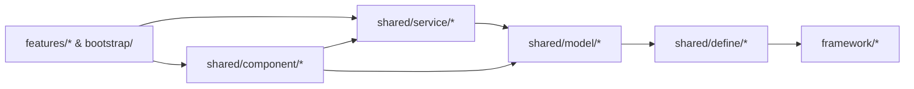

# Game · Shared (跨模块业务共享内核与防膨胀架构规范)

> 游戏业务层全模块通用的共享内核（Shared Kernel）：仅承载跨 **2 个及以上独立业务模块**共同依赖的静态契约（`define/`）、共享数据模型（`model/`）、跨模块业务服务（`service/`）与无业务流通用交互组件（`component/`）。

---

## 一、 顶层四支柱 + 二级子域分包架构

为防止随着游戏版本迭代导致 `shared/` 退化为平铺数十个文件的“公共垃圾桶”，`src/game/shared/` 严格执行 **“一级按架构职能分 4 柱（单数），二级按功能子域分包（深度封顶 2 层）”**：

```text
src/game/shared/
├── _doc_shared.md                            # 本架构规范文档
│
├── define/                                   # [支柱 1] 静态契约定义层（零逻辑、纯编译期常量/枚举/事件）
│   ├── game_constants.gd                     # 全局存档 Key、音频总线名常量及场景路由别名 (GameConstants)
│   ├── game_events.gd                        # 跨模块解耦事件名与 Payload 契约 (GameEvents)
│   ├── game_enums.gd                         # 跨模块共享业务枚举 (GameEnums: QualityPreset, DamageNumberMode 等)
│   └── generated/                            # [插件自动注入子域 · 严禁手改]
│       └── game_scenes.gd                    # 路由级场景契约自动生成表 (GameScenes: Scene / Dialog / Component)
│
├── model/                                    # [支柱 2] 共享数据模型层（纯数据结构 + 序列化/自愈校验）
│   ├── save/                                 # 子域 A：持久化存档模型（继承 BaseParams，对接 App.storage）
│   │   ├── game_settings_model.gd            # 游戏全局偏好设置存档模型 (GameSettingsModel)
│   │   └── player_profile_model.gd           # 玩家全局持久化档案模型 (PlayerProfileModel)
│   ├── config/                               # 子域 B：(随项目扩展) 跨模块静态策划配表模型 (*Config)
│   └── vo/                                   # 子域 C：(随项目扩展) 跨模块传输值对象与参数包 (*VO / *Params)
│
├── service/                                  # [支柱 3] 共享业务服务层（跨模块状态协调与底层硬件/存档编排）
│   ├── settings/                             # 子域 A：全局游戏设置服务
│   │   └── game_settings_service.gd          # 协调 GameSettingsModel <-> App.audio/display/haptic/input/locale/storage
│   └── profile/                              # 子域 B：玩家全局档案服务
│       └── player_profile_service.gd         # 协调 PlayerProfileModel 读写、金币/天赋变更与 Bus 事件广播
│
└── component/                                # [支柱 4] 跨模块通用 UI 组件与容器调度（无特定业务流）
    ├── button/                               # 子域 A：通用交互按钮族
    │   └── base_texture_button.gd            # 通用贴图按钮 (BaseTextureButton: 缩放/音效/震动/滑动消抖中继)
    ├── dialog/                               # 子域 B：模态弹窗基类与栈调度器
    │   ├── base_dialog.gd                    # 模态弹窗业务基类 (BaseDialog，继承 BaseView)
    │   └── dialog_manager.gd                 # 模态弹窗 LIFO 堆栈、暗色遮罩与返回键调度器 (DialogManager)
    ├── toast/                                # 子域 C：非阻塞轻提示调度
    │   └── toast_manager.gd                  # 全局轻量飘字提示调度组件 (ToastManager)
    └── widget/                               # 子域 D：(随项目扩展) 跨模块通用原子 UI 挂件 (如物品格、顶部货币栏)
```

---

## 二、 防膨胀三大架构铁律 (Anti-Bloat Iron Rules)

### 铁律 1：`Rule of 2+`（至少 2 个独立模块引用才准入）
- **严禁预防性共享**：任何类如果当前仅被 **1 个** Feature 使用（例如仅 `battle` 使用的波次状态或技能槽），**必须**留在 `src/game/features/<feature>/` 内部。
- **按需晋升（Promote）**：只有当第 2 个独立模块（如 `lobby`、`shop` 或 `bootstrap`）真正产生复用需求时，才将其提炼迁入 `src/game/shared/` 对应子域。

### 铁律 2：原子组件（`component/`）与业务面板（`features/`）严格分离
- **`shared/component/` 只放“无业务流”的通用底座与原子控件**：
  - 如 [`BaseDialog`](file:///d:/code/GodotProject/slacker-survivors/src/game/shared/component/dialog/base_dialog.gd)、[`DialogManager`](file:///d:/code/GodotProject/slacker-survivors/src/game/shared/component/dialog/dialog_manager.gd)、[`ToastManager`](file:///d:/code/GodotProject/slacker-survivors/src/game/shared/component/toast/toast_manager.gd)、[`BaseTextureButton`](file:///d:/code/GodotProject/slacker-survivors/src/game/shared/component/button/base_texture_button.gd)。它们只负责通用交互反馈与容器调度，绝不包含具体业务规则。
- **完整业务弹窗/面板严禁放入 `shared/component/`**：
  - 例如“设置面板（SettingsDialog）”、“商店购买弹窗”、“暂停菜单”，即便可从大厅和战斗两处打开，依然属于拥有独立 MSVP 闭环的业务功能，必须放在 `src/game/features/<feature>/view/` 下，仅在弹出时通过 `DialogManager.open(...)` 挂载。

### 铁律 3：严格单向依赖链（DAG）与上浮毕业机制

1. **外部隔离红线**：`src/game/shared/` **严禁**反向引用任何 `src/game/features/` 或 `src/game/bootstrap/` 代码（由 `check_compliance` 静态门禁强制拦截）。
2. **内部单向红线**：
   - `define/` 零外部业务依赖；
   - `model/` 仅承载数据结构、范围校验（`sanitize()`）与序列化，严禁直接调用 `App.*` 或引用 `service/`、`component/`；
   - `service/` 负责连接 `model/` 与 `App.*` / `Bus`，严禁直接操作具体 UI 控件；
3. **上浮毕业（Graduation）**：若某个 `shared/service/` 随需求演进长出专属的多步交互界面与独立状态机，应立即将其上浮拆分为独立的 `src/game/features/<domain>/`。

---

## 三、 全局游戏设置架构 (`GameSettingsModel` + `GameSettingsService`)

- **数据层 [`GameSettingsModel`](file:///d:/code/GodotProject/slacker-survivors/src/game/shared/model/save/game_settings_model.gd)**：
  - 完整覆盖五大维度：**音频总线与独立静音（含后台失焦静音 `mute_in_background`）**、**窗口模式与分辨率/VSync/帧率**、**画质预设档位（`LOW/MEDIUM/HIGH/ULTRA/CUSTOM`）与底层视口渲染参数（MSAA 2D/3D、FXAA/SMAA、3D 渲染缩放、2D 纹理过滤）**、**幸存者玩法视觉反馈（粒子密度预算 `particle_density`、伤害飘字模式 `damage_number_mode`、震屏强度 `screen_shake_intensity`、物理震动）** 以及 **多语言与手柄死区/自定义键位映射**。
- **服务层 [`GameSettingsService`](file:///d:/code/GodotProject/slacker-survivors/src/game/shared/service/settings/game_settings_service.gd)**：
  - 启动期由 `ApplySettingsStep` 调用 `await GameSettingsService.load_and_apply()` 一键完成磁盘读取、边界钳制与全系统硬件同步；
  - 运行期提供 `set_quality_preset()`（一键展开预设档位并广播 `GameEvents.QUALITY_PRESET_CHANGED`）与 `set_custom_graphics()`（单项微调自动切入 `CUSTOM` 档位）；
  - 自动监听 `Bus.app_paused` / `Bus.app_resumed`，按 `mute_in_background` 动态控制后台音频暂停。
