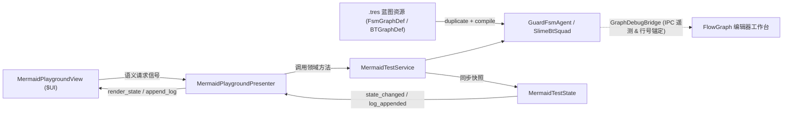

# Mermaid Graph Test & Blueprint Tutorial (可视化图蓝图教学与契约验证模块)

> 本模块严格遵循 [`_doc_test.md`](../_doc_test.md) 的 **MSVP 交互模块模式** 与 [`_doc_game.md`](../../game/_doc_game.md) 的 **`view/scene/<domain>/` 领域单元目录规范**，提供从 `.tres` 蓝图编辑、GDScript 原子算子绑定、享元多实例复用到运行期可视化联调的标准工程样板。

---

## 一、 模块架构目录树

```text
src/test/mermaid_graph/
├── _doc_mermaid_graph.md                                        # 本模块架构说明与 5 步快速上手教程
├── resources/                                                   # 可视化图蓝图定义 (.tres，双击直接在 FlowGraph 画布打开)
│   ├── def_fsm_guard_patrol.tres                                # [FSM 蓝图] 守卫巡逻状态机 (FsmGraphDef: 4状态 / 7转换边)
│   └── def_bt_slime_ai.tres                                     # [BT 蓝图] 史莱姆战术行为树 (BTGraphDef: 11节点)
├── model/
│   └── mermaid_test_state.gd                                    # 演练场响应式运行时状态 (MermaidTestState, *State 规范)
├── service/
│   ├── guard_fsm_agent.gd                                       # [纯净模板 ①] 从 .tres 装配 FSM 的单实体代理 (零 UI 耦合)
│   ├── slime_bt_squad.gd                                        # [纯净模板 ②] 从 .tres 编译享元 BT 驱动双实体的标准模板
│   └── mermaid_test_service.gd                                  # 演练场业务编排与 5 项自动化契约验证服务
├── presenter/
│   └── mermaid_playground_presenter.gd                          # 连接被动 View 与 Service / State 的薄协调器
└── view/
	└── scene/
		└── playground/
			├── mermaid_playground_scene.tscn                    # 100% 声明式演练场主场景 ($UI: MermaidPlaygroundView)
			├── mermaid_playground_scene.gd                      # 极简场景路由生命周期入口 (extends BaseScene)
			└── mermaid_playground_view.gd                       # 纯被动视图脚本 (extends BaseView，仅发信号与 render_*)
```

---

## 二、 核心数据流与分层职责



- **直接可复制的纯净业务模板**：
  - 需要给角色或怪物接入 `.tres` 状态机？直接参考 [`guard_fsm_agent.gd`](service/guard_fsm_agent.gd)（仅百行、零 UI 噪音）。
  - 需要用 1 棵行为树驱动同屏多只怪物？直接参考 [`slime_bt_squad.gd`](service/slime_bt_squad.gd)（演示 `1 BTTree` + `N BTContext` 享元隔离）。

---

## 三、 五步快速上手实操指南

1. **双击 `.tres` 体验资源可视化直编**：
   - 在 Godot 文件系统双击 [`def_fsm_guard_patrol.tres`](resources/def_fsm_guard_patrol.tres) 或 [`def_bt_slime_ai.tres`](resources/def_bt_slime_ai.tres)，自动在顶部 **【FlowGraph】** 主视口打开；
   - 单击节点在右侧「检视」栏查看职责类型、参数与流出条件；也可在右侧「资源」页浏览全项目自动扫描的图资源；拖拽节点或修改右侧「源码」后点击 **「保存 .tres」** 直接落盘。
2. **按 `F6` 启动演练场，观察实时流光脉冲**：
   - 打开 [`mermaid_playground_scene.tscn`](view/scene/playground/mermaid_playground_scene.tscn) 按 **`F6`** 运行；
   - 切回编辑器顶部 **【FlowGraph】** 视图（或提取为独立浮动窗口），在左上角下拉框切换 `守卫队长_FSM`、`史莱姆A_近战态`、`史莱姆B_残血态` 三个实时运行实例，点击游戏窗内的视野/眩晕/扣血按钮观察动态分支抢占。
3. **画布反向控制（暂停 / 单步 / 双击强跳）**：
   - 在画布上**双击**任意状态或动作胶囊（或点右下角 **「强制触发」**），游戏内实体立即强制切入对应节点；点击顶栏 **「暂停 / 单步」** 可单独冻结当前 AI 逐帧排查。
4. **从图节点一键跳转回业务脚本行**：
   - 单击画布节点后点击右侧 **「跳转源码」**（或检视卡中的蓝色 `guard_fsm_agent.gd:xx` / `slime_bt_squad.gd:xx` 链接），编辑器立即切至 Script 视图并高亮注册该算子的代码行。
5. **按 `F8` 停止运行，体验离线定格快照與草稿导出**：
   - 按 **`F8`** 停止后，画布自动定格为 **`[快照]`**（保留末帧高亮与黑板变量，仍可查节点与跳转代码）；
   - 切至 `手动 Mermaid 源码 (草稿)` 编写 `stateDiagram-v2` 或 `flowchart LR`，点 **「导出 .tres」** 即可一键生成新蓝图资源。

---

## 四、 内置自动化契约验证用例（5 项）

| 用例编号 | 验证项 | 预期结果 |
| :--- | :--- | :--- |
| **CASE 1** | `FsmGraphDef` `.tres` 标准图 IR 导出完整性 | `schema == "fsm"`，精确包含 4 个状态节点与 7 条有向转换边 |
| **CASE 2** | `StateMachine` 编译挂载与源码行号自动锚定 | 成功编译启动，且 Debug 下自动捕获 `guard_fsm_agent.gd` 行号 |
| **CASE 3** | `BTGraphDef` `.tres` 树形拓扑编译完整性 | `schema == "bt"`，完整还原 11 节点层级（`Selector`/`Sequence`/`Cooldown`/`Wait`） |
| **CASE 4** | Flyweight 享元单树驱动双独立黑板实例 | `Alpha` 与 `Bravo` 共享同一 `BTTree` 且黑板 `hp_ratio` 完全隔离 |
| **CASE 5** | 黑板声明式条件分流准确性 | 残血 `Bravo` (`HP=22%`) 首帧精准命中 `反向逃跑回血` 叶节点 |

---

## 五、 运行方式

1. **编辑器交互运行**：打开 [`mermaid_playground_scene.tscn`](view/scene/playground/mermaid_playground_scene.tscn) 并按 **`F6`**。
2. **命令行无头自检**：
   ```bash
   Godot --headless --path . res://src/test/mermaid_graph/view/scene/playground/mermaid_playground_scene.tscn -- --mermaid-test-auto-quit
   ```
