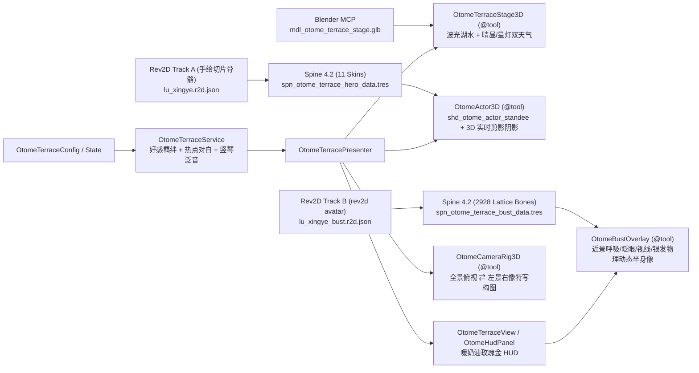

# 晴风湖畔 · 花树咖啡露台 (`otome_terrace`)

## 1. 模块定位与「黄金双轨制」多工具链协同架构

`src/test/otome_terrace/` 是用于验证 **「Blender MCP 3D 开放式温馨庭院建模 + Rev2D MCP 商业乙女黄金双轨制角色管线（3D 漫游精致绘本三头身 + 近景动态高精半身像） + Godot MCP 声明式组装与 `@tool` `.tscn` 编辑器实时预览」** 全管线能力的 MSVP 独立垂直切片测试包。

## 2. 目录与预制体拆分 (`<= 30` 本地节点预算)

| 层级 | 文件路径 | 核心职责 |
| :--- | :--- | :--- |
| **Root Scene** | `otome_terrace_test.tscn` / `view/scene/terrace/otome_terrace_scene.gd` | 继承 `BaseScene`，统一托管场景级 `SpinePool`，同时挂载漫游三头身与近景半身像 |
| **Model** | `model/otome_terrace_config.gd` / `model/otome_terrace_state.gd` | 户外热点坐标契约、11 套分槽皮肤映射、双轨表情动画映射与双分支心动台词表 |
| **Service** | `service/otome_terrace_service.gd` | 穿搭/神态/道具组合切换、邻近热点检测、好感升级计算与 `user://` 沙盒偏好持久化 |
| **Presenter** | `presenter/otome_terrace_presenter.gd` | 协调 `WASD`/点击地面漫步、热点自动寻路入场、特写推镜及 UI 信号 |
| **3D Stage** | `view/component/stage/otome_terrace_stage_3d.tscn` (`.gd`) | `@tool` 承载开放式湖畔露台 GLB、波光湖面 Shader、热点呼吸光环与落樱/萤火粒子 |
| **Track A Roam Hero** | `view/component/actor/otome_actor_3d.tscn` (`.gd`) + `shd_otome_actor_standee.gdshader` | `@tool` 编辑器 `.tscn` 实时预览 + 保色柔光 2.5D 立牌着色器 + 四层 Mix-and-Match 皮肤与 3D 实时剪影阴影 |
| **Track B Bust Portrait** | `view/component/bust/otome_bust_overlay.tscn` (`.gd`) | `@tool` 承载 `rev2d avatar` 导出的高精动态半身像，特写态右侧柔光滑入，全景漫游态自动休眠零开销 |
| **Camera Rig** | `view/component/camera/otome_camera_rig_3d.tscn` (`.gd`) | `@tool` 全景漫游（`-25°`）与「左庭院微景 + 右高精半身像」黄金分割特写镜头平滑过渡 |
| **Warm UI** | `view/component/hud/otome_hud_panel.tscn` + `dialogue/` + `bubble/` + `pill/` | 暖奶油底 `#FFFDF9` + 玫瑰金细描边 `#D9A796` 乙女向响应式 HUD（全部单文件 `<= 30` 本地节点） |

## 3. `@tool` 编辑器 `.tscn` 直接预览机制

- 在编辑器直接打开 `otome_terrace_test.tscn` 或 `otome_actor_3d.tscn` 时，`OtomeActor3D` 在 `Engine.is_editor_hint()` 下自动驱动 `SpineViewport/SpineRoot/EditorPreviewSpine`（`SpineSprite`）加载 `spn_otome_terrace_hero_data.tres` 并合成 `default + outfit/cardigan + expr/gentle + prop/none` 皮肤，通过 `shd_otome_actor_standee.gdshader`（`discard` 剪影 + 保色柔光包裹漫反射）直接在编辑器 3D 视口渲染完整手绘三头身立绘与地面实时阴影，无需运行代码即可预览和调参。
- 单独打开 `otome_bust_overlay.tscn` 时，同样可在 2D 视口直接预览高精半身像（在 `otome_hud_panel.tscn` 实例上默认 `show_in_editor_preview = false`，确保漫游视口清爽无遮挡）。
- 游戏运行期自动销毁编辑器预览节点，统一由 `SpinePool` 池化借出与回收 `SpineController`。

## 4. 操作指南

- **`WASD` / 方向键 / 鼠标左键点地**：控制男主「陆星野」在石板小径、樱花草坪与木质咖啡露台自由漫步；
- **点击悬浮热点气泡 / 按 `E`**：自动漫步走近并进入专属浪漫互动（樱下共读诗集 / 品尝手冲拿铁 / 凭栏共赏湖风），3D 角色自动切换专属穿搭与手持道具，同时右侧滑入高精动态半身立绘并弹出双分支心动选项；
- **`1` / `2`**：实时热切三套穿搭（晨光粗针开衫 / 可可咖啡围裙 / 暮色迎风风衣）与三套神态（温柔浅笑 / 弯眼宠溺 / 微怔脸红，双轨同步联动）；
- **`G`**：触发温柔挥手问候动作与语音气泡；
- **`L`**：一键切换「☀ 春昼晴风（飘落樱瓣）」与「🌅 落日星灯（铁艺暖光街灯 + 紫金湖光 + 半身像暖金微染）」户外光影；
- **`C` / `Q` `R` / 滚轮**：切换全景与近景半身特写模式、微旋庭院视角及远近缩放。
